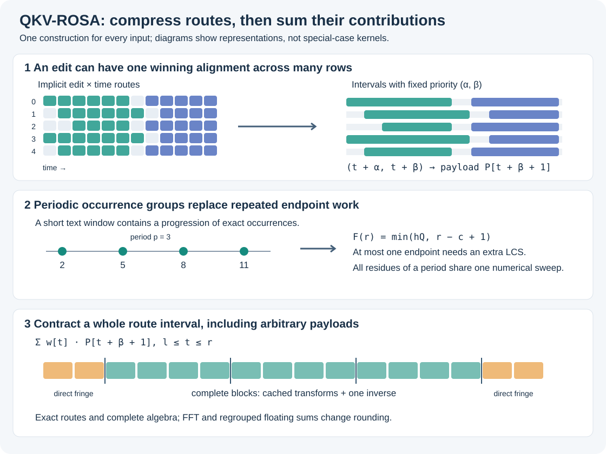
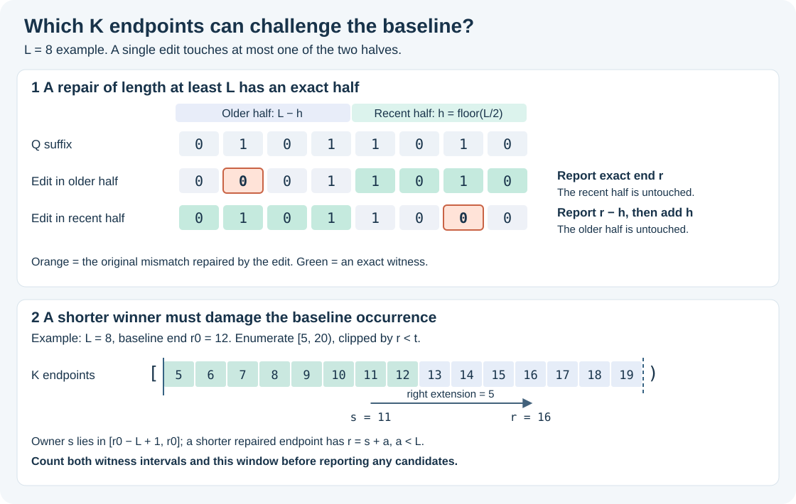
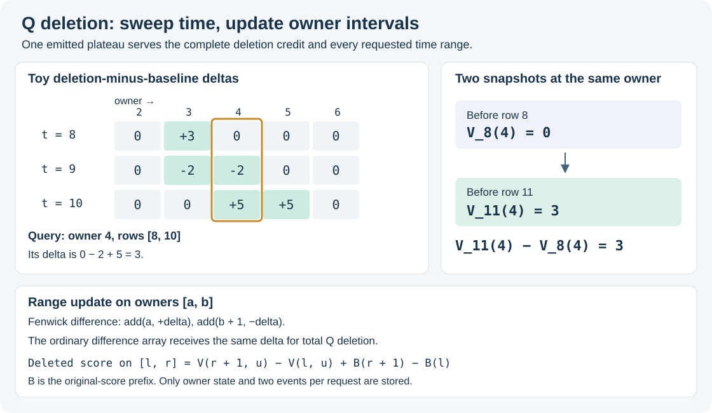

# Computing every bit credit without visiting every edit–row pair

[中文](ALGORITHM.zh-CN.md) · [Full proof](docs/subquadratic-proof.md) · [Deletion proof](docs/subquadratic-deletion-proof.md) · [Training interface](docs/native-training.md)

The C++ engine changes the unit of work. It represents many counterfactual routes by intervals, arithmetic progressions, and a small set of winning matches, then sums their numerical contributions in batches. It also counts a complete set of possible contributors before deciding whether that set needs compression at all. For fixed bit width and numerical dimension, its worst-case bound is $\widetilde O(n^{7/4})$ time and $\widetilde O(n^{4/3})$ space. The tilde hides logarithmic factors.

Those factors and the constants matter. A lower exponent does not promise a faster training step at a particular sequence length. This is the repository's single backward engine. Historical implementations appear only as measured baselines in the results, not as selectable backends.

## 1. The quantity being computed

Let $Q$ and $K$ contain $n$ packed symbols, each with $b$ bits. At row $t$, only K endpoints $r<t$ are legal. Define

```math
F_t(r)=\operatorname{LCSuffix}(Q[0..t],K[0..r]),
\qquad (L_t,r_t)=\max_{r<t}(F_t(r),r).
```

The maximum compares lengths first and endpoints second. Every zero-length result is normalized to $(0,-1)$. A nonempty route returns the payload **after** its endpoint: $Y(r)=P_{r+1}$. The empty route returns $e_0$.

For one bit edit $i$, first-order credit is $C_i=\sum_t g_t^\top(Y_t^{\operatorname{flip}(i)}-Y_t)$.

For QKV-ROSA, $P_s=(2V_s-1)\odot e_1$. V never changes routes: one scatter gives $C^V_{s,j}=-2(2V_{s,j}-1)e_{1,j}\sum_{t:r_t+1=s}g_{t,j}$ in $O(nd)$ time. The embedding gradients use the same baseline routes.

The numerical vectors have dimension $d$. Keeping $b$ and $d$ separate helps expose costs: finding one-bit neighbors depends on $b$; taking a dot product depends on $d$. The usual layer uses the same width for both, but the internal kernels and their tests do not assume that equality.

This is a finite change in the hard component output, projected on its upstream gradient. It is not the derivative of a threshold and does not rerun an arbitrary downstream loss. Route selection always uses longest-then-latest order, never the numerical score $g_t^\top Y$.

## 2. Where the fourth, third, and second powers come from

A literal implementation tries $O(nb)$ edits. For each edit it visits $n$ output rows, tries $n$ endpoints, and compares up to $n$ preceding symbols. Its matching work is $O(bn^4)$.

Cache suffix-match lengths in a dynamic program, and each edited forward costs $O(n^2)$, giving $O(bn^3)$. Sharing unchanged comparisons and representing an edit by the mismatch it repairs removes another factor. But a program that still visits every owner and output row has committed to a quadratic set of questions. Making each answer cheap cannot remove that set.

We need a representation in which one operation answers many of those questions. There are two sources of structure: matching occurrences repeat periodically, and the same winning alignment often survives over a time interval. Neither property is a promise that the input belongs to a particular text family. They follow from exact matches wherever those matches occur.

## 3. Separate what an edit destroys from what it creates

Temporarily forbid a match from crossing the edited symbol. Keep every position where it was; this operation does not shift either sequence. Call the best surviving route **deletion**.

A match after the bit flip either avoids the owner, so deletion already contains it, or crosses the owner. In the latter case, its original alignment has exactly one mismatch, and that mismatch is the bit being flipped. Call the best such route **repair**. Therefore

```math
\operatorname{Flip}=\max(\operatorname{Delete},\operatorname{Repair}).
```

All bits of an owner share the same deletion term. Only their repairs differ. Numerically, add deletion-minus-baseline once per owner, then add repair-minus-deletion wherever repair wins.



For a one-mismatch center $(u,s)$ with $s<u$ and $Q_u\oplus K_s=2^j$, let $\ell$ and $a$ be its exact left and right extensions. At time $t=u+h$, for $0\le h\le a$, its route is $(h+1+\ell,s+h)=(t+\alpha,t+\beta)$, where $\alpha=\ell+1-u$ and $\beta=s-u$.

Its lifetime is an interval. More usefully, its priority against another live repair is the fixed pair $(\alpha,\beta)$. We can sweep endpoints and maintain that priority; there is no need to recompute it at every row.

### First ask how much of the answer needs a long match

Suppose every match is temporarily capped at one symbol. Matching now means looking up the latest equal word; a repair means looking up a word at Hamming distance one. Group equal packed words once, connect their one-bit neighbors, and use prefix sums over their occurrence lists. This computes the complete one-symbol term without a suffix array.

Let $D$ be full deletion-minus-baseline, $R_1$ the one-symbol repair term, and $R_t$ the full repair contribution of row $t$. The same credit can be written as

```math
C=D+R_1+\sum_t\bigl(R_t-R_{1,t}\bigr).
```

This identity gives a useful stopping test. If no causal K adjacent pair is within total bit distance one of `Q[t-1], Q[t]`, no original or singly edited route ending at $t$ can have length two. That row's residual is exactly zero, for every payload. A second certificate removes rows whose possible mismatch-owner window contains no causal one-bit center. Neither test guesses whether a gradient is small.

For each remaining row, only two kinds of K endpoint can matter: its last word equals $Q_t$, or differs from $Q_t$ in one bit. In the first case an LCS query locates the first mismatch; in the second the mismatch is already at the endpoint. All other last words are impossible. The engine counts these endpoints before reporting them. If their total $M$ fits the work budget $n\max(1,\lfloor n^{3/4}\rfloor)$, it evaluates the complete residual directly. Otherwise the interval construction below handles the same sum. The budget is what keeps this simple enumeration from turning into a quadratic algorithm.

Adjacent residual rows can reuse $F_t(r)=1+F_{t-1}(r-1)$ when the final words match. Only 32 rows are retained: $32n$ integers, not an $n\times n$ table. Missing history uses the shared exact suffix index. If deletion itself never sees a match longer than one, its one-symbol value is already complete too.

There is one more saving inside this residual. For a mismatch at the final symbol, the right extension is zero: the Q owner is $t$ and the K owner is the endpoint $s$. A nonempty left extension requires both predecessors to exist and $Q_{t-1}=K_{s-1}$. If that single comparison fails, the candidate has length one and its Q effect is already in the reference term. If any longer Q repair exists, it outranks all those length-one candidates. The residual at Q owner $t$ can therefore be evaluated directly as the score of the full winner minus the score of the latest one-bit neighbor; the two empty-route scores cancel before evaluation.

K needs a separate argument. Write $e$ for the latest original same-word endpoint. When $L_t\le1$ and $s>e$, both full and one-symbol repair return endpoint $s$, whatever the left extension. A competing positive-right-extension repair cannot have that owner: its original matching endpoint is at most $e$, and its owner is earlier still. The K update cancels completely. When $L_t\ge2$, a length-one K candidate cannot beat deletion: outside the baseline occurrence the baseline survives; inside it, the baseline endpoint is later than $s$ and retains a suffix of length at least one. The full repair term is then zero, while any nonzero reference term is still subtracted. These are exact cancellations and losing-route proofs; no potentially winning residual is discarded.

## 4. Deletion: compress the occurrences before summing them

### A staircase for Q deletion

Write $R_t[h]$ for the latest causal K endpoint whose match length is at least $h$. As $h$ increases, $R_t[h]$ can only move left.

Forbidding Q position $u\le t$ caps every suffix match at $t-u$. If the cap is zero the route is empty. Otherwise its endpoint is $R_t[\min(L_t,t-u)]$. Thus constant parts of the $R$ staircase become intervals of owners with the same payload.

For example, take `Q = xxxxababa`, `K = ababa#bay`, and row $t=8$. The baseline route is $(5,4)$ and returns $P_5$:

| Required suffix length | Latest endpoint | Payload |
|---|---:|---|
| 1 or 2 | 7 | $P_8$ |
| 3, 4, or 5 | 4 | $P_5$ |

Deleting Q owner 6 or 7 changes the payload to $P_8$; deleting owner 8 makes it empty. The other owners leave the payload unchanged, even though some shorten the selected match. One interval update handles both owners 6 and 7.

Constructing the staircase by trying every length would still be expensive. Choose a terminal length $A$, and find occurrences of the length-$A$ suffix in K start-position blocks of width $A$. Each block occupies a text fragment of length at most $2A-1$. Occurrences of one pattern in such a fragment form an arithmetic progression. First, second, and last occurrence queries recover it without listing its members. This is the occurrence fact used in [Kociumaka et al., *Internal Pattern Matching Queries in a Text and Applications*](https://arxiv.org/abs/1311.6235).

For progression endpoints $r_0,r_0+p,\ldots,r_1$, let $h_Q$ be the maximal $p$-periodic suffix of Q at $t$, and let $c$ be the common left boundary of the corresponding periodic K suffixes. Their full match lengths are $F_t(r)=\min(h_Q,r-c+1)$, except possibly at $r=c+h_Q-1$. While both strings stay periodic, their equal last period propagates left. If one periodic extent ends first, its preceding character breaks that equality. Only when both extents end together can their nonperiodic predecessors continue matching. The code measures that one endpoint directly.

The last ordinary endpoint dominates all earlier ordinary endpoints of its progression for the $R$ staircase. Keep it and the exception. Across a row, this leaves $O(n/A)$ long candidates, plus fewer than $A$ short lengths.

There is no need to query even those short lengths one by one. If $r=R_t[h]$, it remains the latest endpoint through $F_t(r)$: a later endpoint matching a longer suffix would already have matched length $h$. Jump straight to $F_t(r)+1$. After at most $A$ such jumps, either the row is finished or the remaining suffix length exceeds $A$, so the progression bound still applies. This turns a long constant plateau into one update while retaining the same worst-case proof.

### K deletion has two competing sides

For K owner $s$, a surviving match either ends before $s$, or ends after $s$ and stops before crossing it:

```math
A_t(s)=\max_{r<s}(F_t(r),r),
\qquad
H_t(s)=\max_{s\le r<t}(\min(F_t(r),r-s),r).
```

As $s$ moves right, $A_t(s)$ improves and $H_t(s)$ worsens in route order. They cross once. The suffix index finds that crossing, including the endpoint tie. The same occurrence progressions then describe the two regions: fixed endpoints on the $H$ side, and fixed or periodic endpoint runs on the $A$ side. Only the final $A$ owners of the baseline match can require individual indexed queries; once the $A$ side wins with sufficient length, its stream covers that remaining fringe as well.

The next trap would be to expand a periodic run during numerical evaluation. Instead, group **all residues of one period** together. For period 3, the payloads for its three residue coefficients change like this inside one owner block:

| Owner | Residue 0 | Residue 1 | Residue 2 |
|---:|---|---|---|
| 3 | $P_3$ | $P_1$ | $P_2$ |
| 4 | $P_3$ | $P_4$ | $P_2$ |
| 5 | $P_3$ | $P_4$ | $P_5$ |

Each residue switches once. Compute its old and new dot products, then prefix-sum their differences. A block of width $p$ costs $O(pd)$ and there are $O(n/p)$ blocks: $O(nd)$ per period. Each interval start or end changes one coefficient vector in $O(d)$ work.

All deletion work is $\widetilde O((d+1)(nA+n^2/A))$; take $A\asymp\sqrt n$. Each row lazily emits its next event. Event positions are integers in $[0,n)$ and never move backward, so owner buckets suffice: one reusable event slot per row, constant work to enqueue or remove it. The implementation never stores the implicit owner–row matrix or every expanded progression member. See [delete.h](conv_rosa_transformer/csrc/subquadratic/delete.h) and the [deletion proof](docs/subquadratic-deletion-proof.md).

## 5. Q repairs: use a counting argument to decide what to expand

Fix Q owner $u$ and bit $j$. Its possible K sources already satisfy $s<u$. As the right context grows, sources only disappear; new causal sources cannot arrive later for this owner.

### A branch that has lost its edit never comes back

There is a cheap way to exploit this before building a range tree. Use the same suffix automaton as forward, and fork its query cursor at a bit edit. At row $t$, the edit has age $t-u$. If the edited longest suffix is longer than that age, it crosses the edit and gives the exact winning repair. Otherwise no crossing match survives, and this branch can be discarded forever.

To see why it cannot revive, suppose a later crossing match appeared. Remove its last character. Its K endpoint also moves left by one, so strict causality is preserved; this would give a crossing match at the previous row. Repeating contradicts the row where the branch died.

The deletion term uses a second cursor in that same automaton. It starts empty at owner $u$ and reads only $Q[u+1..t]$, exactly the query allowed by Q deletion. All bits of an owner share its advance and score. While $L_t>t-u$, the entire permitted tail matches, so this cursor advances without suffix fallback. Once $L_t\le t-u$, deletion equals the original route forever: baseline length grows by at most one per row, just as the age does. We can discard this barrier cursor and use the original route whenever a surviving edited branch needs its deletion score. No separate occurrence query is needed.

Keep the barrier cursor even if all edited bits at that owner have died: deletion can still change the original output. At row $t$, the live barriers are exactly the owners with ages $0,\ldots,L_t-1$, hence there are $L_t$ of them. This gives a useful check before any automaton is built. Set $C=2\max(32,2b+2\lceil\log_2(n+1)\rceil)$; if any saved baseline length exceeds $C$, this evaluation cannot fit its live-state budget and is rejected immediately. Otherwise count barrier and edited cursors together against $C$.

One more safeguard is needed: a newly copied cursor may walk a long chain of suffix links immediately, so a bound on live cursors alone does not bound work. The attempt also caps the total number of transition probes at $2nC$, including original, edited and deleted cursors and causal symbol checks. The last step can exceed the cap by at most $O(n)$ probes. If either cap is exceeded, discard the temporary sums and let the shared deletion and heavy/light construction below finish the same calculation.

A successful attempt computes full Q credit. Accumulate deletion-minus-original once per owner, broadcast it to the owner's bits at the end, and add each bit's repair-minus-deletion. This avoids a bit loop for every barrier visit and needs no second Q deletion sweep. The internal `include_deletion=false` option returns only the repair part for callers that already have deletion. Matching, endpoint selection and numeric work cost $O(nC(d+\log n)+nb)$, with $O(n+nb+C)$ non-index storage. A rejected attempt obeys the same bound and publishes no partial credit. The live-state proof and work cap make this a bounded evaluation of the same formula.

### A counting argument handles a large frontier

At a fixed output row, the static occurrence sets of different edited Q suffixes are disjoint. Two different owners would require the same aligned symbol to be both original and flipped. Different bits at the same owner also disagree. Their total occurrence count is therefore at most $n$.

Choose a threshold $\kappa$. There are at most $n/(\kappa+1)$ branches with more than $\kappa$ static sources at a row. Evaluate those heavy branches directly. When a branch first has at most $\kappa$ sources, enumerate them once and sweep their expiration times. This produces at most $\kappa$ affine winner intervals for its remaining light tail.

The distinction between static and causal counts matters: the disjointness proof charges the static occurrence sets, while the actual winner must obey $s<u$. The C++ index keeps those queries separate.

The total heavy work is $\widetilde O(n^2/\kappa)$; the light list has at most $nb\kappa$ records. Every live Q repair is longer than Q deletion, so deletion subtraction needs just one existence interval per owner and bit. The implementation is in [repair.h](conv_rosa_transformer/csrc/subquadratic/repair.h).

A two-dimensional range tree finds heavy winners without enumerating a large source class. But a class of eight sources does not need that machinery. For classes of size at most $\max(64,\lfloor\sqrt n\rfloor)$, compute the whole winner envelope directly. This adds $O(nb\sqrt n)$ structural work in the worst case, below the fixed-width Q bound.

Even here, sorting a fresh candidate list would repeat work. Sources are already sorted by right-suffix rank. Their right-LCP lifetimes decrease as we move away from the query rank on either side. Merge those two lists from longest lifetime to shortest, keeping the largest $(\ell,s)$ seen so far. Reading the record maxima backward gives the winner intervals in time order. The $(\kappa+1)$-st lifetime also gives the same heavy/light transition. The square-root threshold chooses the winner data structure; $\kappa$ controls what is retained. Heavy rows are still summed directly, and only the original light tail is stored, so the $nb\kappa$ space bound survives.

## 6. K repairs: make short matches cheap and long matches discoverable

### Which endpoints can actually challenge the baseline?

At row $t$, let the baseline length be $L_t=L\ge2$. Split its final $L$ Q symbols into two disjoint halves. A repaired match of length at least $L$ contains at most one changed character, so at least one half is untouched. Every such challenger therefore appears in one of two exact suffix-index occurrence intervals. The older half's reported K endpoint must be shifted right by the recent half's length.

What about a winning repair shorter than $L$? It can win only if its owner $s$ damages the baseline occurrence, so $r_t-L+1\le s\le r_t$. Its repaired endpoint is $r=s+h$ with $h<L$. Thus it lies in the small window $[r_t-L+1,r_t+L)$, clipped by causality. For $L<2$, use all causal endpoints and charge them to the same work budget.



Count both occurrence intervals and the entire window first, including duplicates and noncausal reports. With $W_n=n\max(1,\lfloor n^{3/4}\rfloor)$ and short cutoff $L_{\mathrm{cut}}$, this K evaluation allows at most $\min(4W_n,8nbL_{\mathrm{cut}})$ reports. The second cap also limits its work relative to the short catalogue it can replace. If the conservative count fits, enumerate all reports and retain the best repair for each owner and bit. If it does not, the short/long construction below supplies the compressed sum. No candidate is dropped to make the budget fit.

The same reports often settle deletion as well. They contain every original exact route at least as long as the recent half. Only owners in the baseline occurrence can change deletion, and these owners form a contiguous interval of length $L$. Bucket each reported route by its start and end on that interval. A forward maximum gives routes wholly before the owner, a backward maximum gives routes wholly after it, and a running maximum endpoint gives crossing routes shortened to end-minus-owner. The two sweeps cost the report count plus $L$, with constant-time lookup afterward. If this surviving winner reaches the half-length threshold, an unreported shorter route cannot beat it. Otherwise query the exact index. Deletion and repair reuse that answer for the row. The extra $L$ owners are already charged: their count is no larger than the counted window.

### A short full window is a stronger witness

A matching half can admit many endpoints whose other half is wrong. If the largest saved baseline length is at most $C_K=\max(32,2b+2\lceil\log_2(n+1)\rceil)$, we can ask about the whole window instead. At row $t$, take $m=\max(1,L_t)$. Every repair of length at least $L_t$ has either zero or one changed bit in its final $m$ symbols. Query the original window and its at most $mb$ one-bit replacements. A shorter repair can win only inside the same baseline-damage window proved above.

The implementation indexes K windows by a rolling 64-bit fingerprint. Replacing one symbol changes the fingerprint in constant time; a precomputed causal full-word support test skips replacements that cannot occur in K. Fingerprints only report endpoints. Every reported repair is reconstructed by comparing full symbols around its one-bit mismatch. These comparisons are bounded: for any causal pair $r<t$, its original LCS is at most the saved $L_t\le C_K$. Thus direct comparison costs at most $C_K$ and needs no suffix array. Collisions only add reports. The fingerprint formula and symbol salt are fixed, independently of the optional randomized query cache, so its acceptance decision does not change with that cache's seed or switch.

The same index supplies exact occurrence predecessors: each fingerprint bucket stores sorted endpoints, and a query checks candidates backward from its cutoff until it finds a real match. Build $R_t[1..L_t]$ by jumping over constant-endpoint plateaus. For increasing deleted owner $s$, the best match ending before $s$ gains only endpoint $s-1$; the longest suffix after $s$ is the largest $h$ with $R_t[h]-h\ge s$, and this $h$ only decreases. One sweep gives all $L_t$ affected deletion routes, without building a separate occurrence index.

Every lookup, raw report, predecessor candidate and damage-window visit is charged against $W_n$. Exceeding the budget discards the temporary result and uses the complete two-half or compressed evaluation. With at most $C_K$ length dictionaries, the attempt costs $O(nC_K\log n+n(b+d)+W_n(d+C_K+\log n))$ even on rejection. This preserves the full exponent while avoiding the extra reports admitted by a half-match. The implementation is [fingerprint_k.h](conv_rosa_transformer/csrc/subquadratic/fingerprint_k.h).

### Short matches become a dictionary problem

Choose a short-length cutoff $L$. For one K owner and bit, only $L+1$ nearby endpoints can produce a winning short repair that crosses the owner. Represent their edited reversed prefixes as **virtual words**: an original substring, one edit position, one bit mask, and a length. Comparing two words jumps between their at most two edits using exact LCP queries. It does not copy or scan $L$ symbols.

Sorting these words and building a compact trie partitions the Q suffix-rank line into $O(L)$ pieces. On each piece, one endpoint represents the best matching dictionary word. A query can diverge inside a compressed trie edge: all words below that edge then have the same match length, so their largest endpoint supplies the correct tie.

The engine removes every piece portion whose match length exceeds $L$. Weighted offline dominance queries sum the remaining row scores. They compare match length with baseline length, and endpoint with baseline endpoint when lengths tie. Explicit corrections cover early causal rows and owners near a baseline endpoint; an incremental endpoint-cutoff dictionary answers those corrections in polylogarithmic time. There is no extra scan through all $L$ ages per exceptional row.

This gives $\widetilde O(nb(d+1)L)$ time with bounded batches of virtual words and numeric jobs. See [short_k.h](conv_rosa_transformer/csrc/subquadratic/short_k.h). When $b=d=D$, its coefficient contains $D^2$; the exponent in $n$ does not make that factor disappear.

### Long matches contain an exact anchor

Set $L=4B$. A one-mismatch match longer than $4B$ has an exact side of length at least $2B$. That side contains a full grid-aligned Q block of length $B$.

For each Q grid block, query its suffix-array interval and enumerate only exact occurrences with causal K starts. There are at most $O(n^2/B)$ such anchors; failed block starts need no individual probe. Extend each anchor to the ends of its exact run, then inspect its two neighboring mismatch centers. Keep only one-bit XORs whose full left-plus-one-plus-right capacity exceeds the cutoff. Rejecting a smaller capacity before storing or sorting it loses no long route. A bounded cache suppresses repeat visits to identical center pairs; collisions merely repeat work, and the final sort still deduplicates. This covers every long repair; `k_anchor_probes` counts the actual causal anchors processed.

A fixed corridor can beat deletion only on a suffix of its lifetime. The proof tracks the exact occurrences that would block it: extending the pattern can remove those blockers, but cannot bring them back. One binary search trims the corridor. The surviving corridors use the fixed $(\alpha,\beta)$ priority from Section 3, so an ordinary event sweep produces $O(n^2/B)$ winner segments.

There are also useful exact certificates. If there is no causal one-bit mismatch center, all repair terms are zero. If the largest baseline exact match has length $E$, any one-mismatch match has length at most $2E+1$. These are consequences of the same matching rule, used inside the engine rather than separate input-family kernels.

## 7. An interval description must lead to a fast numerical sum

An affine winner with endpoint $t+\beta$ contributes $\sum_{t=l}^r g_t^\top P_{t+\beta+1}$: an arbitrary shifted interval correlation. Expanding it row by row would throw away the structural saving.

Split time into blocks of width $W$. A query has two short fringes and a middle of complete blocks. Fringes are direct dot products. For complete blocks, cache payload FFTs, transform each gradient block once, sum channel products in frequency space, and invert one spectrum per useful block pair. Process blocks in order while retaining one running sum per shift. Two signed snapshots retrieve each query's middle. No block-by-shift answer table is stored.

For $M$ requests, the balanced cost is $\widetilde O(dn\sqrt M+n+M)$ with $O(nd+M)$ storage. The C++ planner compares block sizes using the request lengths; it can leave short requests entirely direct. See [correlation.h](conv_rosa_transformer/csrc/subquadratic/correlation.h).

### Q subtraction is a time sweep, not another block decomposition

A Q deletion plateau at row $t$ adds one scalar to an interval of owners. That is exactly a range-add, point-query Fenwick operation. Sweep rows in time order. A request for owner $u$ over rows $[l,r]$ reads the cumulative value at $u$ immediately before $l$ and immediately before $r+1$, then subtracts. Add the baseline-score prefix as well, because plateau updates describe deletion-minus-baseline rather than the full deleted score.



There are $O(n^{3/2})$ plateau updates and two snapshots per request, giving $\widetilde O((d+1)n^{3/2}+M)$ time and $O(n+M)$ auxiliary scalar storage. The same plateau stream also feeds an ordinary difference array for the full Q deletion credit. Generating it twice would buy nothing. Requests of at most four rows are evaluated directly; this bounded base case costs only $O(M(d+1))$ and avoids event setup for tiny intervals.

K deletion still needs its periodic endpoint contraction. Its kernel accepts selected original rows: using blocks of $H$ rows and internal threshold $A\asymp\sqrt H$ costs $\widetilde O((d+1)(n^2/\sqrt H+MH))$ for $M$ requests. The engine chooses $H\asymp(n^2/M)^{2/3}$, clipped to the input length, from the **actual** request count. At worst-case $M=O(n^2/B)$ this is $H\asymp B^{2/3}$; sparse envelopes permit larger blocks. One owner-prefix vector and two snapshots per request replace a quadratic table.

## 8. Put the costs together

The following table suppresses logarithms, but keeps bit width and numerical dimension visible.

| Part | Time |
|---|---:|
| Shared Q/K deletion | $(d+1)n^{3/2}$ |
| Q heavy rows | $(d+1)n^2/\kappa$ |
| Bounded live-frontier attempt, $C=O(b+\log n)$ | $nC(d+\log n)+nb$ |
| Q small-class envelopes | $nb\sqrt n$ |
| Q light records and positive sums | $nb\kappa+d n\sqrt{nb\kappa}$ |
| Shared Q deletion and $M\le nb$ subtraction requests | $(d+1)n^{3/2}+M$ for the sweep; bounded direct requests add $Md$ |
| Short K repair | $nb(d+1)B$ |
| Long K anchors and envelopes | $n^2/B$ |
| Long K positive sums | $d n^2/\sqrt B$ |
| Long K deletion subtraction | $(d+1)n^2/B^{1/3}$ |

For fixed $b,d$, take $\kappa\asymp n^{1/3}$ and $B\asymp n^{3/4}$, with the appropriate clipping for short sequences. The compressed Q construction costs $\widetilde O(n^{5/3})$ and K determines the full $\widetilde O(n^{7/4})$ bound. Dimension-aware choices use $\kappa\asymp(n/b)^{1/3}$ and $B\asymp(n/b)^{3/4}$ when $b\le n$; the additional $nb\sqrt n$ leaf term must remain visible if width grows with length.

The one-symbol control costs $\widetilde O(nb(d+1))$. Either counted endpoint evaluation costs $\widetilde O((d+1)M+nb)$: complete residual rows allow $M\le W_n$, and the two-half K evaluation allows $M\le\min(4W_n,8nbL_{\mathrm{cut}})$. Both report budgets are $O(n^{7/4})$. A rejected preflight stores interval descriptors rather than its candidate set. These choices therefore preserve the same worst-case exponent. The two-half K evaluator processes one row's reports at a time; the 32-row residual cache adds only $O(n)$ storage.

Retained records occupy $\widetilde O(n+nd+nb+nb\kappa+n^2/B)$, or $\widetilde O(n^{4/3})$ for fixed dimensions. The complete engine is not linear-space. Its deletion and correlation workspaces are near-linear apart from their requested outputs. The [full proof](docs/subquadratic-proof.md) gives the parameter accounting and coverage arguments.

Native workspace counters report a **buffer capacity estimate**, based on tracked reserved arrays and their element sizes. This is separate from the asymptotic storage proof; it is not a measurement of process RSS or a guaranteed overall allocator/runtime peak.

## 9. C++ choices that keep the bound usable

[index.h](conv_rosa_transformer/csrc/subquadratic/index.h) reuses the routes saved by forward. Symbol compression, each suffix array, and each wavelet matrix are built only when a query needs them. Compression compares full `uint64_t` values before introducing sentinels; bit 63 and `UINT64_MAX` remain ordinary symbols. The word dictionary allows a fixed number of hash probes, then uses an ordered exact lookup, so an adversarial collision cannot turn preprocessing quadratic.

An index query also gets a chance to prove its answer cheaply. Equal words at the requested occurrence boundary certify the nearest endpoint. A pair of constant-symbol runs either ends at a different length, which determines the exact LCP, or advances to the next boundary. At most two boundaries are inspected; unresolved cases use suffix RMQ. Thus a long run can be skipped in constant work, while an alternating string cannot induce an unbounded direct scan. The optional query cache is allocated only after these certificates fail.

The suffix array uses radix doubling; LCP range minima use contiguous sparse-table levels. Wavelet matrices answer occurrence predecessor queries and causal prefix winner queries. For the latter, the lexicographic predecessor and successor among eligible reversed K suffixes attain the maximum LCP. This removes a binary search over possible match lengths from each prefix query. A final occurrence query resolves the latest-endpoint tie.

Deletion row generators retain constant state, with one pending bucket event per live stream. Period buffers are allocated only when needed; equal endpoints certify constant $R$ plateaus. Two consecutive occurrences also certify a periodic run: one exact LCE extends it across discovery blocks, and no new occurrence phase can appear inside it. Adjacent pieces with the same periodic endpoint formula are coalesced, including compatible fixed tails. Discovery boundaries therefore do not become unnecessary numerical events.

The numerical lift centers on the first reachable payload `P[1]`. `P[0]` is never returned and is excluded from channel-span estimates. This prevents channel sampling from inventing noise when all reachable outputs are identical.

## 10. First order, diagonal trust, joint bits, and randomness

The same structural engine accepts a fixed diagonal quadratic row score $\phi_t(y)=g_t^\top(y-Y_t)+\frac12\sum_c h_{t,c}(y_c-Y_{t,c})^2$.

Every nonempty payload is a signed $e_1$ vertex, so its componentwise square is fixed. The quadratic term can therefore be represented by adjusted linear coefficients plus one empty-payload indicator channel. The implementation centers the features before forming them to reduce cancellation. The [training code](conv_rosa_transformer/csrc/training_impl.h) keeps V's original linear credit, supplies the Q/K trust diagonal, and appends a bounded set of joint-bit corrections. With $J$ selected pairs, ordinary forward replays of the edited strings add $\widetilde O(Jn(d+1))$ work; they need no deletion or repair index. An increasing $J$ must remain in the complexity statement.

The outer model still performs one forward, one loss evaluation, and one backward. Joint corner evaluations are internal component work. The diagonal is an explicit local training model, not a recovered downstream Hessian; the [training guide](docs/native-training.md) derives its interpretation.

There is also a smaller prefix-sum representation when every contributing row has $L_t\le1$. Its one-symbol baseline is the actual baseline. On a K interval with fixed output change $\delta$, the quadratic sum is simply $(\sum g_t)^\top\delta+\tfrac12(\sum h_t)^\top\delta^2$. Two sets of $d$ prefix sums suffice; separate positive/negative baseline curvature buckets are unnecessary. The certificate includes curvature-only rows with $g_t=0$.

There are two randomness contracts:

| Mode | What randomness changes | What remains complete |
|---|---|---|
| Exact acceleration | Placement in a bounded full-query-key cache | All structural queries and numerical contributions |
| Approximate backward | Selected complete residual rows, or explicitly selected numerical channels | Hard forward and route decisions of every evaluated contribution |

The exact cache checks the entire `(row, length, cutoff)` key. Collisions cause replacement or exact recomputation. A short observation window disables most probes when reuse is low and periodically tries again. No fingerprint equality decides a route, and the cache does not reorder arithmetic. Its seed can change runtime, but need not improve every workload.

With row sampling, the engine keeps full deletion and a one-symbol repair control. It samples complete remaining row corrections and applies inverse-probability weights **after** their route maxima have been resolved. Sampling candidate matches before taking their maximum would target a different quantity. Exact certificates remove known-zero residuals first. With an explicit positive channel budget, the engine instead runs the complete structural calculation on a fixed-size weighted channel sample; constant and empty terms are handled separately. In the current implementation these are two alternatives within approximate mode, not two automatically compounded sampling stages.

These estimators target the chosen credit conditionally in real arithmetic. They do not provide a universal relative-error or training-loss guarantee. Selected joint corners are restored by complete internal evaluations when needed. API choices and budgets are documented in [native-training.md](docs/native-training.md).

## 11. Three meanings of “exact”

The distinction matters when comparing this engine with the earlier one:

1. **Route exactness.** Every string comparison, causal cutoff, and longest/latest tie is exact. The randomized cache preserves this contract.
2. **Algebraic completeness.** Complete mode includes every term of the finite-credit formula. Interval grouping and convolution are identities over exact arithmetic.
3. **Floating-point evaluation.** C++ uses binary64 sums and FFTs. Grouping changes addition order, and FFTs add roundoff. Complete mode is not a promise of bitwise identity with the previous engine's reduction order. An exact sum of already rounded FFT coefficients cannot undo their earlier rounding.

Switching the exact cache on and off within this engine leaves its arithmetic schedule unchanged; that is a different, stronger bitwise comparison. Approximate row or channel sampling has an additional statistical error and must be assessed separately.

The local tests use literal edited strings and endpoint scans as independent oracles:

| Test | Main checks |
|---|---|
| [subquadratic_delete.cpp](tests/cpp/subquadratic_delete.cpp) | Exhaustive binary strings, AP coverage and full-length profiles, owner/time ranges, empty and unsorted row subsets, bit 63, independent numeric dimensions, cache bitwise equality |
| [subquadratic_repair.cpp](tests/cpp/subquadratic_repair.cpp) | Q repair envelopes and long K coverage versus literal edits |
| [subquadratic_q_frontier.cpp](tests/cpp/subquadratic_q_frontier.cpp) | Full Q and repair-only cursor credit, permanent death, both work caps, and transactional rejection |
| [subquadratic_short.cpp](tests/cpp/subquadratic_short.cpp) | Virtual comparisons, compact tries, causal dictionaries, weighted dominance, short credit and complete K witnesses |
| [subquadratic_indexed_row.cpp](tests/cpp/subquadratic_indexed_row.cpp) | Complete row repair, one-symbol subtraction, exact cancellations, and diagonal row scores |
| [subquadratic_fingerprint_k.cpp](tests/cpp/subquadratic_fingerprint_k.cpp) | Full-window coverage, literal K credit, forced fingerprint collisions, placement-seed equality, and budget rejection |
| [subquadratic_correlation.cpp](tests/cpp/subquadratic_correlation.cpp) | Arbitrary shifted intervals and numerical contraction |
| [test_subquadratic_engine.py](tests/test_subquadratic_engine.py) | Native integration and training options |

For example, the deletion test can be run without Python or PyTorch:

```bash
c++ -O2 -std=c++17 tests/cpp/subquadratic_delete.cpp -o /tmp/rosa-delete-test
/tmp/rosa-delete-test
```

This is a CPU C++17 implementation. Index construction, dominance queries, and numerical batch setup have substantial finite-size costs. Compare complete backward and training-step timings, memory, and the chosen approximation error on the intended workload when choosing the credit order and approximation budget for a model.
