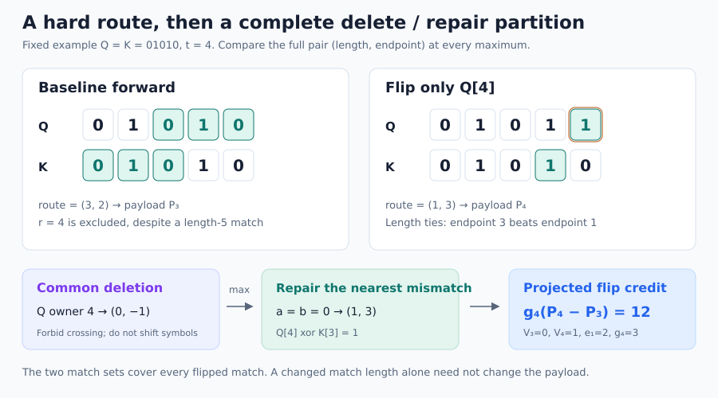
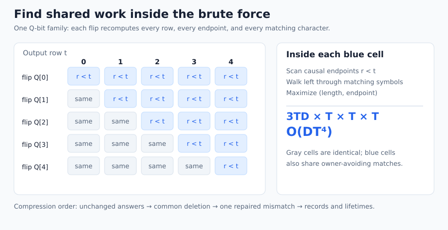
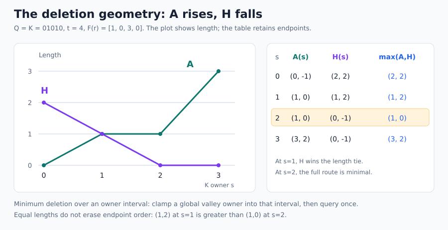
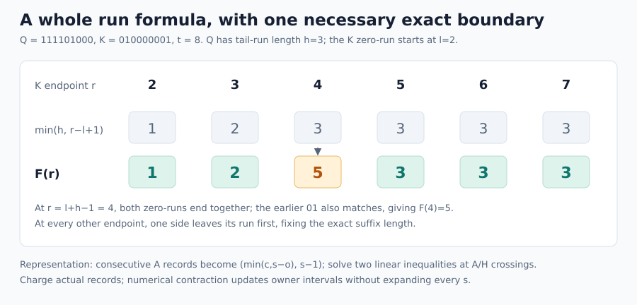
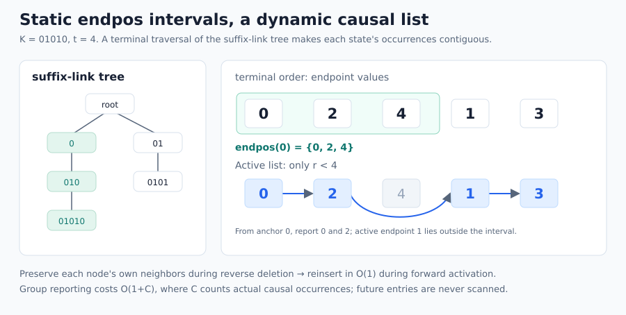
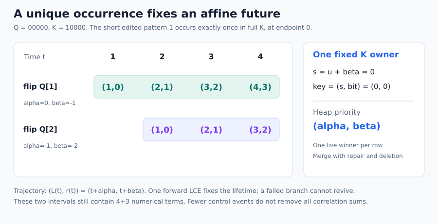
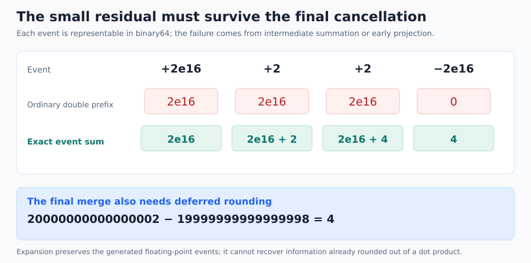

# From bit-flip brute force to a unified QKV-ROSA backward

[中文推导](ALGORITHM.zh-CN.md) · [Usage](README.md) · [Measurements](benchmarks/README.md)

The starting algorithm is easy to trust: flip one bit, rerun the hard forward,
and measure the output difference. It also repeats nearly everything. This
guide follows those repetitions to the invariants that remove them. Every
compression below keeps the same untruncated, longest-match/latest-endpoint
semantics, and every complexity statement charges for work that remains.

Useful prerequisites are strings, lexicographic order, difference arrays, and
basic trees. The suffix automaton and Fenwick tree are introduced where they
solve a specific problem. The implementation has one optimized algorithm;
ordinary states and certified intervals are representations within it, not
input-family backends.

## 1. Specify the answer before accelerating it

Consider one stream, with zero-based positions and closed intervals unless
stated otherwise.

| Symbol | Meaning | Shape or domain |
|---|---|---|
| $`T`$ | Sequence length | Nonnegative integer |
| $`D`$ | Bits per symbol, dimensions per payload | $`1\le D\le64`$ |
| $`Q_t,K_t`$ | Packed hard symbols | Unsigned $`D`$-bit words |
| $`V_{s,j}`$ | Payload bits | $`T\times D`$, 0 or 1 |
| $`e_0,e_1`$ | Empty payload and signed-payload scale | $`D`$ |
| $`g_t`$ | Given upstream vector `grad_y[t]` | $`D`$ |
| $`(L_t,r_t)`$ | Selected match length and K endpoint | Lexicographic route |
| $`C^Q,C^K,C^V`$ | Single-bit flip credits | Each $`T\times D`$ |

At output row $`t`$, only endpoints $`r\lt t`$ are legal. Define

```math
F_t(r)=\mathrm{LCSuffix}(Q[0..t],K[0..r]),
\qquad (L_t,r_t)=\max_{r\lt t}(F_t(r),r).
```

Longer matches win. Among equally long matches, later endpoints win. Normalize
every zero-length candidate to $`(0,-1)`$, so an empty match cannot select a
payload merely because its endpoint is later. The maximum of an empty
candidate set is also $`(0,-1)`$; in particular, $`y_0=e_0`$.

With $`P_s=(2V_s-1)\odot e_1`$, the output is

```math
y_t=\begin{cases}
e_0,&r_t=-1,\\
P_{r_t+1},&r_t\ge0.
\end{cases}
```

The `+1` is part of the architecture: retrieve the payload following the
matched K suffix. Because $`r\lt t`$, selecting $`V_t`$ is legal; selecting a K
endpoint at $`t`$ is not.

### Our hand-checkable example

Take $`D=1`$, $`Q=K=01010`$. At $`t=4`$, the candidate lengths at endpoints
0, 1, 2, 3 are respectively 1, 0, 3, 0. Endpoint 4 would match five symbols but
is not causal. The winner is $`(3,2)`$, selecting $`P_3`$.

Flip $`Q_{4,0}`$. The Q prefix becomes `01011`. Endpoints 1 and 3 both match
one symbol, so the winner becomes $`(1,3)`$, selecting $`P_4`$. If
$`V_3=0,V_4=1,e_1=2,g_4=3`$, this flip contributes $`3(2-(-2))=12`$.
Earlier rows cannot depend on $`Q_4`$.



The generator [`images/generate_figures.py`](images/generate_figures.py)
independently enumerates the examples in this guide and writes their data to
[`images/figure_data.json`](images/figure_data.json). It imports no optimized
matching code.

## 2. The expensive definition, and a map of its repeated work

The credit of bit $`(s,j)`$ in $`X\in\{Q,K,V\}`$ is defined by

```math
\boxed{C^X_{s,j}=\sum_t g_t^\top
\left(y_t^{\mathrm{flip}(X_{s,j})}-y_t\right).}
```

The independent oracle in
[`rosa_reference.py`](conv_rosa_transformer/rosa_reference.py) implements that
definition directly. Its literal forward considers every row, every candidate
endpoint, and then walks left while the characters agree:

```text
for each of the 3*T*D single-bit flips:
    for each output row t:
        best = (0, -1)
        for each endpoint r < t:
            walk left to find the matching suffix length
            best = lexicographic_max(best, candidate)
        select the payload and accumulate its projected difference
```

The suffix walks cost $`O(T^3)`$ per forward. Including payload-vector work,
all flips cost $`O(DT^4+D^2T^2)`$, usually abbreviated to $`O(DT^4)`$ for
fixed or small D.



A natural first thought is to compute all original $`F_t(r)`$ by
$`F_t(r)=1+F_{t-1}(r-1)`$ on equality and zero otherwise. That is a valid
$`O(T^2)`$ dynamic program. But rerunning it after every flip still repeats
whole tables. It reduces the all-flip total to $`O(DT^3+D^2T^2)`$, but a large
table does not explain which terms can be shared between owners. We need a
decomposition of the changed answer.

| Repeated work | Invariant that will remove it |
|---|---|
| Rerouting after a V flip | V never participates in matching |
| Recomputing the same unaffected matches for every bit | A common deletion route depends on owner, not bit |
| Searching all new alignments independently for Q and K | Every new match repairs one nearest mismatch |
| Emitting each later equal-length A winner | Consecutive endpoints in a character run have a formula |
| Scanning future K occurrences | Causal activation can be represented directly |
| Advancing a unique edited occurrence each row | Static uniqueness fixes its alignment and lifetime |
| Repeating identical payload dot products | Scores depend on row and payload class |

These are the successive steps below. The final algorithm never allocates the
full alignment table.

### “Exact backward” is a finite difference, not a threshold derivative

All other bits and the supplied $`g`$ stay fixed in the definition. This is a
counterfactual difference of hard outputs projected onto an upstream vector.
The ordinary derivative of threshold quantization is zero almost everywhere;
it is a different object. For a nonlinear downstream loss, the supplied
upstream vector is its local linear functional, not an exact loss rerun.

The layer separately maps credit to logits. For $`b=\mathbf1[z\gt 0]`$, orient
the flip difference as $`\Delta_{1-0}=(1-2b)C`$. The `bernoulli` mapping uses
$`p=\sigma(z/\tau)`$ and returns

```math
\frac{p(1-p)}{\tau}\Delta_{1-0}.
```

This differentiates the conditional two-endpoint interpolation with other
bits and $`g`$ fixed. The `identity` mapping returns $`\Delta_{1-0}`$.
These are explicit training choices; neither changes the returned bit-credit
definition or the hard forward.

## 3. Remove V rerouting, then separate deletion from repair

### V is a scatter along the baseline route

A V flip cannot change Q/K matches. It affects just one selected component:

```math
C^V_{s,j}=-2(2V_{s,j}-1)e_{1,j}
\sum_{t:r_t+1=s}g_{t,j}.
```

One route scatter computes all V credits in $`O(TD)`$. We no longer need one
hard forward per V bit.

### A Q/K edit has only two kinds of surviving match

Call the edited position its *owner*. “Delete” means forbid a match from
crossing the owner; it does not remove a symbol or shift the sequence.

Every match after a Q/K bit flip either avoids the owner, or crosses it.
Avoiding matches are unchanged and belong to the deletion set. A crossing
match must originally have had a mismatch at the owner: flipping a bit would
destroy an originally equal symbol. Every other symbol in that repaired
alignment must still be equal. Hence

```math
\boxed{\mathrm{route}_{\rm flip}
=\max(\mathrm{route}_{\rm delete},
      \mathrm{route}_{\rm repair}).}
```

This partitions all possible matches, so the decomposition is complete. The
deletion route is shared by all D bits at that owner.

Let an alignment $`(t,r)`$ have $`a`$ matching symbols immediately to the
right of its nearest mismatch. If
$`Q_{t-a}\mathbin{\mathrm{xor}}K_{r-a}=2^j`$, bit j repairs it. Define

```math
u=t-a,\quad s=r-a,\quad
b=\mathrm{LCSuffix}(Q[0..u-1],K[0..s-1]).
```

The full candidate is $`(a+1+b,r)`$, with Q owner u and K owner s. Every new
one-bit match has this description. Shorter candidates at the same endpoint
can be discarded, because its longest candidate dominates them.

In our example, flipping $`Q_4`$ deletes every nonempty suffix at row 4.
The alignment ending at K endpoint 3 has $`a=b=0`$, and XOR equal to 1. Its
repair route is $`(1,3)`$. The same alignment corresponds to K owner 3, but
that owner's deletion still retains $`(3,2)`$; its shorter repair cannot win.
Sharing a candidate does not mean sharing its final owner credit.

Numerically, add the common deletion-minus-baseline contribution first. Then
add repair-minus-deletion where a repair wins. This replaces the common answer
without subtracting the baseline twice.

## 4. Derive the deletion envelope from candidate geometry

Fix row t, abbreviate $`F=F_t`$, and let the baseline be $`(L,r_0)`$. Define

```math
R[h]=\max\{r\lt t:F(r)\ge h\},\qquad 1\le h\le L.
```

### Q owner: cap the length

For $`u\le t`$, forbidding Q owner u caps every surviving suffix at
$`t-u`$. Its best length is $`h=\min(L,t-u)`$. Among endpoints supporting
that length, the latest is R[h]:

```math
\mathrm{DelQ}(u)=
\begin{cases}
(0,-1),&h=0,\\
(h,R[h]),&h\gt 0.
\end{cases}
```

Only owners in the selected baseline suffix can change deletion. Future
owners and owners before that suffix retain the baseline. As u increases,
h decreases; ordered ordinary Q owners can query the R staircase with one
monotone cursor instead of a binary search per bit.

### K owner: split endpoints at the owner

For $`s\lt t`$, an endpoint to the left of s cannot cross it. An endpoint on
its right may retain only the $`r-s`$ symbols strictly after it. Therefore

```math
A(s)=\max_{r\lt s}(F(r),r),\qquad
H(s)=\max_{s\le r\lt t}(\min(F(r),r-s),r),
```

```math
\mathrm{DelK}(s)=\max(A(s),H(s)).
```

Only $`s\in[r_0-L+1,r_0]`$ can destroy the baseline match. Outside that
interval the best route remains legal, and deletion cannot improve it.

For `01010` at row 4, all values can be checked by four endpoints:

| K owner s | A(s) | H(s) | Deletion winner |
|---:|---|---|---|
| 0 | (0, −1) | (2, 2) | (2, 2) |
| 1 | (1, 0) | (1, 2) | (1, 2) |
| 2 | (1, 0) | (0, −1) | (1, 0) |
| 3 | (3, 2) | (0, −1) | (3, 2) |



A is nondecreasing as its endpoint set grows. H is nonincreasing as its set
shrinks and each surviving length cap decreases. Both statements hold in the
full lexicographic order, not just in length. Their maximum has a valley.
If p is a global minimum owner, the minimum over $`[a,b]`$ is attained at
$`\mathrm{clamp}(p,a,b)`$. This will let us reject whole repair groups
whose best candidate cannot beat even the least deletion route in their owner
span. Notice the tie at s=1: H wins because endpoint 2 is later than 0.

## 5. Compress A records without paying to expand them later

A straightforward envelope builder emits a record whenever a later endpoint
becomes best. Equal-length matches also create records because of the endpoint
tie-break. Before changing the representation, ask why adjacent records differ.

Suppose Q currently ends in h copies of symbol c, and a maximal K run of c
starts at l. For an endpoint r in that run:

- If $`r-l+1\lt h`$, K leaves the run first, so $`F(r)=r-l+1`$.
- If $`r-l+1\gt h`$, Q leaves first, so $`F(r)=h`$.
- At $`r=l+h-1`$, both leave together. Earlier symbols may keep matching,
  so that one endpoint needs a genuine suffix query.

Every other endpoint obeys

```math
\boxed{F(r)=\min(h,r-l+1).}
```



For the illustrated companion input, h=3 and l=2. The ordinary formula gives
1, 2, 3, 3, 3, 3, but the boundary endpoint 4 actually matches five symbols.
Replacing every suffix query by the formula would be wrong; checking exactly
that boundary makes compression safe.

The generator emits a consecutive sequence of improving endpoints as an
owner interval with

```math
A(s)=(f(s),s-1),\qquad f(s)=\min(c,s-o),
```

where c is its length cap and o its origin. If the exception establishes a
length above the cap, subsequent shorter endpoints in that run cannot set new
records and are skipped. Causal and baseline owner boundaries still truncate
every interval.

### Solve the A/H crossing as inequalities

For positive A length f, H wins equal-length ties because its endpoint is on
or to the right of the owner. A wins exactly when no H candidate supports
length f, equivalently

```math
s+f(s)\ge R[f(s)]+1.
```

On an R step with endpoint value r, substitute $`f(s)=\min(c,s-o)`$:

```math
s+c\ge r+1,\qquad 2s-o\ge r+1.
```

The first possible owner is

```math
\max\left(r+1-c,\left\lceil\frac{r+1+o}{2}\right\rceil\right),
```

intersected with the current A interval and the part whose lengths lie on the
R step. Both cursors move forward. Merge cost is linear in actual records,
not in implicit endpoints. An A record occupies three integers (12 bytes);
a K route segment occupies four (16 bytes), using tags for fixed/moving
endpoint and constant/growing length.

### Moving endpoints need a vector identity

If contraction later visits every implicit owner, record compression merely
postpones the same work. For endpoint $`s-1`$, however, the payload is $`P_s`$.
Such segments have a nonempty baseline. Write its bit as
$`b_{t,j}=V_{r_0+1,j}`$. The row contribution is

```math
2\sum_j e_{1,j}g_{t,j}(V_{s,j}-b_{t,j}).
```

Keep two owner-range gradient buckets per dimension, indexed by baseline bit.
On $`[a,b]`$, add $`g_{t,j}`$ to bucket $`b_{t,j}`$ through two boundary
updates. After taking owner prefixes, let the bucket sums be
$`G_{s,j,0},G_{s,j,1}`$. Contract once:

```math
\boxed{2\sum_j e_{1,j}
\left[V_{s,j}G_{s,j,0}-(1-V_{s,j})G_{s,j,1}\right].}
```

This costs $`O(D)`$ per formula interval plus $`O(TD)`$ final work, using at
most $`2(T+1)D`$ doubles allocated on demand. Equal bits have coefficient zero
before arithmetic. Formula segments must not also subtract baseline through
the scalar K difference array: these buckets already include it. Their sums
still use floating-point arithmetic; this identity is not a general
infinite-precision summation guarantee.

## 6. Share one K suffix automaton, while keeping all answers causal

The remaining search problem asks which suffixes, including edited ones,
occur in K. A suffix automaton (SAM) represents substrings by their sets of
occurrence endpoints, or `endpos`. Substrings with the same endpoint set share
a state. Suffix links lead toward shorter suffixes. In a depth-first terminal
order of that tree, each state's endpoint set occupies a contiguous interval.

The backward builds one SAM of full K. At row t it activates endpoint t−1,
then consumes $`Q_t`$. The index knows the future but every answer filters
by $`r\lt t`$. Static earliest endpoints can certify existence; causal latest
endpoint queries settle ties. Original root transitions and one-bit alternatives
are looked up exactly. An absent causal target rejects a birth without
searching for an impossible repair.

### Share the question before speeding up the dictionary

If a Q word appears ten times, all ten positions ask the same static root
question. Only the causal time limit changes. Classify equal Q words once;
for each of the $`U_Q`$ classes, save its root neighbors and check their earliest
K endpoints at the current row. A neighbor with first K position at or after
the last occurrence of that Q word can never be causal and is discarded.

A dense table would still allocate $`U_QD`$ cells, usually including many absent
neighbors. Instead, each Q class stores a bit mask, an offset and only its
existing root targets, in increasing bit order. If R targets survive the
causal test, this takes $`O(U_Q+R)`$ root storage. The row loop walks that mask;
it does not test every globally live bit for every occurrence of a Q word.
The same sparse representation is used with randomization either off or on.

The dictionaries compare the full 64-bit word; SAM transitions also compare
the full state. Random placement affects probe counts, never word equality.
With randomization off, root preparation queries every allowed flipped word.
With it on, the same search may use a cheaper exact cover:

1. Randomly partition the D bit positions into two or four balanced blocks.
2. For each block, index distinct K words by **all bits outside that block**.
3. Query each Q word in those indexes. A true one-bit neighbor differs inside
   exactly one block, so it must meet Q in that block's bucket.
4. Check the full XOR. Accept only a single set bit and a possible causal root.

The random choice cannot remove a true neighbor. It changes how many false
candidates are inspected. If a bucket has c members and its block has m
allowed bits, inspect the bucket only when that is cheaper; otherwise query
those m exact bit flips. Thus candidate/probe attempts per Q are bounded by
$`\sum_b\min(c_b,m_b)\le D`$, plus the block lookups. Index construction and
actual hash collisions still cost time; this is not a whole-backward bound.

A cost planner chooses direct queries, two blocks or four blocks from the
observed Q/K vocabulary and varying bits. These are choices inside one exact
root join, not specialized kernels for benchmark families. The planner can be
wrong about speed without changing any credit. The [randomized search guide](docs/exact-randomized.md)
derives its coverage probability, construction costs and measured failures.

The standalone forward follows only the original Q trajectory. Its matched
length increases by at most one per row, so at most T suffix-link fallbacks
occur in total; binary lifting and the causal occurrence list are
unnecessary. Each transition first requires the target state's earliest
endpoint to be below t, then obtains the latest endpoint through exact
certificates or a lazily built range-maximum tree. Auxiliary space is O(T).
Assuming constant average hash-probe cost, the scan is O(T), and the complete
algorithm including general endpoint maintenance is O(T log T). Full state
and 64-bit symbol comparisons make hash collisions a performance concern only.
The [forward measurements](benchmarks/results/forward.json) time this path
separately from the backward.

An ordinary Q branch stores owner, bit, longest edited match, and `short_state`:
the state of the **whole edited suffix from the owner through the current
row**. The shortest suffix that still contains the edit must keep extending.
If it cannot, that owner branch retires. The longest match may fall back to a
shorter suffix while this edited suffix remains; keeping both states prevents
an unedited suffix from being mistaken for a repair.

### Why “scan static endpos and filter” is avoidable

For K=`01010`, the endpos of `0` is {0,2,4}. At t=4, endpoint 4 is still
illegal. Paying to discover it in every group is unnecessary.



Maintain a doubly linked list of active endpoints in terminal order. Build
the complete list, then delete endpoints in reverse time order. A deleted
node's own neighbor pointers are preserved while its neighbors are linked
together. Reversing these operations gives its exact insertion neighbors
when it becomes active, so activation takes $`O(1)`$.

If a state's earliest endpoint is below t, that node is an active anchor in
its terminal interval. Walk left and right until the interval boundaries.
Every causal occurrence is reached once, and no future one is visited.
Preprocessing takes $`O(T)`$ time and space; reporting $`C_v`$ endpoints
costs $`O(1+C_v)`$. The maximum tree still has its separate update cost, so
the entire SAM advance is not constant time.

### Exact certificates before general endpoint queries

Three local proofs can answer a latest-endpoint request directly:

1. Static `last < t`: all occurrences are already visible.
2. Count equals `last - first + 1`: the endpoint set is an integer interval,
   so its causal maximum is $`\min(\text{last},t-1)`$.
3. A true direct transition extends the previous latest endpoint by one and
   reaches the tight latest-endpoint bound. This is not used after suffix-link
   fallback, where the same bound need not apply.

Other queries reuse this SAM rather than build a second matching index.
The baseline state saved for a Q row and a K-prefix state have a common
suffix-link ancestor. Its length, capped by the saved Q match length, gives
their common suffix. A lazy LCA table supports that query. A lazy wavelet
index on the same terminal order supports endpoint predecessor/successor
queries. Fixed small scans answer short queries first. An unused index is
never built; general queries remain available when certificates fail.

## 7. Reuse Q repair discovery for K owners

A live Q branch already identifies the suffix that would also match if the
aligned K bit were flipped. For Q owner u, a causal endpoint r of its edited
suffix maps to

```math
s=r-(t-u)
```

as K owner. A left-side suffix query recovers full length $`t-u+1+b`$.
Maintain the maximum candidate per $`(s,j)`$, then compare it with that
owner's exact K deletion route.

Before reporting, the minimum deletion route over the possible owner span
provides a lower bound. If a group's maximum repair cannot beat this bound,
the whole group is irrelevant. Otherwise that bound can require a longer
edited suffix, shrinking the endpoint set reported. Final checks still
include endpoint ties.

Distinct active Q owner/bit branches have disjoint edited-suffix endpoint
sets at a row. If two shared an endpoint, at the later edited position one
aligned string would contain the original Q symbol and the other its flipped
symbol: contradiction. Thus the number of represented branches at a row is
bounded by the number of causal endpoints. Their total lifetimes can still
be quadratic; a per-row bound is not a bound on the whole execution.

## 8. Replace a uniquely determined future by an interval event

Suppose `short_state` has exactly one endpoint r₀ in **full static K** at row
t₀, certified by `first_endpoint == last_endpoint`.

Take any future occurrence at t₀+h ending at r′. Remove its last h symbols.
The remainder must be an occurrence of today's complete edited suffix, hence
r′−h=r₀. Only one future alignment is possible, and causality persists because
r₀+h<t₀+h.

If the current longest repair is $`(L_0,r_0)`$, define

```math
\alpha=L_0-t_0,\quad\beta=r_0-t_0\lt 0,\qquad
\tau=t_0+\mathrm{LCE}(Q[t_0+1..],K[r_0+1..]).
```

Its whole closed lifetime obeys

```math
\boxed{\mathrm{repair}(t)=(t+\alpha,t+\beta),
\qquad t_0\le t\le\tau.}
```

The earlier left boundary is already fixed; appending equal characters adds
one to both coordinates. The first mismatch retires the branch permanently:
a later occurrence would imply an occurrence at that failed row by removing
its trailing symbols.



The companion input Q=`00000`, K=`10000` makes the certificate visible. The
edited symbol `1` has only endpoint 0. Flipping Q owner 1 gives routes
(1,0), (2,1), (3,2), (4,3) at rows 1 through 4. Flipping Q owner 2 gives
(1,0), (2,1), (3,2) at rows 2 through 4. Both map to K owner 0.

Two tempting weaker tests are invalid. The longest edited match being unique
does not make shorter edited suffixes unique. A currently causal occurrence
being unique does not rule out a future occurrence. The certificate must use
the **short complete edited suffix and full static K**. Detach only when at
least one matching future character exists, so an interval does not merely
store zero future work.

Lifetime discovery jumps over equal-character runs of Q and K. Let J count
the run blocks inspected. Long equal runs are cheap; arbitrary periods can
still make J large.

### K: heap by an owner that no longer moves

For Q owner u, the K owner throughout the interval is

```math
s=(t+\beta)-(t-u)=u+\beta.
```

Group intervals by $`(s,j)`$ in a max-heap with fixed priority
$`(\alpha,\beta)`$. Adding t to both coordinates preserves route order.
Insert at birth and lazily pop expired tops. Each active key contributes one
winner per row, then joins ordinary candidates and deletion in the same max.
There is no per-input dispatch, and no repeated discovery of these K owners.

### Q: replace the common interval contribution using snapshots

A repair containing Q owner u has length at least t−u+1, while its Q deletion
has length at most t−u. Thus the repair wins for its whole lifetime. Let
$`\Delta_t(u)`$ be the common Q deletion-minus-baseline contribution. Add

```math
\sum_{t=t_0}^{\tau}
\left(g_t^\top P_{t+\beta+1}-g_t^\top y_t\right)
-\sum_{t=t_0}^{\tau}\Delta_t(u).
```

The second sum is a range-add/point-query problem: common deletion writes
owner intervals, while a detached branch needs one owner's cumulative value.
A Fenwick tree supports both in logarithmic path length. Take the birth
snapshot before row t₀'s updates and the finish snapshot after row τ's
updates. Their difference includes both endpoints and cancels older rows.
When no live snapshot consumer exists, these tree updates are unnecessary.

Route eventization does not eliminate all numerical terms. Their count is

```math
\mathcal H=\sum_c(\tau_c-t_{0,c}+1).
```

Keep $`\mathcal H`$ in the cost model even when every corresponding SAM
advance has disappeared.

## 9. Share payload scores with a finite memory budget

Routes selecting the same V bit vector at row t share $`g_t^\top P`$. Let U
be the number of payload classes. Ordinary queries calculate requested scores
lazily within the row. Finished intervals also query older rows; caching all
$`T\times U`$ scores would defeat the memory goal.

Admit at most 4D classes to a history cache. If $`U\le4D`$, admit all.
Otherwise admit only classes of frequency at least
$`\lceil T/(4D)\rceil`$. For admitted count $`U_h`$,

```math
U_h\left\lceil\frac{T}{4D}\right\rceil\le T
\quad\Longrightarrow\quad U_h\le4D.
```

The table has at most 4TD double entries and is allocated only when an interval
needs it. Entries are computed on demand; ordinary row scores populate the
same table. Nonadmitted classes execute the same dot product without a history
slot. No approximation or different matcher is involved.

With X additional interval dot products actually computed, this part costs
$`O(\mathcal H+DX)`$, plus residual-component work. If all classes are
admitted, $`X\le TU`$. Cache hits do not remove the $`\mathcal H`$ visits.
The runtime counters `payload_dot_components` and `singleton_dot_components`
must be added to count both sources of payload dot products; fixed empty
scores are separate $`O(TD)`$ work.

## 10. A real-number identity is not yet a safe floating-point program

Grouping updates into intervals changes the order of cancellation. The sum
$`2\cdot10^{16}+2+2-2\cdot10^{16}=4`$ can become zero under ordinary
binary64 addition. Subtracting two rounded global prefixes also introduces
large history outside the requested interval.



`ExactExpansion` retains error-free floating-point residuals through Fenwick
nodes, point queries, birth/finish snapshots, interval sums, common Q
difference boundaries, and the final owner prefix.

Why must the final merge also remain unrounded? Let A be the key's earlier
ordinary correction, B its interval repair-minus-baseline sum, Dᵢ common
deletion inside the interval, and Dₐₗₗ common deletion over all rows. Preserve
E=A+B−Dᵢ in the expired birth-snapshot slot, then compute

```math
\mathrm{round}_{64}(E+D_{\rm all}).
```

Separately rounding E and Dₐₗₗ can still lose the answer:
$`20000000000000002-19999999999999998=4`$, but separately rounded operands
can yield zero. The detached key never reenters ordinary states, so reusing
its snapshot does not overwrite a future update or require another full
$`TD`$ matrix of accumulators.

The common object holds two doubles and a pointer, normally 24 bytes. Its
update uses `TwoSum`, combines residuals without loss, orders them to meet
`FastTwoSum`'s magnitude precondition, and normalizes the leading pair before
allocating extra storage. Nonzero residuals are never discarded to force a
two-component representation. Wide exponent ranges may need more components.

The guarantee is exact accumulation of the **finite binary64 events actually
generated**, assuming nearest-even rounding, gradual underflow, and no internal
overflow. The build disables FP contraction and does not enable fast-math.
This cannot recover rounding already incurred in row dot products, row
subtractions, prior ordinary Q sums, or other K/V arithmetic. Whole-VJP
bitwise equality across summation orders is not promised.

## 11. Put the pieces together and count the remaining work

The row loop activates the next causal endpoint, advances baseline and ordinary
Q states, and extracts new certified intervals. It observes the shared route
index, constructs deletion ranges, and adds common credits. Ordinary Q
repairs and their K candidates are contracted alongside active K heap winners.
Intervals ending on the row preserve their correction. Final owner prefixes,
interval merges, and V scatters complete the outputs.

The following parameters count actual execution, not the number of conceptual
alignments a compressed record represents. Put
$`\ell=\max(1,\lceil\log_2(T+1)\rceil)`$. Keep actual hash probe work explicit;
randomized placement cannot be replaced by a deterministic constant-cost
lookup in an unconditional bound.

| Parameter | Work counted |
|---|---|
| $`U_Q`$ | Distinct Q words whose root alternatives are prepared |
| $`U_K,R`$ | Distinct K words; stored causal root neighbors |
| $`P_{\rm root}`$ | Root-index construction and candidate/probe attempts, excluding collision overhead |
| $`B_0`$ | Stored root neighbors visited over all Q positions |
| $`H_{\rm hash}`$ | Actual full-key hash probes in construction, Q classification, root lookup, and streaming transitions |
| $`A_*`$ | Ordinary Q advance attempts, including retirement attempts |
| $`B`$ | Successful Q births after the $`B_0`$ sparse causal checks |
| $`C`$ | Causal endpoints actually reported for ordinary K repair |
| $`W_*`$ | Total deletion-generation cost, including records and the full costs of probes/indexed queries |
| $`M`$ | Detached intervals, at most $`TD`$ |
| $`J`$ | Run blocks inspected for interval lifetimes |
| $`E`$ | Active K interval heap keys, summed over rows |
| $`\mathcal H`$ | Total interval lifetime coverage |
| $`G`$ | Moving-endpoint numerical owner intervals |
| $`S,X`$ | Ordinary and additional interval dot products actually performed |
| $`F_{\rm exp}`$ | Actual expansion work, including components and Fenwick paths |

A conservative time bound is

```math
O\!\left(T\ell+TD+UD+P_{\rm root}+B_0+H_{\rm hash}+W_*+(T+A_*+B)\ell+C\ell
+M\log(M+1)+J+E\ell+\mathcal H+D(S+X+G)+F_{\rm exp}\right).
```

The $`W_*`$ term includes query costs; it is not merely the number of A records
or indexed jumps. Heap insertion and expiration cost $`O(M\log(M+1))`$ altogether. Fenwick
paths and component manipulation belong to $`F_{\rm exp}`$, not a fictional
single constant-time addition. Bounded cache allocation and two gradient
buckets are included in the TD term. Here $`U`$ is the number of distinct
payload words from the score-sharing section. Direct roots use
$`P_{\rm root}=O(U_QD)`$. With p blocks, the root work is bounded by
$`O(D+pU_K+pU_Q+\sum_{q,b}\min(c_{q,b},m_b))`$, excluding actual hash
collision probes. The sparse birth visits satisfy $`B_0\le TD`$. Constant
average hash-probe cost is an assumption; the expression retains actual
probe work when that assumption fails. Space is

```math
O(TD+UD+T\log(T+1)+P_{\rm exp}),
```

where $`P_{\rm exp}`$ counts extra stored residuals. Sparse roots use
$`O(U_Q+R)`$ storage, with $`R\le U_QD\le TD`$; the position-to-class map and
flat dictionaries use $`O(T)`$ space. Vector capacity is not peak RSS. Lazy indexes
still incur their worst-case space charge. No quadratic alignment matrix is stored.

For fixed machine-word D and constant average hash-probe cost, the structural
worst case remains quadratic up to logarithmic factors, with numerical
component costs accounted for separately.
This is not a general near-linear theorem or a claim of global optimality.

### Optional sampling should preserve the common work

The decomposition also gives a control variate. Write each Q/K credit as its
exact common deletion value plus its repair residual, $`C_{s,j}=B_s+R_{s,j}`$.
Sampling an entire supported bit lane with probability $`p_j`$ gives

```math
\widehat C_{s,j}=B_s+I_jR_{s,j}/p_j,\qquad
\mathbb E\widehat C_{s,j}=C_{s,j}.
```

Deletion and V remain exact; unsupported lanes have a certified zero residual.
A selected lane retains all of its alternatives, including the maximum needed
by each K owner. Sampling alternatives before taking that maximum would not
have this expectation. Forced joint-block lanes are computed exactly, and a
separate random stream samples the others with known conditional probabilities.

This saves only selected repair work, not shared preparation, deletion,
payload scoring, or all $`TD`$ output cells. Its mean squared coordinate error
is $`(1-p_j)R_{s,j}^2/p_j`$ in exact arithmetic. The measured error is too large
on some inputs to enable a small budget by default. Full repairs remain the
ordinary path. Even oracle importance probabilities leave large errors on
the measured inputs. The [randomization guide](docs/exact-randomized.md)
records this rejection. The public `randomized=True` option selects the exact
root join above and never enables this separate research sampler.

### Two structures that show the difference between control and arithmetic

For $`Q=K=0^T`$, deletion emits only a constant number of formulas per row.
That module's construction is $`O(T)`$, and its contraction is $`O(TD)`$.
Shared SAM/root preprocessing retains its cost.

For $`Q=0^T,K=10^{T-1}`$, $`T\ge3`$, ordinary Q advances vanish:
$`A_*=0`$, $`M=J=T-2`$, $`E=T-1`$. However,

```math
\mathcal H=\frac{T(T-1)}2-1.
```

The unresolved numerical operation is a collection of interval correlations
$`\sum_{t=a}^b g_t^\top P_{t+\beta+1}`$, with differing lifetimes and offsets.
A full-shift convolution formula alone does not solve all these interval
queries with small constants and controlled rounding.

Periods greater than one leave a second obstacle: equally spaced endpoints
are not consecutive endpoints, so the run identity does not compress all
periodic A records. Extending it requires bounding the splits when arithmetic
progressions interact with R steps and lexicographic ties. Neither obstacle
is a quadratic lower bound.

## 12. Read the implementation, then try to break an invariant

| Mathematical role | Source |
|---|---|
| Independent hard forward and all-bit definition | [`rosa_reference.py`](conv_rosa_transformer/rosa_reference.py) |
| Public arrays, validation, native build | [`rosa_core.py`](conv_rosa_transformer/rosa_core.py) |
| Lean hard forward and lazy latest endpoints | [`forward.h`](conv_rosa_transformer/csrc/forward.h) |
| Full-key SAM dictionaries, shared Q roots, causal support, Q branches | [`sam_q.h`](conv_rosa_transformer/csrc/sam_q.h) |
| Shared suffix and endpoint queries | [`sam_routes.h`](conv_rosa_transformer/csrc/sam_routes.h) |
| R staircase, A/H, compressed owner intervals | [`delete_indexed.h`](conv_rosa_transformer/csrc/delete_indexed.h) |
| Row loop, K heaps, score sharing, contraction | [`unified_core.cpp`](conv_rosa_transformer/csrc/unified_core.cpp) |
| Residual-preserving aggregation | [`exact_expansion.h`](conv_rosa_transformer/csrc/exact_expansion.h) |
| Bounded causal-band joint proposals | [`pair_candidates.h`](conv_rosa_transformer/csrc/pair_candidates.h) |
| Batched training, metric, blocks and logit mapping | [`training_impl.h`](conv_rosa_transformer/csrc/training_impl.h) |
| Framework-independent C interface | [`training.h`](conv_rosa_transformer/csrc/training.h) |
| Thin PyTorch autograd adapter | [`rosa_layer.py`](conv_rosa_transformer/rosa_layer.py) |

Run `python tests/run.py` for quick independent checks, or
`python tests/run.py --exhaustive` for the full binary enumeration and
structural oracles. [`tests/README.md`](tests/README.md) states the test gates;
[`benchmarks/README.md`](benchmarks/README.md) gives absolute CPU latency,
throughput, resource measurements, and a reproducible upstream comparison.

Useful exercises before modifying a data structure:

1. In the five-symbol example, compute every Q deletion route. Explain why
   changing a winning match length need not change its payload or credit.
2. Prove the A/H crossing condition with the endpoint tie-break included.
   What goes wrong if `>=` is changed at the wrong boundary?
3. Construct a short edited pattern with two static occurrences, only one of
   which is currently causal. Explain why a temporary uniqueness test fails.
4. For the unique-continuation example, derive the fixed K owner for every
   Q flip and count $`\mathcal H`$ directly. Which work is eventized and
   which work is still a sum?
5. Place a small term between two large opposite terms. Check what is lost
   by rounding a Fenwick node, a snapshot, or the final correction too early.
6. Prove that a one-bit neighbor survives the omitted-block join for every
   partition. Why can a large bucket safely switch to exact bit probes?
7. Why does sampling a K bit lane preserve its maximum, while sampling only
   some alternatives need not? Construct two alternatives that expose the bias.

## 13. Accurate output credit is only one part of learning

The derivation above computes $`g^T\delta_i`$ for the exact output change of a
bit flip. It does not turn that finite jump into an exact downstream loss
change. Given an output-space diagonal $`h`$, the same routing engine can score
$`g^T\delta_i+\tfrac12\sum h\delta_i^2`$. Each coordinate of a matched payload
has only two possible values, so two baseline-relative costs per coordinate
are enough; neither another route search nor a dense Hessian is required.
This is an exact score of a chosen local model. Supplying a useful $`h`$ in a
deep network is a separate problem.

There is also a different obstacle: both individual flips may leave the
output unchanged while their joint flip changes the match. No output
curvature can recover an interaction absent from both single-flip deltas.
Selected pairs therefore need their joint corner evaluated explicitly.
The four resulting costs admit both independent interpolation and an exact
optimal coupling at fixed flip marginals. The latter can remove a local
two-bit probability barrier, but it cannot create a descending corner where
all four corners have no improvement.

Ordinary model integration has an information constraint:
backward receives the current g. Every function
$`L_a(Y)=g_0^T(Y-Y_0)+a\lVert Y-Y_0\rVert^2/2`$ has the same gradient at $`Y_0`$,
despite differing curvature. A toy interface supplied with the correct
diagonal therefore does not establish automatic Hessian recovery in a model.

### A diagonal penalty should preserve an aligned feasible move

The layer can define an explicit local metric from its own output geometry.
One group's output lies in
$`\{e_0\}\cup\{s\odot e_1:s_j\in\{-1,1\}\}`$. A diameter bound is

```math
D_Y=\max\left(2\lVert e_1\rVert_2,
                 \lVert |e_0|+|e_1|\rVert_2\right).
```

Scoring finite edits with $`h_{t,j}=\lVert g_t\rVert_2/D_Y`$ needs no downstream
Hessian. It has a simple property: for nonzero g, an aligned displacement
$`\delta=-s g/\lVert g\rVert`$, with $`0\lt s\le D_Y`$, satisfies

```math
g^T\delta+\tfrac12h\lVert\delta\rVert^2
 \le-\tfrac12\lVert g\rVert s\lt 0.
```

At least half the linear improvement remains for an aligned feasible jump.
Using the radius $`\lVert e_1\rVert`$ directly can penalize a move across the
entire payload range down to zero. This happens in an actual ROSA example:
both individual flips preserve the output, and the old penalty also assigns
zero credit to the useful joint flip. Diameter scaling restores its signal.
The regression test executes the layer's ordinary `loss.backward()`.


This statement concerns the chosen local model. Unknown downstream cross
curvature and simultaneous shared-parameter changes still prevent a guarantee
of decreasing the actual loss. The implementation applies this metric to Q/K
routing changes, retains linear V credit, and uses independent four-corner
interpolation for selected joint blocks.

### Integration and total cost belong in the evaluation

These operations now live inside `NBitQKVRosa`. The caller executes one model
forward, one task loss and one `loss.backward()`, without supplying h or
changing its optimizer. Each selected pair adds one exact component-internal
matching pass; training timings must include it. Active-row selection and the
metric depend on g. Their surrogate update preserves positive loss scaling,
but is not a fixed VJP additive in arbitrary incoming gradients.

The [native component guide](docs/native-training.md) derives the selected
rule and its first-order alternative. Packing, both passes, the diagonal,
proposals, joint replay, logit mapping and embedding gradients now run in one
batched C++ implementation. The [results](docs/native-results.md) separate
exact randomization from native integration, and retain the numerical
migration and held-out loss regressions. The [forward supplement](docs/forward.md) continues to document the
separate lean matcher and its timings.
