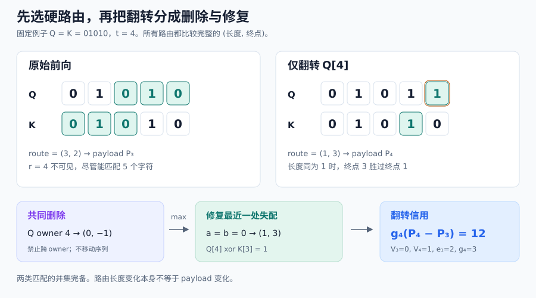
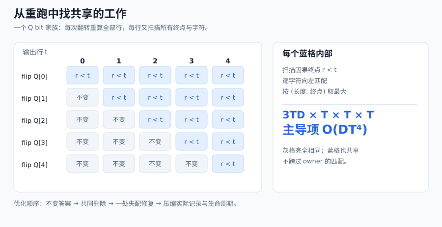
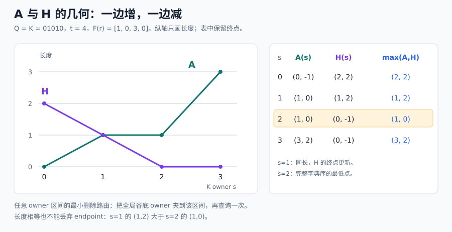
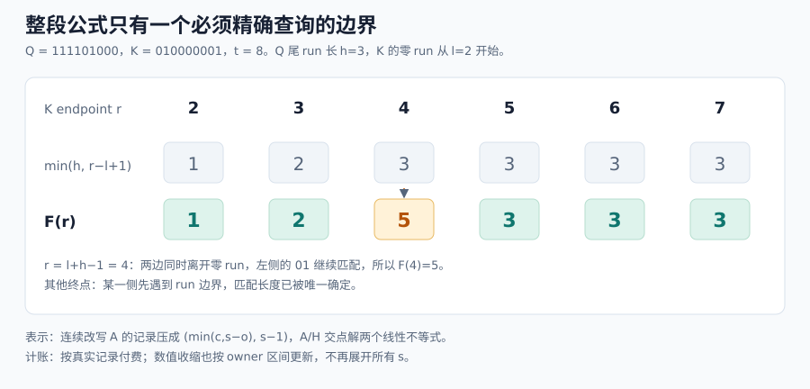
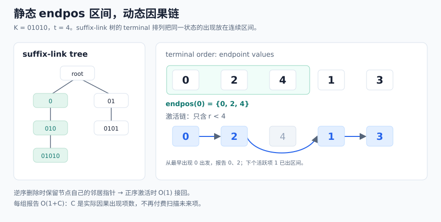
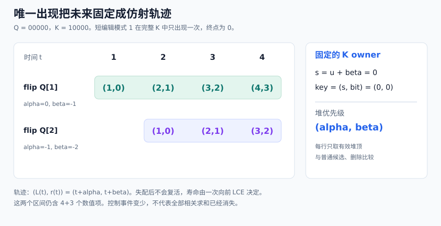
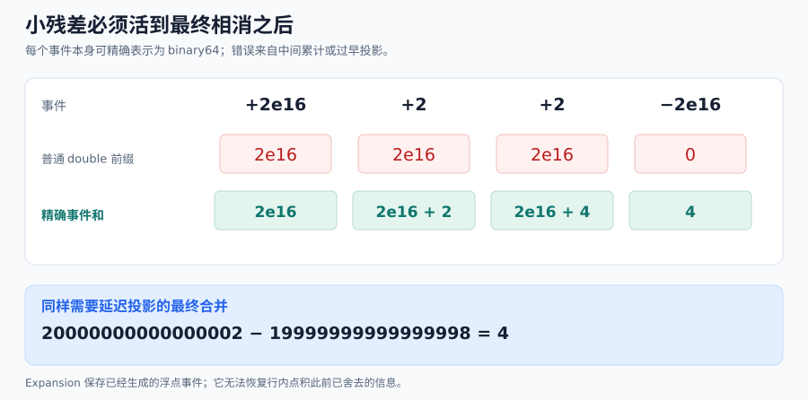
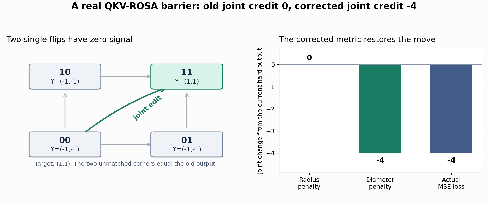

# 从逐位翻转的暴力，推到统一的 QKV-ROSA 反向算法

[English](ALGORITHM.md) · [运行方法](README.md) · [性能数据](benchmarks/README.md)

这道题的暴力很好写：翻转一位，重跑前向，把输出变化乘上上游梯度。
难的是不重跑，还能把同一个答案算出来。

下面从这份暴力出发。每省下一层枚举，都先说明哪些工作重复了，为什么能共享，
共享之后又该怎样表示。差分数组、字典序比较和树是主要工具；后缀自动机与
Fenwick 树会在真正需要它们的地方引入。全文讨论的是一个统一算法，普通状态、
公式区间和唯一出现区间都是其中的数据表示。

## 1. 先把题意钉牢：匹配的是 K，取出的是后一个 V

先看一个长度为 $`T`$ 的流，下标从 0 开始。除非另有说明，区间均为闭区间。

| 符号 | 含义 | 形状或取值 |
|---|---|---|
| $`T`$ | 序列长度 | 非负整数 |
| $`D`$ | 一个符号的 bit 数，也是 payload 维数 | $`1\le D\le64`$ |
| $`Q_t,K_t`$ | 打包后的硬符号 | 无符号 $`D`$-bit 整数 |
| $`V_{s,j}`$ | payload 的各个 bit | $`T\times D`$，取 0 或 1 |
| $`e_0,e_1`$ | 空匹配向量、有匹配时的幅度向量 | $`D`$ |
| $`g_t`$ | 给定的上游向量 `grad_y[t]` | $`D`$ |
| $`(L_t,r_t)`$ | 匹配长度、K 的右端点 | 按完整二元组取字典序最大 |
| $`C^Q,C^K,C^V`$ | 每一个 bit 的翻转信用 | 各为 $`T\times D`$ |

计算第 $`t`$ 行时，允许的 K 终点只有 $`r\lt t`$。记

```math
F_t(r)=\mathrm{LCSuffix}(Q[0..t],K[0..r]).
```

也就是把两个前缀的末端对齐，向左最多能连续匹配多少个符号。选择

```math
(L_t,r_t)=\max_{r\lt t}(F_t(r),r).
```

先比长度，再比终点；同长时选更晚的终点。零长度统一写成 $`(0,-1)`$，
不能因为某个零长度候选的终点较大，就把它当成有匹配。
空候选集合的最大值也定义为 $`(0,-1)`$，因此第 0 行必定输出 $`e_0`$。

令

```math
P_s=(2V_s-1)\odot e_1,
```

则输出为

```math
y_t=\begin{cases}
e_0,&r_t=-1,\\
P_{r_t+1},&r_t\ge0.
\end{cases}
```

注意 $`r_t+1`$。架构要复制的是匹配片段之后的 payload，而非匹配终点自身的
payload。因果条件 $`r\lt t`$ 允许取到 $`V_t`$，但不允许匹配 K 的第 $`t`$ 位。

### 后面反复用到的五字符例子

取 $`D=1`$，$`Q=K=01010`$，看最后一行 $`t=4`$。终点 0、1、2、3
对应的匹配长度依次是 1、0、3、0。终点 4 本来能匹配五个字符，但它不合法。
所以基准路由是 $`(3,2)`$，输出 $`P_3`$。

只把 $`Q_{4,0}`$ 翻转，Q 变成 `01011`。此时终点 1 和 3 都能匹配一个字符，
按“同长选最新”得到 $`(1,3)`$，输出改为 $`P_4`$。若
$`V_3=0,V_4=1,e_1=2,g_4=3`$，这一位的信用就是
$`3(2-(-2))=12`$。前面几行不可能受 Q 的第 4 位影响。



插图数据由 [`images/generate_figures.py`](images/generate_figures.py)
中的独立枚举计算；它不导入优化算法。完整数据保存在
[`images/figure_data.json`](images/figure_data.json)，可以手算后核对。

## 2. 暴力的四次方，具体花在哪里

对 $`X\in\{Q,K,V\}`$，第 $`(s,j)`$ 位的信用定义为

```math
\boxed{C^X_{s,j}=\sum_t g_t^\top
\left(y_t^{\mathrm{flip}(X_{s,j})}-y_t\right).}
```

除了指定 bit，其他输入、embedding 和给定的 $`g`$ 全部不变。
[`rosa_reference.py`](conv_rosa_transformer/rosa_reference.py) 保留了直接实现：

```text
枚举 3*T*D 个单 bit 翻转：
    枚举输出行 t：
        best = (0, -1)
        枚举终点 r < t：
            从 (t,r) 向左逐字符匹配
            用 (匹配长度, r) 更新 best
        按 best 取出 payload，累计与基准输出的差
```

一个前向，外面是行、终点两层，里面还可能向左比较 $`O(T)`$ 个字符，
所以是 $`O(T^3)`$。再乘 $`TD`$ 次翻转，加上向量输出的工作，得到
$`O(DT^4+D^2T^2)`$；D 固定或较小时，通常只写主导项 $`O(DT^4)`$。



第一个容易想到的优化是算一张原始匹配表：字符相等时
$`F_t(r)=F_{t-1}(r-1)+1`$，否则为零。整张表只要 $`O(T^2)`$。
这把全部翻转的总成本降到了 $`O(DT^3+D^2T^2)`$，但每翻一位仍重算整张表；
而且表本身没有告诉我们，不同 owner 的答案之间究竟可以共享什么。

把重算的内容拆开看，会得到下面这条路线。

| 暴力重复做的事 | 可以利用的性质 |
|---|---|
| 翻 V 后重新寻找路由 | V 根本不参与 Q/K 匹配 |
| 同一个 owner 的 D 个 bit 分别找未受影响的匹配 | 不跨 owner 的匹配与翻哪一位无关 |
| Q 翻转、K 翻转分别发现新匹配 | 两者都在修复同一对齐上的一处失配 |
| 相同长度、终点连续后移，也逐条存 A 记录 | 同字符 run 内的长度和终点有公式 |
| 扫静态出现集合，再丢掉未来项 | 可以直接维护已经因果可见的出现链 |
| 唯一出现每行重新向后推进 | 完整静态唯一性固定了之后的对齐 |
| 相同 payload 反复与同一行梯度点乘 | 分数只由行和 payload 类决定 |

接下来逐条把这些性质变成可查询、可累计的数据结构。

### 这里的“反向”不是阶跃函数的普通导数

上式是硬输出的有限差分，再投影到给定的上游向量。阶跃函数几乎处处导数为零，
那是另一个量。若下游 loss 非线性，$`g`$ 提供的是它当前的线性泛函，
不能把一次输出差分投影说成任意非线性 loss 的精确变化。

训练层还要把 bit 信用映射到 logit。设 $`b=\mathbf1[z\gt 0]`$，先统一方向：

```math
\Delta_{1-0}=(1-2b)C.
```

`bernoulli` 模式令 $`p=\sigma(z/\tau)`$，返回

```math
\frac{p(1-p)}{\tau}\Delta_{1-0}.
```

它对应固定其他 bit 和 $`g`$ 时，两个端点之间条件插值的导数。
`identity` 则直接返回 $`\Delta_{1-0}`$。这些是显式的训练映射选择；
硬前向以及本节定义的 bit 信用并未因此改变。

## 3. 不跨编辑点的答案，先一起算掉

### V 只需要沿原路由散射

翻 V 不会改变匹配，只会改被选中向量的一个分量。因此

```math
C^V_{s,j}=-2(2V_{s,j}-1)e_{1,j}
\sum_{t:r_t+1=s}g_{t,j}.
```

按基准路由做一次 scatter，$`O(TD)`$ 算完所有 V 信用。V 的那一大批前向
重跑就完全不需要了。

### Q/K 的新答案可以分成两个集合

称被翻转的位置为 owner。定义一个“删除”问题：禁止匹配跨过这个位置。
这里只禁止跨越，不是真的删掉字符，不改变任何下标。

翻转之后的一个匹配，如果不跨 owner，它原来就存在，属于删除问题。
如果跨 owner，那么原对齐在 owner 处必定失配：原来若相等，翻一位反而会破坏
相等。其余位置必须全部相等。因此所有翻转后的匹配恰好落入这两类：

```math
\boxed{\mathrm{route}_{\rm flip}
=\max(\mathrm{route}_{\rm delete},
      \mathrm{route}_{\rm repair}).}
```

删除与 bit 无关，可以给同一 owner 的所有 bit 共用。修复只找新产生的匹配。
整个式子仍按完整 $`(\text{长度},\text{终点})`$ 比较。

再把修复写清楚。对原始对齐 $`(t,r)`$，设最右侧连续相等的长度为 a，
下一处失配满足

```math
Q_{t-a}\mathbin{\mathrm{xor}}K_{r-a}=2^j.
```

这一处恰好能由第 j 位修复。令

```math
u=t-a,\quad s=r-a,\quad
b=\mathrm{LCSuffix}(Q[0..u-1],K[0..s-1]).
```

修好以后，还能向左延伸 b 个字符，所以候选路由为 $`(a+1+b,r)`$，
Q owner 是 u，K owner 是 s。任何单 bit 新匹配都有这样的“右侧相等—失配—
左侧相等”分解。同一终点的更短候选不可能胜过它的最长候选，可以丢掉。

回到五字符例子：翻 $`Q_4`$ 时，第 4 行的共同删除路由为空。对齐到 K 终点 3，
有 $`a=b=0`$，XOR 为 1，修复给出 $`(1,3)`$。这条对齐也对应 K owner 3；
但 K owner 3 的删除仍能保留基准 $`(3,2)`$，长度 1 的修复就赢不了。
共享修复候选，并不意味着两个 owner 的最终信用相同。

数值上，先给每个 owner 加“删除减基准”，再给修复获胜的 bit 加“修复减删除”。
这样正好替换共同项，不会重复减基准。

## 4. 删除问题只剩一条阶梯和两个包络

固定一行 t，省略 $`F_t`$ 的下标，基准路由记作 $`(L,r_0)`$。定义

```math
R[h]=\max\{r\lt t:F(r)\ge h\},\qquad 1\le h\le L.
```

它回答：至少匹配 h 个字符时，最新的终点在哪里？

### Q 删除：给所有候选统一加一个长度上限

禁止跨过 Q owner $`u\le t`$，留下的后缀最多长 $`t-u`$。最优长度必为
$`h=\min(L,t-u)`$，然后在支持这个长度的终点里取最新：

```math
\mathrm{DelQ}(u)=
\begin{cases}
(0,-1),&h=0,\\
(h,R[h]),&h\gt 0.
\end{cases}
```

只有位于基准匹配后缀内的 owner 可能改变答案。更早或未来的位置，基准路由
仍合法。u 递增时 h 递减，因此按 owner 顺序处理普通 Q 分支时，可以用一个
游标顺着 R 阶梯走，不必每个 bit 都二分。

### K 删除：按 owner 左右分开终点

禁止 K owner s 后，终点 $`r\lt s`$ 的候选完全不受影响；终点 $`r\ge s`$
只能保留 s 右边的 $`r-s`$ 个字符。于是

```math
A(s)=\max_{r\lt s}(F(r),r),
```

```math
H(s)=\max_{s\le r\lt t}(\min(F(r),r-s),r),
```

```math
\mathrm{DelK}(s)=\max(A(s),H(s)).
```

真正需要修改的 owner 只在基准匹配的 K 区间 $`[r_0-L+1,r_0]`$ 内。
其余位置删不到基准；删除又不可能创造更优匹配。

例子中 $`F=[1,0,3,0]`$，四个 owner 的完整答案如下：

| K owner s | A(s) | H(s) | 删除后胜者 |
|---:|---|---|---|
| 0 | (0, −1) | (2, 2) | (2, 2) |
| 1 | (1, 0) | (1, 2) | (1, 2) |
| 2 | (1, 0) | (0, −1) | (1, 0) |
| 3 | (3, 2) | (0, −1) | (3, 2) |



s 右移时，A 的候选集合扩大，所以不减；H 的候选集合缩小，保留项的长度上限
也下降，所以不增。这两个结论对完整路由字典序成立。取 max 后得到一个谷形。
若 p 是某个全局最低 owner，那么任意区间 $`[a,b]`$ 的最低路由都可在
$`\mathrm{clamp}(p,a,b)`$ 取到。

这个性质后面可以整组剪枝：如果一组修复的最大值，连 owner 区间内最弱的删除
路由都打不过，就不必枚举它们。这里不能丢终点信息。s=1 与 s=2 的长度都是 1，
但 $`(1,2)\gt (1,0)`$，真正谷底在 s=2。

## 5. 连续终点为什么不必逐条生成

朴素的 A 包络生成器，每遇到一个更优终点就存一条记录。即使长度没增加，
更晚的终点也会因为 tie-break 产生新记录。长重复串中，大量工作正出在这里。

设 Q 当前尾部是 h 个相同符号 c，K 中某段极大的 c-run 从 l 开始。
考察其中一个终点 r，不用立即发起 LCS 查询，先比较两侧 run 剩下的长度。

- 若 $`r-l+1\lt h`$，向左走到 K 的 run 边界时，Q 还在 c-run 内，
  因而 $`F(r)=r-l+1`$。
- 若 $`r-l+1\gt h`$，Q 先离开 run，因而 $`F(r)=h`$。
- 只有 $`r=l+h-1`$ 时，两侧同时离开 run。外面的字符可能继续相等，
  这个点必须真正查询。

除这一个边界外，整个 run 都满足

```math
\boxed{F(r)=\min(h,r-l+1).}
```



图中的辅助例子有 $`h=3,l=2`$。公式给出 1、2、3、3、3、3，
而边界终点 4 的真实匹配长 5。它提醒我们，压缩的依据是上述分情况证明，
不能把“很像连续 run”直接当成所有位置都满足公式。

连续产生的新 A 记录可以整体存成

```math
A(s)=(f(s),s-1),\qquad f(s)=\min(c,s-o),
```

其中 c 为长度上限，o 为起点偏移。异常点仍精确查询；如果它产生了超过 run
上限的匹配，后面那些更短终点就不再能刷新 A，整段跳过。所有区间继续受因果
边界和基准 owner 区间约束。

### A 和 H 的交点也要直接求，不能把刚压缩的段再展开

设 A 当前正长度为 f。若 H 也能到达 f，它的终点位于 owner 右侧，平局一定
胜过 A。因此 A 获胜恰好等价于 H 达不到 f，即

```math
s+f(s)\ge R[f(s)]+1.
```

在 R 值固定为 r 的一个阶梯上，代入 $`f(s)=\min(c,s-o)`$，得到

```math
s+c\ge r+1,\qquad 2s-o\ge r+1.
```

第一个可能的 owner 直接是

```math
\max\left(r+1-c,
\left\lceil\frac{r+1+o}{2}\right\rceil\right),
```

再与当前 A 区间，以及 f(s) 落在当前 R 阶梯的部分求交即可。
A 长度不减，R 游标也只走一个方向，合并成本与真正存储的记录数线性相关。

实现里 A 记录只存三个 int，共 12 字节；K 路由段四个 int，共 16 字节。
通过标记区分恒定/增长长度、固定/移动终点，避免为普通记录引入笨重对象。

### 数值收缩还差一步：owner 自己的 payload 会移动

终点为 $`s-1`$ 的公式段，选中的是 $`P_s`$。如果最后逐 owner 再去点乘，
刚省掉的枚举就又回来了。这样的段必有非空基准；记本行基准 payload 的第 j 位为
$`b_{t,j}=V_{r_0+1,j}`$，则贡献为

```math
2\sum_j e_{1,j}g_{t,j}(V_{s,j}-b_{t,j}).
```

V 的 bit 只有两种取值。对每一维，按基准 bit 是 0 还是 1，分成两个梯度桶。
每个 owner 区间 $`[a,b]`$ 只在对应桶的 a、b+1 两个位置作差分更新。
最后沿 owner 求前缀和，记结果为 $`G_{s,j,0},G_{s,j,1}`$，统一收缩：

```math
\boxed{2\sum_j e_{1,j}
\left[V_{s,j}G_{s,j,0}-(1-V_{s,j})G_{s,j,1}\right].}
```

每个公式段 $`O(D)`$，结尾 $`O(TD)`$。两个桶按需分配，最多存
$`2(T+1)D`$ 个 double。相同 bit 的系数事先就是零，也避免先算两个很大的
相同分数再相减。公式段的 baseline 已经包含在桶中，不能再向标量 K 差分数组
额外减一次 baseline。这些桶本身仍按浮点数累计，并没有因此获得任意精度保证。

## 6. 后缀自动机解决什么，因果性又怎样保住

剩下的搜索问题是：当前原始后缀、编辑后缀在 K 中出现在哪里？
后缀自动机 SAM 把终点集合 `endpos` 相同的子串放在同一状态。
suffix link 指向更短后缀。在 suffix-link 树上做 terminal 的 DFS 排列，
一个状态的全部出现终点恰好占据连续区间。

反向计算只建立一个完整 K 的 SAM。处理行 t 时，激活终点 t−1，再读入 $`Q_t`$。
虽然静态索引包含未来，查询始终限定 $`r\lt t`$。最早终点可以证明是否存在因果
出现，最新端点查询负责 tie-break。Q 原符号和单 bit 替代符号的 root
转移提前精确查询；没有因果 root 目标的 bit，不可能产生修复分支。

### 先合并相同的问题，再加速字典

假设同一个 Q 词出现十次。十个位置查的是同一批静态 root 目标，区别只在
当前的因果时间。先把相同的 Q 词归为一类，每类只准备一次邻居，扫描时检查
其最早 K 终点。若这个 K 词第一次出现的位置，已经不早于该 Q 词最后一次
出现的位置，它永远不可能因果有效，直接删掉。

但按 $`U_QD`$ 开表还有浪费：不少位置根本没有邻居。因此每个 Q 类只保存一个
bit 掩码、一个偏移和实际存在的 root 目标，目标按 bit 从低到高排列。若因果
检查后留下 R 项，根表只占 $`O(U_Q+R)`$。每行沿掩码访问实际邻居，不再把全局
还活着的所有 bit 都问一遍。随机化开关的两侧都使用这一个稀疏表示。

哈希命中比较完整的 64 位词；SAM 转移还比较完整状态编号。随机槽位只影响
探测次数，不决定词是否相等。关闭随机化时，逐位翻转、精确查根字典。打开后，
同一个根邻居查询可以换一种覆盖方式：

1. 把 D 个位位置随机分成两块或四块，块大小尽量相等。
2. 每块都建一个 K 词索引，键是**该块以外的全部 bit**。
3. Q 词查各个索引。若 K 与 Q 只差一位，这一位必定落在唯一的一块里；忽略
   这一块后，两词一定相同，所以必定进入同一个桶。
4. 再比较完整 XOR，只接受恰有一位不同、且可能因果有效的目标。

这里随机的是会多看多少个无效候选，真正的一位邻居一个都不会丢。桶过大也
不用硬扫：桶里有 c 项、块内有 m 个允许翻转的位，就在扫描桶和 m 次精确
翻转查询之间取便宜者。因此每个 Q 的候选或翻转尝试不超过
$`\sum_b\min(c_b,m_b)\le D`$，再加几次桶查询。建索引和哈希碰撞仍要计费，
这不是整个反向的复杂度上界。

规划器根据 Q/K 词表和实际变化的位，估计直接查询、两块、四块的成本。这是
同一个精确根邻居算法中的查询选择，不是识别 benchmark 家族再换内核。
估计错了会慢，不会改答案。[随机化补篇](docs/exact-randomized.zh-CN.md) 给出
候选进入桶的概率、完整的预处理费用，以及实测中没有变快的输入。

独立前向只走一条原始 Q 轨迹。每行匹配长度最多增加 1，每次 suffix-link
回退至少减少 1，所以总回退次数不超过 T；倍增表、因果出现链都不必
建立。转移先检查目标状态的最早终点小于 t，再用精确证书或按需建立的区间
最大值树求最新端点。辅助空间为 O(T)。在哈希平均探测代价为常数的假设下，
扫描为 O(T)，包含一般端点维护的总时间仍为 O(T log T)。哈希命中完整比较
状态编号和 64 位符号，碰撞只会影响耗时，不会改变答案。
[前向计时](benchmarks/results/forward.json) 单独测量了这条路径。

普通 Q 分支保存 owner、bit、最长编辑匹配，还保存 `short_state`：
**从 owner 到当前行、完整包含这次编辑的最短后缀**所在的状态。
这个短后缀必须继续匹配，否则该 owner 分支退休。最长匹配可以沿 suffix link
缩短，只要完整编辑后缀仍在就合法。保存两个状态，是为了区分“匹配变短了”
和“已经缩到不包含编辑点了”。

### 静态出现表里，未来项可以连扫描都不扫描

K=`01010` 时，`0` 的 endpos 为 {0,2,4}。在 t=4，终点 4 还不可见。
每次扫完整集合再把 4 过滤掉，是索引表示带来的额外成本。



改成在 terminal 排列上维护仅含已激活节点的双向链。插入位置怎么找？
不需要另建一个 successor 结构：先从完整链开始，按终点时间逆序删除。
删除节点时，修改它两侧邻居的指针，但保留节点自己的左右指针。

正序激活，恰好是上述删除的逆过程。轮到某节点插回时，它保存的就是此刻的
两个邻居，所以只改常数个指针。若某状态的最早终点小于 t，这个终点必然已激活，
可以用作区间内锚点。从它向左右沿链走，走出静态区间就停。

每个合法出现恰好报告一次，未来项不会经过。预处理时间和额外空间都是
$`O(T)`$，链激活 $`O(1)`$，一组 C 个出现的报告为 $`O(1+C)`$。
最大值树的更新还要单独计费，不能把整个 SAM advance 说成常数时间。

### 最新端点查询前，先检查能直接证明答案的条件

实现用了三类精确证书。

1. 静态 `last < t`：最新出现已经可见，直接返回。
2. 出现数等于 `last - first + 1`：说明中间整数没有缺口，因果最大值就是
   $`\min(\text{last},t-1)`$。
3. 一次真正的直接转移，把上一行最新终点延伸一位，并达到最新端点的严格上界。
   若发生 suffix-link 回退，不使用这个条件。

其他查询继续复用同一 SAM。历史 Q 行的基准匹配状态，与某个 K 前缀状态在
suffix-link 树上的公共祖先，给出公共后缀；长度再截到保存的 Q 匹配长度。
需要时才建立 LCA 表。端点 predecessor/successor 也在同一 terminal 排列上
按需建立 wavelet 索引。很小的区间先作固定预算的直接扫描。
这些是同一查询流程中的证书与边界处理，不是识别输入类别后换算法。

## 7. K 修复不必再独立搜索一遍

普通 Q 分支已经找到一个包含编辑的后缀。它的某个因果出现终点为 r，Q owner 为 u，
对应的 K owner 就是

```math
s=r-(t-u).
```

再查 owner 左边的公共后缀 b，得到完整候选 $`(t-u+1+b,r)`$。
每行按 $`(s,j)`$ 留一个最大候选，最后与该 owner 的 K 删除路由比较。

报告出现以前，先求这组可能 owner 区间的最小删除路由。如果该组最大修复连这个
下界也打不过，整组跳过；否则还可以用下界要求更长的编辑后缀，缩小需要报告的
endpos 集合。最后的逐候选检查仍保留终点平局规则。

这里还有一个有用的计数性质：同一行，不同 Q owner/bit 分支的完整编辑后缀
endpos 集合互不相交。假设两个分支共享终点，在较晚的编辑位置，一条对齐使用
原 Q 符号，另一条使用翻转后的符号，不可能同时等于同一个 K 符号。
因此同一行活着的这些分支至多有因果终点那么多。

不过，把“每行至多 t 个”跨所有行求和，仍然可能二次。要进一步减少推进，
需要能描述一个分支的整个未来。

## 8. 一个静态唯一出现，能决定整段生命周期

设 t₀ 行某分支的 `short_state` 在**完整静态 K** 中只有一个出现终点 r₀。
实现用 `first_endpoint == last_endpoint` 精确判断。

取未来 t₀+h 行的任意出现，设终点是 r′。删掉末尾 h 个符号，剩下的必定是
当前完整编辑后缀的一个出现。唯一性强制 r′−h=r₀，所以未来只有一条可能的
对齐：r′=r₀+h。并且 r₀<t₀，所以这条轨迹以后自动保持因果。

设当前最长修复为 $`(L_0,r_0)`$，定义

```math
\alpha=L_0-t_0,\qquad\beta=r_0-t_0\lt 0,
```

```math
\tau=t_0+\mathrm{LCE}(Q[t_0+1..],K[r_0+1..]).
```

在整个闭区间 $`[t_0,\tau]`$ 上，路由都由一条公式给出：

```math
\boxed{\mathrm{repair}(t)=(t+\alpha,t+\beta).}
```

左侧边界在出生时已经确定；右侧每追加一个相等字符，长度与终点同时加一。
第一次失配以后不会复活：若更晚又有出现，去掉后面的字符，就会推出失配那行
也存在出现，与唯一对齐的失配矛盾。



辅助例子 Q=`00000`、K=`10000` 很直观。短编辑模式 `1` 只在终点 0 出现。
翻 Q owner 1，行 1 到 4 的路由依次为 (1,0)、(2,1)、(3,2)、(4,3)；
翻 owner 2，行 2 到 4 的路由依次为 (1,0)、(2,1)、(3,2)。
两者最后都对应 K owner 0。

两个较弱的判断都不够。最长编辑匹配唯一，不代表更短的完整编辑后缀也唯一；
当前因果前缀内唯一，不代表未来没有另一个出现。必须检查**短的完整编辑后缀，
以及完整静态 K**。实现还要求至少能继续匹配一个未来字符，才摘成区间，
避免为了零未来工作创建事件对象。

寿命用 Q/K 的同字符 run 右边界跳跃求出。记真正经过的 run 块数为 J。
一个很长的相等 run 可以一次跳过；一般周期串的 J 仍可能很大，必须计入复杂度。

### K 侧：owner 不动了，堆的优先级也不动了

Q owner 为 u 时，这条轨迹对应的 K owner 为

```math
s=(t+\beta)-(t-u)=u+\beta.
```

它与 t 无关。按 $`(s,j)`$ 建最大堆，优先级直接使用 $`(\alpha,\beta)`$。
同一行把所有优先级的两个坐标都加上 t，字典序不变。
出生时入堆，堆顶过期时弹出；每个有效 K 键每行只给出一个区间胜者，
再与普通修复、删除路由取同一个 max。

### Q 侧：共同删除已经加过，区间里要把它换掉

包含 Q owner u 的修复长度至少 t−u+1，而 Q 删除长度至多 t−u，
所以在整个寿命里修复一定获胜。设 $`\Delta_t(u)`$ 为这一行共同 Q 删除
相对基准的贡献，只需额外加入

```math
\sum_{t=t_0}^{\tau}
\left(g_t^\top P_{t+\beta+1}-g_t^\top y_t\right)
-\sum_{t=t_0}^{\tau}\Delta_t(u).
```

后一个和是很标准的“区间加，单点查”：共同删除每行给 owner 区间加数，
一个摘出的分支要读取自己的累计值。用 Fenwick 树维护即可。
出生快照必须放在 t₀ 行更新**之前**，结束快照放在 τ 行更新**之后**，
这样相减才恰好覆盖闭区间，两端都不漏，之前的行也消掉。
没有存活快照消费者时，相应树更新可以省去。

这里消掉的是重复状态推进和 K 候选发现。数值求和仍然覆盖

```math
\mathcal H=\sum_c(\tau_c-t_{0,c}+1)
```

个区间行。即使 SAM 的相关推进次数已经归零，也不能把 $`\mathcal H`$
从复杂度中删掉。

## 9. 分数可以共享，但缓存得有上限

一行中若两个路由选中相同 V bit 向量，$`g_t^\top P`$ 完全一样。
设共有 U 个 payload 类，普通路径在行内按需计算分数。区间结束时还会回读
历史行，这时把所有 $`T\times U`$ 个分数都存下来，最坏会变成二次空间。

算法给历史缓存最多 4D 个类的名额。若 $`U\le4D`$，全部准入；否则只准入
在 V 中出现至少 $`\lceil T/(4D)\rceil`$ 次的类。设准入数为 $`U_h`$，则

```math
U_h\left\lceil\frac{T}{4D}\right\rceil\le T
\quad\Longrightarrow\quad U_h\le4D.
```

所以历史表最多 4TD 个 double，第一个真实区间需要时才分配，表项也按需计算。
普通路径当前行已经算过的分数可以写进同一张表。未准入的类仍使用原来的点积
公式，只是不保留历史槽位。

记区间额外真正执行的点积数为 X，这部分代价是
$`O(\mathcal H+DX)`$，另计精确残差累计。全部类准入时还有 $`X\le TU`$。
缓存命中仍然要访问区间条目，不会消掉 $`\mathcal H`$。看工作计数时，
`payload_dot_components` 与 `singleton_dot_components` 要相加；
固定的空 payload 评分还另有 $`O(TD)`$ 工作。

## 10. 实数里等价，浮点数里还要过一关

区间把很多更新合并以后，相消的顺序改变了。比如

```math
2\cdot10^{16}+2+2-2\cdot10^{16}=4,
```

普通 double 顺序累计却可能得到 0。用两个全局前缀相减，还会把区间外的巨大
历史带进本来很小的答案。



`ExactExpansion` 把无损变换产生的残差一起保存。Fenwick 节点、点查询、出生与
结束快照、区间自身的修复和、共同 Q 差分边界，以及最后的 owner 前缀都参与这个
过程。不能先用普通 double 丢掉小量，最后再把结果包进 expansion。

最终合并也不能提前舍入。记一个摘出 key 之前的普通修复信用为 A，区间内
“修复减基准”为 B，区间内共同删除为 Dᵢ，全部时间的共同删除为 Dₐₗₗ。
结束时保存 E=A+B−Dᵢ，最后计算

```math
\mathrm{round}_{64}(E+D_{\rm all}).
```

若两者先各自舍入，即使都曾精确累计，仍可能出错：
$`20000000000000002-19999999999999998=4`$，分别舍入后再相减却可以得到 0。
E 复用已经失效的出生快照槽保存；该 key 不会回到普通 Q 状态列表，
所以不需要为此再开一个 $`TD`$ 的精确对象矩阵。

普通 expansion 对象是两个 double 加一个指针，通常 24 字节。
更新用 `TwoSum` 保存加法残差，精确合并后按绝对值排序，满足 `FastTwoSum`
的前提，再规范化高低两项。只有确实压不回两项时才分配更多分量，
不会为了固定大小而丢弃非零残差。宽指数范围可以需要更多分量。

保证针对的是**实际生成的有限 binary64 事件的精确累计**，前提为最近偶数舍入、
渐进下溢且内部运算不溢出。构建关闭 FP contraction，不启用 fast-math。
行内点积、行内减法、之前普通 Q 累计，以及其他 K/V 浮点路径已有的舍入，
expansion 无法追回。因此整个 VJP 不保证与另一求和顺序逐 bit 一致。

## 11. 把实际还在做的工作全部记到账上

主循环按行激活因果 K 终点，推进基准和普通 Q 状态，摘出新的唯一出现区间；
共享索引记录当前行，再构造删除区间、累加共同信用。普通 Q 修复及其 K 候选，
与 K 区间堆顶一起参与收缩。到期区间保存数值补偿。最后做 owner 前缀、
区间补偿的最终合并和 V 的散射。

复杂度要按实际存储、访问的对象计算。设
$`\ell=\max(1,\lceil\log_2(T+1)\rceil)`$。哈希探测的实际工作单独计费，
不能在无条件上界里把随机布局直接当成确定的常数次查找。

| 参数 | 计入的工作 |
|---|---|
| $`U_Q`$ | 需要准备 root 替代目标的不同 Q 词数 |
| $`U_K,R`$ | 不同 K 词数；实际存储的因果 root 邻居数 |
| $`P_{\rm root}`$ | 根索引构造与候选／查询尝试数，不含额外哈希碰撞探测 |
| $`B_0`$ | 全部 Q 位置实际访问的稀疏根邻居数 |
| $`H_{\rm hash}`$ | 构造、Q 分类、root 查询、流式转移实际发生的完整键哈希探测 |
| $`A_*`$ | 普通 Q 推进尝试，包括本次退休的状态 |
| $`B`$ | 经过 $`B_0`$ 次稀疏因果检查后，成功出生的 Q 分支 |
| $`C`$ | 普通 K 修复组真正报告的因果端点 |
| $`W_*`$ | 删除生成的总成本，包含记录以及探查、索引查询的完整开销 |
| $`M`$ | 摘出的区间数，至多 $`TD`$ |
| $`J`$ | 确定寿命所访问的 run 块数 |
| $`E`$ | 每行有效 K 区间堆键数之和 |
| $`\mathcal H`$ | 所有区间的寿命长度之和 |
| $`G`$ | 移动终点的数值 owner 区间数 |
| $`S,X`$ | 普通路径、区间新增路径实际执行的点积次数 |
| $`F_{\rm exp}`$ | 实际 expansion 工作，含组件操作和 Fenwick 路径 |

一个保守的时间上界是

```math
O\!\left(T\ell+TD+UD+P_{\rm root}+B_0+H_{\rm hash}+W_*+(T+A_*+B)\ell+C\ell
+M\log(M+1)+J+E\ell+\mathcal H+D(S+X+G)+F_{\rm exp}\right).
```

$`W_*`$ 已经包含查询成本，不能把它当成 A 记录数或索引跳跃次数。
入堆和全部过期弹出合计 $`O(M\log(M+1))`$。Fenwick 路径与组件处理放在
$`F_{\rm exp}`$ 中，不能假设它们总是一次普通加法。有限缓存与两个梯度桶的
初始化属于显式的 TD 项。这里的 $`U`$ 是前面评分共享中不同 payload 词的数量。
直接查根时 $`P_{\rm root}=O(U_QD)`$；使用 p 块时，构造与候选工作为
$`O(D+pU_K+pU_Q+\sum_{q,b}\min(c_{q,b},m_b))`$，额外哈希碰撞另计。
稀疏出生访问满足 $`B_0\le TD`$。平均常数探测是性能假设；不满足时，公式中
仍保留实际探测费用。空间为

```math
O(TD+UD+T\log(T+1)+P_{\rm exp}),
```

其中 $`P_{\rm exp}`$ 是额外保存的残差组件。稀疏 root 表占 $`O(U_Q+R)`$，
$`R\le U_QD\le TD`$；位置到类的映射与平坦字典另占 $`O(T)`$。vector 预留
容量不能当成峰值 RSS。LCA/wavelet 虽然按需建立，最坏空间仍然要算上。
没有保存二次大小的对齐矩阵。

D 为固定机器字、哈希平均探测代价为常数时，组合结构的最坏时间界仍是带对数因子的二次，
数值组件工作另外明确计入。这里没有得到一般输入上的近线性定理。

### 要抽样，也应留下已经便宜的共同项

刚才的分解自然给出一个控制变量。每个 Q/K 信用写成精确共同删除项与修复
残差之和：$`C_{s,j}=B_s+R_{s,j}`$。以概率 $`p_j`$ 选择一个完整的有效位通道，可用

```math
\widehat C_{s,j}=B_s+I_jR_{s,j}/p_j,\qquad
\mathbb E\widehat C_{s,j}=C_{s,j}.
```

删除项和 V 仍完整计算；支持集外的残差已经证明为零。抽到一个通道，就保留
它的全部候选，包括 K owner 必须取的最大值。若先随机丢掉候选再取 max，
这个期望等式通常不成立。联合位块需要的通道强制精确，其他通道再用独立的
随机流按已知条件概率抽样。

能省下的是被抽样的修复工作，不是共享准备、删除、payload 评分或全部 $`TD`$
个输出格子。按实数算术，每个坐标的均方误差为 $`(1-p_j)R_{s,j}^2/p_j`$。
实测表明一些输入上的误差仍然很大，因此普通路径保留完整修复，不默认打开
小预算。甚至事先知道全部残差、使用最优重要性概率，测得的误差仍很大。
[随机化补篇](docs/exact-randomized.zh-CN.md) 保留这个否定结果。公开的
`randomized=True` 只选择前面的精确根查询，不会启用这个独立的研究抽样器。

### 两个输入，能看清控制工作与数值工作的区别

在 $`Q=K=0^T`$ 上，每行删除只需要常数条公式记录。删除模块的构造为
$`O(T)`$，数值收缩为 $`O(TD)`$，共享 SAM/root 预处理仍有自己的成本。

在 $`Q=0^T,K=10^{T-1}`$、$`T\ge3`$ 上，普通 Q 推进消失：
$`A_*=0`$，$`M=J=T-2`$，$`E=T-1`$，但是

```math
\mathcal H=\frac{T(T-1)}2-1.
```

剩余问题是许多个 $`\sum_{t=a}^b g_t^\top P_{t+\beta+1}`$：寿命区间不同，
偏移也不同。整个位移相关能写成卷积，并不自动解决这些任意区间查询；
边界处理、预处理和浮点误差都要重新计账。

周期大于一还留下另一处困难：等差终点不是连续终点，同字符 run 恒等式并不能
压缩所有周期 A 记录。若推广到等差段，必须约束不同余数类与 R 阶梯、终点
tie-break 相遇时的总分裂次数。这些都是剩余成本，不是二次下界证明。

## 12. 对照源码，再试着破坏一个不变量

| 数学对象 | 实现位置 |
|---|---|
| 独立硬前向、逐 bit 信用定义 | [`rosa_reference.py`](conv_rosa_transformer/rosa_reference.py) |
| 数组接口、输入检查、原生构建 | [`rosa_core.py`](conv_rosa_transformer/rosa_core.py) |
| 轻量硬前向、按需建立的最新端点索引 | [`forward.h`](conv_rosa_transformer/csrc/forward.h) |
| 完整键 SAM 字典、共享 Q root、因果支持集、Q 分支 | [`sam_q.h`](conv_rosa_transformer/csrc/sam_q.h) |
| 共享公共后缀与端点查询 | [`sam_routes.h`](conv_rosa_transformer/csrc/sam_routes.h) |
| R 阶梯、A/H 包络、公式 owner 区间 | [`delete_indexed.h`](conv_rosa_transformer/csrc/delete_indexed.h) |
| 主循环、K 堆、评分共享、数值收缩 | [`unified_core.cpp`](conv_rosa_transformer/csrc/unified_core.cpp) |
| 保存残差的数值累计 | [`exact_expansion.h`](conv_rosa_transformer/csrc/exact_expansion.h) |
| 固定预算的因果分带联合位提案 | [`pair_candidates.h`](conv_rosa_transformer/csrc/pair_candidates.h) |
| 批量训练、度量、联合块与 logit 映射 | [`training_impl.h`](conv_rosa_transformer/csrc/training_impl.h) |
| 无框架依赖的 C 接口 | [`training.h`](conv_rosa_transformer/csrc/training.h) |
| 薄层 PyTorch autograd 接入 | [`rosa_layer.py`](conv_rosa_transformer/rosa_layer.py) |

`python tests/run.py` 运行快速独立检查；
`python tests/run.py --exhaustive` 加入完整二值穷举和结构 oracle。
测试范围见 [`tests/README.md`](tests/README.md)，绝对延迟、吞吐、资源与
原始上游比较见 [`benchmarks/README.md`](benchmarks/README.md)。

准备改一个结构之前，可以先试这几个小题：

1. 手算五字符例子里所有 Q 删除路由。解释为什么最长匹配变短，不一定改变
   payload，也不一定产生非零信用。
2. 把终点 tie-break 一起写进 A/H 交点的证明。哪个边界的等号不能随意换？
3. 构造一个完整编辑后缀，它在静态 K 中有两次出现，但当前只有一次因果可见。
   用它说明临时唯一性为什么不能决定未来。
4. 在唯一出现的五字符例子里，求每个 Q 翻转对应的固定 K owner，再直接数
   $`\mathcal H`$。哪些操作已经变成事件，哪些加项仍然存在？
5. 把一个小数夹在两个巨大相反数之间，分别让 Fenwick 节点、出生快照、最终
   补偿过早转成单个 double，看看各自会丢在哪一步。
6. 证明：不管位位置怎么分块，遗漏块查询都不会丢掉一位邻居。为什么桶过大
   时可以换成逐位精确查询？
7. 为什么抽一整个 K 位通道能保住它的 max，抽一部分候选却可能有偏？构造
   两个候选，算出这种偏差。

## 13. 输出信用算准了，训练还差哪一步

前面的推导精确计算的是 $`g^T\delta_i`$：真的翻转一位以后，输出变化在上游
梯度上的投影。有限幅度的跳跃，未必能由 loss 的切线估准。若调用者提供输出
空间的对角 $`h`$，同一套路线结构可以改算
$`g^T\delta_i+\tfrac12\sum h\delta_i^2`$。匹配 payload 的每个坐标只有两个
可能值，提前为这两个值各算一个相对基线的代价就够了，不需要第二次路线搜索，
也不需要稠密 Hessian。这里算准的是给定局部模型；深层网络怎样得到有用的 $`h`$，
仍是另外的问题。

另一类困难来自离散匹配本身：两位分别翻转都不改变输出，一起翻转却能匹配。
两个单点输出变化都是零，再好的输出曲率也不能把联合作用变出来。因此，选中
少量 pair 后还要明确计算联合角。四个角点既能作独立概率插值，也能在固定翻转
边缘概率后，求最优的相关联合分布。后者可以去掉一类两 bit 的概率障碍；如果
四个角里根本没有更好的点，它同样无从制造下降。

把它放进普通组件，还需要处理一个信息限制：backward 只收到当前的 g。
函数 $`L_a(Y)=g_0^T(Y-Y_0)+a\lVert Y-Y_0\rVert^2/2`$ 在 $`Y_0`$ 的梯度全部
相同，曲率却可以不同。不能把一个依赖外部正确对角的 toy 接口，直接说成了
任意模型都能获得真实曲率。

### 对角惩罚先别挡住显然该走的一步

实际层可以自己定义一个有明确含义的局部度量。一个组的输出来自
$`\{e_0\}\cup\{s\odot e_1:s_j\in\{-1,1\}\}`$，其直径有显式上界

```math
D_Y=\max\left(2\lVert e_1\rVert_2,
                 \lVert |e_0|+|e_1|\rVert_2\right).
```

用 $`h_{t,j}=\lVert g_t\rVert_2/D_Y`$ 评价有限修改，不需要从下游取 Hessian。
它的一个基本性质可以直接检查：对于非零 g，如果 $`\delta=-s g/\lVert g\rVert`$，且
$`0\lt s\le D_Y`$，那么

```math
g^T\delta+\tfrac12h\lVert\delta\rVert^2
 \le-\tfrac12\lVert g\rVert s\lt 0.
```

因此，一个沿负梯度方向、处于可行幅度内的跳跃，至少保留一半切线收益。
若用半径 $`\lVert e_1\rVert`$ 直接替代直径，反向穿过整个 payload 范围的修改
反而可能被罚成零。这确实会发生在 ROSA 中：下图的两个单点翻转都保持输出
不变；旧惩罚又把唯一有用的联合翻转算成零，两个 logit 便都没有更新信号。
直径定标恢复了这个联合方向。对应测试实际执行层的 `loss.backward()`。



这是局部模型的性质，不能推出真实下游 loss 必降。下游交叉曲率、共享参数
造成的同时改动仍可能超出这个模型。实现把该度量用于 Q/K 路线信用，V 保留
直接的线性信用；联合块沿用独立四角插值。

### 接入与评价也要算进算法

这些计算现在都在 `NBitQKVRosa` 内部。调用方执行一次模型前向、一次任务 loss
和一次 `loss.backward()`，不需要传入 h 或修改优化器。每个选中 pair 增加一次
组件内部的精确匹配，这个成本必须计入训练时间。活动行选择和上述度量依赖 g，
其代理更新保持正的 loss 缩放关系，但不再是对任意上游梯度可加的固定 VJP。

[原生组件说明](docs/native-training.zh-CN.md) 推导选定的训练规则及其一阶选项。
打包、前后向、对角项、联合提案与重放、logit 映射和 embedding 梯度，都已放进
一套批量 C++ 实现。[本轮实测](docs/native-results.zh-CN.md) 分开报告精确随机化
与原生化的收益，也保留浮点迁移和测试损失退步。[前向补篇](docs/forward.zh-CN.md) 仍单独解释
轻量匹配器的证明和计时。
