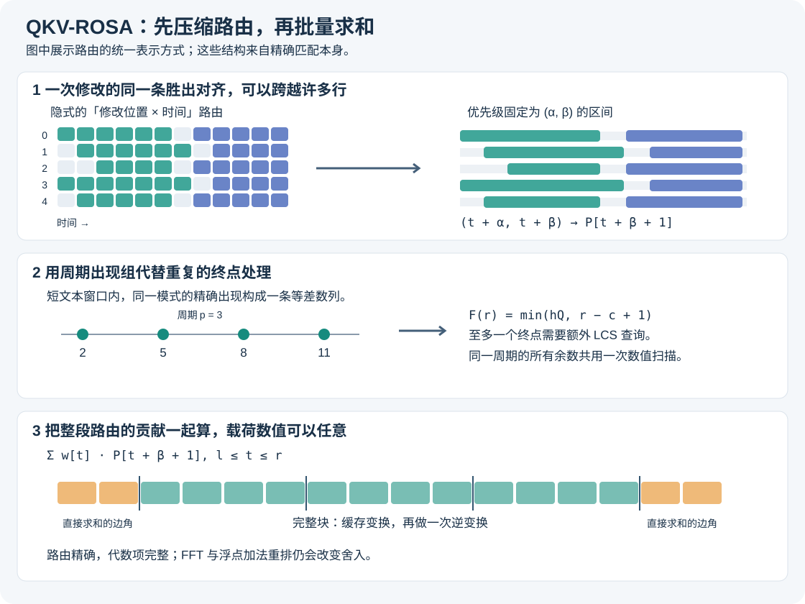
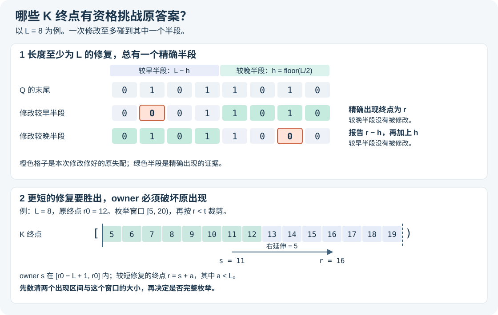
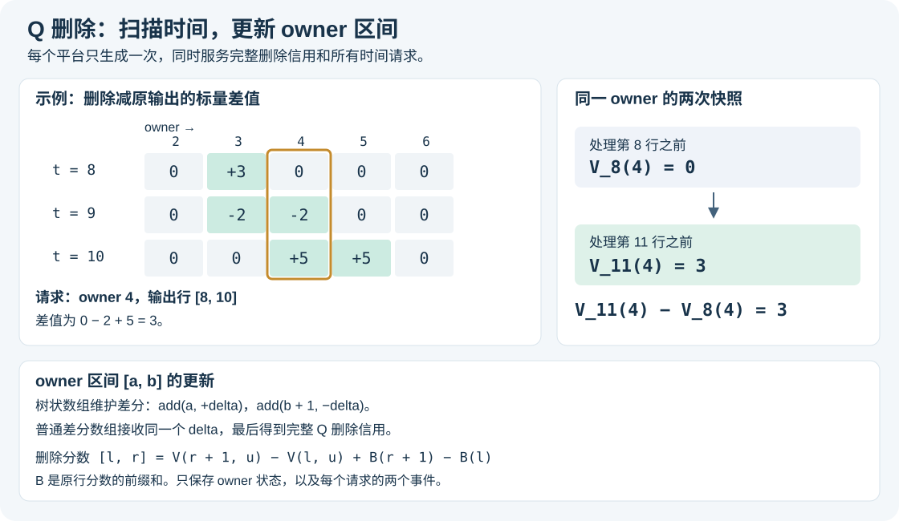

# 不再逐个枚举「修改位置 × 输出行」

[English](ALGORITHM.md) · [完整证明](docs/subquadratic-proof.md) · [删除部分的证明](docs/subquadratic-deletion-proof.md) · [训练接口](docs/native-training.zh-CN.md)

C++ 引擎把许多反事实路由合并成区间、等差数列和少量胜出的匹配，再批量计算它们的数值贡献。真正展开候选前，先数清完整集合的大小；工作本来就少时，也就不必为它建立重型结构。固定 bit 数和数值维数时，最坏时间为 $\widetilde O(n^{7/4})$，空间为 $\widetilde O(n^{4/3})$；波浪号只省略对数因子。

对数和常数都要付钱。复杂度指数更低，不等于某个实际长度上的训练就更快。仓库只保留这一套反向引擎，历史实现仅作为实测对照，不是可切换的后端。这里先讲清楚：二次方究竟是怎样被拆掉的，又有哪些代价被搬到了别处。

## 1. 先把要算的东西写准确

$Q,K$ 各有 $n$ 个符号，每个符号打包了 $b$ 个 bit。输出行 $t$ 只能使用 K 中 $r<t$ 的终点。记

```math
F_t(r)=\operatorname{LCSuffix}(Q[0..t],K[0..r]),
\qquad (L_t,r_t)=\max_{r<t}(F_t(r),r).
```

先比较匹配长度，长度相同再选更晚的终点。长度为零统一记成 $(0,-1)$。非空路由取的是终点**后面**的载荷 $Y(r)=P_{r+1}$；空路由输出 $e_0$。

翻转一个 bit $i$，一阶信用为 $C_i=\sum_t g_t^\top(Y_t^{\operatorname{flip}(i)}-Y_t)$。其中 $g_t$ 是正常反向传播传来的上游梯度。数值向量维数记为 $d$：寻找 bit 邻居与 $b$ 有关，点积与 $d$ 有关，分析时不能把两者混在一起。常用层里它们恰好相等，内部算法不依赖这一点。

QKV-ROSA 的载荷是 $P_s=(2V_s-1)\odot e_1$。V 不参与路由，一次沿原路由的散射就给出 $C^V_{s,j}=-2(2V_{s,j}-1)e_{1,j}\sum_{t:r_t+1=s}g_{t,j}$，总共 $O(nd)$。嵌入参数的梯度也沿这些原路由累加。

这算的是硬组件输出的有限变化在上游梯度上的投影，不是阈值函数的经典导数，也没有重新运行后面的任意损失函数。尤其别把「取最长匹配」误换成「取数值分数最大的匹配」；路由优先级始终由长度和终点决定。

## 2. 四次方容易拆，最后的二次方难在哪里

最朴素的程序有四层工作：尝试 $O(nb)$ 次 bit 修改；每次遍历 $n$ 个输出行；每行尝试 $n$ 个 K 终点；每个候选向前比较最多 $n$ 个符号。匹配部分于是达到 $O(bn^4)$。

先用 DP 记住公共后缀长度，每次修改后的前向降为 $O(n^2)$，总量变成 $O(bn^3)$。再共享没受修改影响的比较，把一次修改描述成它修好的那一个失配，还能去掉一层枚举。

但如果程序仍然对每个修改位置、每个输出行各回答一次「这里会变成什么」，那么即使单次回答只花常数，也已经有二次方个问题。接下来必须改变问题的表示方式：让一次操作同时回答很多格子。

匹配本身提供了两种可以利用的结构：相邻的出现位置受周期约束，同一个胜出的对齐也会持续一段时间。这些性质不要求输入整体是周期串；哪里发生了相应匹配，哪里就能使用。

## 3. 一次翻转：先删掉旧匹配，再补上新匹配

暂时禁止匹配跨过被修改的符号，但不移动任何位置。最好的剩余路由称为 **deletion（删除）**。

翻转后的一个匹配，要么没有经过修改位置，已经包含在删除答案里；要么经过了它。后一种对齐在原串上恰好只有一个失配，且那个失配正好由本次 bit 翻转修复。把其中最好的称为 **repair（修复）**，就有

```math
\operatorname{Flip}=\max(\operatorname{Delete},\operatorname{Repair}).
```

同一位置的所有 bit 共用一个删除项。数值上，先加入「删除减原输出」，再在修复胜出的地方加入「修复减删除」。



设失配中心为 $(u,s)$，满足 $s<u$ 且 $Q_u\oplus K_s=2^j$。它左边能精确延伸 $\ell$ 个符号，右边能延伸 $a$ 个符号。在 $t=u+h$、$0\le h\le a$ 时，修复路由是 $(h+1+\ell,s+h)=(t+\alpha,t+\beta)$，其中 $\alpha=\ell+1-u$、$\beta=s-u$。

一个中心的有效时间是区间；两个同时存活的中心比较大小，只需比较固定的 $(\alpha,\beta)$。所以可以扫描区间端点、维护堆顶，不必逐行重新决定它们的相对优先级。

### 先看看答案里有多少部分真的需要长匹配

暂时把所有匹配长度截成 1，会怎样？匹配变成「找最近的相同符号」，修复变成「找最近的单 bit 邻居」。相同打包符号归一类，单 bit 邻居关系只建一次，再在出现位置列表上做前缀和，就能算出完整的单符号项，暂时连后缀数组都不用建。

设 $D$ 是完整的「删除减原输出」，$R_1$ 是单符号修复项，$R_t$ 是第 $t$ 行完整的修复贡献，则

```math
C=D+R_1+\sum_t(R_t-R_{1,t}).
```

把简单项先算掉，剩下的行未必还有工作。例如，没有任何合法 K 相邻二元组与 `Q[t-1], Q[t]` 的总 bit 距离不超过 1，就不可能通过一次 bit 修改得到长度至少为 2 的匹配。这一行的残差严格为零，与载荷和梯度的数值都无关。另一个检查利用失配 owner 的可能范围：若里面没有合法单 bit 中心，所有修复也都不存在。这种无需求出全答案、却能保证结论的检查，就是这里说的精确证书。

对剩下的行，也只需看两类 K 终点：末符号等于 $Q_t$，或恰好差一个 bit。前者用 LCS 跳到第一个失配，后者的失配就在末尾。其余符号无法由一次修改修好。引擎先数清这些终点；总量 $M$ 不超过 $n\max(1,\lfloor n^{3/4}\rfloor)$，就完整枚举残差，否则交给后面的区间表示。预算控制的是枚举成本，所有候选仍然完整保留。

相邻残差行还能复用 $F_t(r)=1+F_{t-1}(r-1)$，前提是末符号相同。缓存只留 32 行，共 $32n$ 个整数；查不到时仍使用共享的精确后缀索引。若删除涉及的原匹配也都不超过 1，单符号删除本身就已经是完整答案。

残差里面还可以先消掉一批确定相等的项。失配就在末符号时，右延伸为零，Q owner 是 $t$，K owner 就是终点 $s$。要向左再匹配一个字符，必须先有 $Q_{t-1}=K_{s-1}$，且这两个位置都存在。这个比较失败，候选就只有长度 1，它对 Q 的作用已经包含在单符号参考项中；若有更长修复，长度 1 的候选也不可能赢。因此，Q owner $t$ 的残差可以直接写成「完整赢家的分数减最晚单 bit 邻居的分数」，两个空路由分数在求值之前就抵消了。

K 要另证。记 $e$ 为原串末符号相同的最晚终点。若 $L_t\le1$ 且 $s>e$，不论左边延伸多长，完整修复和单符号修复都返回终点 $s$。右延伸为正的另一修复也不可能争这个 owner：它的原匹配终点至多为 $e$，owner 还要更早。所以这份 K 更新可以完全抵消。若 $L_t\ge2$，长度 1 的 K 候选则一定输给删除：owner 在原出现外，原答案保留；在原出现内，原终点比 $s$ 更晚，且仍留下至少一个字符的后缀。此时完整修复项为零，但非零的参考项仍要减去。这些省略都有相等或落败的证明，没有丢掉可能改变残差的赢家。

## 4. 删除：先压缩出现位置，再考虑怎么求和

### Q 删除是一条阶梯

记 $R_t[h]$ 为匹配长度至少为 $h$ 的最晚合法 K 终点。随着 $h$ 增大，它只能往左移动。

删除 Q 位置 $u\le t$，就是把匹配长度上限压到 $t-u$。上限为零则输出空载荷，否则终点是 $R_t[\min(L_t,t-u)]$。因此，$R$ 的一段平台，对应一段输出相同载荷的修改位置。

例如 `Q = xxxxababa`、`K = ababa#bay`，考察 $t=8$。原路由是 $(5,4)$，输出 $P_5$：

| 要求的后缀长度 | 最晚终点 | 载荷 |
|---|---:|---|
| 1、2 | 7 | $P_8$ |
| 3、4、5 | 4 | $P_5$ |

删除 Q 的位置 6 或 7，输出变成 $P_8$；删除位置 8，输出变空。其余位置不改变载荷，其中有的仍会缩短匹配长度。位置 6、7 的贡献可以一次区间更新完成。

当然，先把每个 $h$ 都求出来再压缩，还是慢。取一个末尾长度 $A$，寻找 Q 的这个长度-$A$ 后缀在 K 里的出现。把候选起点按宽度 $A$ 分块，一块连同匹配本身只占至多 $2A-1$ 个字符。在这么短的文本里，同一个模式的出现位置构成一条等差数列；只需求第一、第二、最后一个出现。这是 [Kociumaka 等人的 Internal Pattern Matching 论文](https://arxiv.org/abs/1311.6235)中的 Fact 1.1。

还需要知道这些出现能向左匹配多长。设终点为 $r_0,r_0+p,\ldots,r_1$，Q 在 $t$ 处最长的 $p$ 周期后缀长为 $h_Q$，相应 K 周期后缀共有左边界 $c$。除至多一个终点外，完整匹配长度都是 $F_t(r)=\min(h_Q,r-c+1)$。

为什么只有一个例外？两个串还处于周期段中时，相等的最后一周期会不断向左传播；谁先离开周期段，谁的前一个字符就打破这种相等。只有两段的周期边界恰好同时到达，外面的非周期部分才可能继续相等。这只发生在 $r=c+h_Q-1$，单独做一次精确 LCS 查询即可。

对 $R$ 阶梯而言，一条普通等差段的最后一个终点支配之前的普通终点。留下它和那个例外，每行只需 $O(n/A)$ 个长匹配候选，再处理不到 $A$ 个短长度。

短长度也可以按平台跳。已知 $r=R_t[h]$，那么它会一直保持到 $F_t(r)$：假如更晚的终点能匹配一个更长后缀，它早就该在长度 $h$ 时胜出了。因此下一次直接查 $F_t(r)+1$。最多跳 $A$ 次，此时要么已经结束，要么剩余长度大于 $A$，再用等差出现描述仍只需 $O(n/A)$ 组。一次跳跃处理多长的平台都行，最坏复杂度也没有失去保护。

### K 删除分成左右两边

删除 K 位置 $s$ 后，匹配要么结束在它之前，要么结束在它之后、但长度不能跨过它：

```math
A_t(s)=\max_{r<s}(F_t(r),r),
\qquad H_t(s)=\max_{s\le r<t}(\min(F_t(r),r-s),r).
```

$s$ 向右移动时，$A_t(s)$ 只会变好，$H_t(s)$ 只会变坏，因此两者只交接一次。后缀索引能找到这个交点，平局也按终点处理。随后，同一批出现位置的等差描述给出两侧答案：$H$ 侧是固定终点区间，$A$ 侧是固定或周期变化的终点区间。只有原匹配末尾至多 $A$ 个位置可能需要单点查询；若 $A$ 侧已经胜出，也能继续用区间流覆盖。

不能到数值阶段又把等差段展开。对一个周期，要把**所有余数一起算**。例如周期 3，三个余数对应的载荷在一个块内这样变化：

| 修改位置 | 余数 0 | 余数 1 | 余数 2 |
|---:|---|---|---|
| 3 | $P_3$ | $P_1$ | $P_2$ |
| 4 | $P_3$ | $P_4$ | $P_2$ |
| 5 | $P_3$ | $P_4$ | $P_5$ |

每个余数只切换一次。先算各余数切换前后的点积，再对差值做前缀和。一个宽度 $p$ 的块花 $O(pd)$，总共 $O(n/p)$ 块，合起来是每个周期 $O(nd)$。一个区间开始或结束，只修改一个余数的系数向量，花 $O(d)$。

于是删除总成本为 $\widetilde O((d+1)(nA+n^2/A))$，取 $A\asymp\sqrt n$。每行只保留生成下一个事件所需的状态。事件位置都是 $[0,n)$ 内的整数，而且只向前走，用 owner 桶即可调度；每行复用一个事件槽，入队、出队都是常数操作。不保存「修改位置 × 输出行」矩阵，也不存等差数列的全部成员。实现见 [delete.h](conv_rosa_transformer/csrc/subquadratic/delete.h)，边界和完整证明见[删除附录](docs/subquadratic-deletion-proof.md)。

## 5. Q 修复：用计数决定哪些分支值得展开

固定 Q 位置 $u$ 和 bit $j$，来源是满足 $s<u$ 的 K 位置。右侧上下文越来越长，来源只会消失，不会新增：对这个 owner 而言，因果条件 $s<u$ 从一开始就固定了。

### 一个分支已经丢掉修改点，就不可能再回来

建范围树之前，可以先用前向的同一个后缀自动机跟踪修改后的后缀。在修改位置复制原查询游标，喂入翻转后的符号，之后继续读原 Q。到第 $t$ 行，修改的年龄是 $t-u$；若修改后的最长后缀比年龄更长，它仍跨过 owner，正是修复赢家。若长度已经不超过年龄，就再也没有跨过 owner 的匹配，可以永久删掉这个分支。

假如它以后还能复活，把那条跨过 owner 的匹配删去最后一个字符，K 终点也随之减一，仍满足上一行的严格因果条件。这样会得到上一行的跨 owner 匹配。不断往前退，就与分支死亡那一行的判断矛盾了。

删除项也交给同一个自动机：为 owner $u$ 准备第二个游标，从空串出发，只读取 $Q[u+1..t]$，这正是 Q 删除允许的查询串。同一 owner 的所有 bit 共用它的推进与分数。只要 $L_t>t-u$，这段允许的尾巴就能完整匹配，游标可以直接延伸，不必沿后缀链接回退。一旦 $L_t\le t-u$，删除就与原路由相同，并且以后一直如此，因为原匹配长度每行至多加一，年龄也恰好加一。此时便能丢掉这个屏障游标；还活着的修改分支若需要删除分数，直接用原路由即可，不再单独查询出现位置。

即使一个 owner 的修改分支全死了，它的屏障也要保留到自己失效为止：删除仍可能改变原输出。第 $t$ 行活跃屏障的年龄恰为 $0,\ldots,L_t-1$，数量就是 $L_t$。于是连自动机都还没建，就能先做一次便宜判断：设 $C=2\max(32,2b+2\lceil\log_2(n+1)\rceil)$，如果前向保存的任意 $L_t>C$，这次求值必然装不进预算，立即放弃。否则把屏障游标和修改游标一起计入 $C$ 的上限。

不过，限制活跃数还不够：一个刚复制的长游标，第一次转移就可能沿后缀链接走很远，它没有自己的摊还历史可用。因此还要给**总转移探测数**设 $2nC$ 的上限，原游标、修改游标、删除游标和因果符号检查全部记账。最后一次调用即便越界，最多多走 $O(n)$ 步。任一上限被触发，就丢弃临时和，交给共享删除与后面的轻重表示完成同一计算。

成功时，整个 Q 信用都已经算完：每个 owner 只累加一份「删除减原输出」，最后统一广播到它的所有 bit，再加入各 bit 的「修复减删除」。这样既不用在每次屏障推进时套一层 bit 循环，也不必再扫一遍 Q 删除。内部 `include_deletion=false` 选项仍可只返回修复部分，供已经算好删除的调用者使用。匹配、终点选择和数值工作合计 $O(nC(d+\log n)+nb)$，索引之外占 $O(n+nb+C)$ 空间；失败尝试也受同一成本约束，而且不会提交部分信用。省下的常数来自同一公式的合并求值，最坏工作量则由两个上限封住。

### 活跃分支多时，用计数安排展开量

在同一输出行，不同修改后 Q 后缀的静态出现集合互不相交。若两个不同 owner 的后缀落在同一 K 终点，较晚 owner 所对齐的字符就得同时是原值和翻转值；同一 owner 的不同 bit 也互相矛盾。因此，这些出现集合的总大小至多为 $n$。

选阈值 $\kappa$。每行来源数超过 $\kappa$ 的重分支至多有 $n/(\kappa+1)$ 个，可以逐行直接求值。一个分支第一次只剩至多 $\kappa$ 个静态来源时，把它们枚举出来；之后仅扫描失效时刻，剩余轻尾最多产生 $\kappa$ 段仿射赢家。

这里必须区分静态计数和因果赢家：前者用于不交集合的计数证明，后者必须满足 $s<u$。重部分总工作为 $\widetilde O(n^2/\kappa)$，轻区间至多 $nb\kappa$ 条。活着的 Q 修复一定比 Q 删除长，所以减去删除项只需每个 owner、bit 一条存在区间。代码见 [repair.h](conv_rosa_transformer/csrc/subquadratic/repair.h)。

大来源集合用二维范围树找赢家，小集合则直接求完整包络。具体取上限 $\max(64,\lfloor\sqrt n\rfloor)$；每个 owner、bit 至多扫描这么多来源，总结构成本为 $O(nb\sqrt n)$，固定宽度时仍低于 Q 部分的主项。

连这份小候选表也不必重新排序。来源已经按右侧后缀排名排好；从查询排名向两边走，右 LCP，也就是存活时长，都只会减小。把这两列按时长从大到小归并，同时维护最大的 $(\ell,s)$。每次刷新最大值，记下它；最后倒着读这些记录，就是按时间排列的赢家区间。第 $\kappa+1$ 大时长还顺便给出了原来的轻重分界。平方根阈值决定用哪种数据结构求赢家，$\kappa$ 决定哪些区间需要保留。重行仍直接求和，只保存轻尾，所以记录数依旧不超过 $nb\kappa$。

## 6. K 修复：短的建字典，长的找锚点

### 先找出有资格挑战原答案的终点

在第 $t$ 行，设原匹配长 $L_t=L\ge2$。把 Q 最后的 $L$ 个符号切成两个互不相交的半段。一个长度至少为 $L$ 的修复匹配只改了一个字符，总有一个半段没被修改。因此，每个这样的候选都能从两个精确出现区间之一找到。若找到的是较早的半段，K 终点还要向右平移较晚半段的长度。

长度小于 $L$ 的修复也可能赢吗？只有删除 owner $s$ 已经破坏了原答案时才可能。因此 $s$ 位于原出现的 $[r_t-L+1,r_t]$ 内，而修复终点是 $r=s+h$、$h<L$，必在窗口 $[r_t-L+1,r_t+L)$ 内，再按因果条件裁剪。$L<2$ 时直接使用所有合法终点，照样先计入预算。



先计算两个出现区间和整个窗口的大小，重复项、不合法的未来终点也先算进去。令 $W_n=n\max(1,\lfloor n^{3/4}\rfloor)$、短匹配上限为 $L_{\mathrm{cut}}$，这次 K 求值最多允许 $\min(4W_n,8nbL_{\mathrm{cut}})$ 个报告；第二个上限还把工作量约束在它可能替代的短匹配目录成本之内。这个保守计数够小，就把候选全部报告出来，为每个 owner、bit 保留最佳修复；计数超额，下面的短长表示继续完成同一个求和。不会为了塞进预算而丢掉候选。

这些报告还能复用来算删除。较晚半段的出现集合，已经包含所有原长度至少为半段长的精确路由。只有原匹配里的 owner 可能改变删除答案，它们恰好占据一个长度为 $L$ 的连续区间。把各条报告的起点、终点放进对应的桶：正向最大值处理完全在 owner 左侧的路由，反向最大值处理完全在右侧的路由；跨过 owner 的路由截短后，长度是「终点减 owner」，沿起点方向维护最大终点即可。两次扫描只花「报告数加 $L$」的工作，之后每个 owner 常数时间查表。若所得剩余赢家仍达到半段长度，没报告的短路由就不可能更好；否则补一次精确索引查询。删除和修复共用这个结果。额外的 $L$ 个 owner 也已付过账，因为前面计数的窗口至少有 $L$ 个位置。

### 整段本来就短，何必只问半段？

半段匹配会带来一些另一半根本不对的候选。如果前向保存的最大匹配长度不超过 $C_K=\max(32,2b+2\lceil\log_2(n+1)\rceil)$，就可以把整段一起问清楚。第 $t$ 行取 $m=\max(1,L_t)$：长度至少为 $L_t$ 的修复，最后 $m$ 个符号要么完全相等，要么只差一个 bit。查询原窗口及至多 $mb$ 个单 bit 替换即可；更短的赢家仍由刚才证明的原匹配受损窗口找全。

K 窗口按滚动 64 位指纹分组，替换一个符号后，常数时间就能算出新指纹。还可以先按 Q owner 检查完整符号：翻转后的词在因果 K 前缀里根本没出现，对应查询就不用做。指纹只负责报告终点；每个修复都要比较完整符号，重新确认左右相等段和唯一单 bit 失配。这次直接比较也有严格上限：任意因果位置对 $r<t$ 的原 LCS 都不超过 $L_t\le C_K$，最多比较 $C_K$ 个符号，不必建后缀数组。碰撞只会多报告候选。指纹公式和符号盐值固定，与可开关的随机查询缓存独立，缓存种子不会改变报告集合或是否接受这次求值。

同一份索引还能精确查出现位置的前驱：每个指纹桶按终点排序，从 cutoff 前向左逐个核验，找到最新的真实出现。用平台跳跃求出 $R_t[1..L_t]$；删除 owner $s$ 递增时，左侧最佳路由每次只新加入终点 $s-1$，右侧最佳高度则是满足 $R_t[h]-h\ge s$ 的最大 $h$。这个 $h$ 只会减小，所以一次扫描就能得到全部 $L_t$ 个受影响 owner 的删除路由，无需另建出现索引。

所有查询、原始报告、前驱核验和受损窗口访问，都计入 $W_n$ 的总预算。超额就丢掉临时结果，由完整的双半段或压缩表示继续求值。长度词典最多 $C_K$ 份，成功、失败尝试都满足 $O(nC_K\log n+n(b+d)+W_n(d+C_K+\log n))$。最坏指数没变，整段见证却能省掉只查半段带来的额外候选。实现见 [fingerprint_k.h](conv_rosa_transformer/csrc/subquadratic/fingerprint_k.h)。

### 短匹配

设短匹配上限为 $L$。对一个 K owner 和 bit，至多 $L+1$ 个附近终点能产生经过它的短修复。把相应修改后反向前缀写成虚拟单词：原串区间、修改偏移、bit 掩码和长度。比较两个单词时，借助精确 LCP 跳过没改的部分，只需处理至多两个修改点，不复制也不逐字扫描长度 $L$ 的串。

排序后建压缩 trie，可以把 Q 后缀的排名轴分成 $O(L)$ 段，每段用一个终点代表最佳匹配。若查询在压缩边内部失配，这条边下面的单词与它的匹配长度都相同，取子树内最大的终点就恰好实现平局规则。

把匹配长度超过 $L$ 的部分掩掉，余下的行分数用离线带权偏序查询批量求和：先比长度，长度相同时再比终点。过早、还未满足因果关系的输出行，以及靠近原终点的 owner，另外做精确修正。一个随终点上界递增的字典，在多对数时间里回答这些修正，不再为每个异常格子扫描 $L$ 种年龄。

总时间为 $\widetilde O(nb(d+1)L)$，虚拟单词和数值查询分批处理。实现见 [short_k.h](conv_rosa_transformer/csrc/subquadratic/short_k.h)。若 $b=d=D$，这里确实有 $D^2$ 系数，不能因为只关心 $n$ 的指数就把它省掉。

### 长匹配

取 $L=4B$。一个长度超过 $4B$ 的单失配匹配，至少有一侧的精确部分长达 $2B$，其中必然包含一个与 Q 网格对齐的完整长度-$B$ 块。

对每个 Q 网格块，先求它的后缀数组区间，只枚举区间里真正相等、且满足因果约束的 K 起点。总数仍至多 $O(n^2/B)$，但不用逐一检查所有失败的起点。随后沿对角线延伸到精确段两端，再检查两侧的失配中心。除了要求单 bit XOR，还要求「左延伸 + 1 + 右延伸」的总容量超过短长分界；容量不足的中心不可能产生长修复，可以在存储、排序之前排除。一个有界缓存跳过重复的完整中心二元组，冲突只会增加重复工作，最后仍精确排序去重。这样找全全部长修复，计数器 `k_anchor_probes` 统计实际处理的合法锚点。

一个固定修复区间，与自身 owner 的删除路由比较时，只会在生命期的某个后缀上胜出。原因是能挡住它的精确出现，在模式继续延长时只会消失，不会重新出现。一次二分就能裁去失败的前缀。剩下的区间按固定 $(\alpha,\beta)$ 优先级扫描，得到 $O(n^2/B)$ 段完整赢家。

还有两条直接来自同一规则的证书：没有合法单 bit 失配中心时，所有修复为零；若原串最大的精确匹配长为 $E$，任意单失配匹配都不超过 $2E+1$。它们是引擎内部的精确判断，不是按测试数据名称选择专用内核。

## 7. 区间压缩之后，数值求和也得跟上

一个终点为 $t+\beta$ 的赢家区间贡献 $\sum_{t=l}^r g_t^\top P_{t+\beta+1}$，即任意平移的区间相关。若仍逐行展开，之前的结构优化就白做了。

把时间分成宽度 $W$ 的块。查询拆成两端短边角和中间完整块。边角直接点积；完整块缓存载荷 FFT，每个梯度块只变换一次，在频域把各通道的乘积相加，每个有用块对只做一次逆变换。按时间处理时，每个平移量只留一个累计值，查询用两个带符号快照取差，不保存「块 × 平移」答案表。

$M$ 个请求的平衡成本为 $\widetilde O(dn\sqrt M+n+M)$，空间 $O(nd+M)$。C++ 根据实际查询长度比较块大小，足够短的请求可以全部直接计算。代码见 [correlation.h](conv_rosa_transformer/csrc/subquadratic/correlation.h)。

### Q 的负项可以直接离线扫时间

Q 删除在一行里做的事，是给一段 owner 加上同一个标量。这恰好就是树状数组的「区间加、单点查」。按输出行推进时间；请求 owner $u$ 在 $[l,r]$ 的和，就在处理 $l$ 之前、处理 $r+1$ 之前，各读一次 $u$ 的累计值再相减。还要加上原行分数的前缀和，因为平台更新存的是「删除减原输出」。



平台更新总数是 $O(n^{3/2})$，每个请求只增加两个快照，因此扫描花 $\widetilde O((d+1)n^{3/2}+M)$ 时间、$O(n+M)$ 额外标量空间。同一批平台顺便更新普通差分数组，得到完整的 Q 删除信用；不必再生成一次。至多四行的短请求直接算，额外成本为 $O(M(d+1))$，省去小区间的事件准备。

K 删除仍要收缩周期终点。对每个时间块的 $H$ 行，内部取 $A\asymp\sqrt H$，$M$ 个请求共需 $\widetilde O((d+1)(n^2/\sqrt H+MH))$。引擎按**实际请求数**取 $H\asymp(n^2/M)^{2/3}$，裁到合法范围。最坏 $M=O(n^2/B)$ 时才是 $H\asymp B^{2/3}$；区间少时能用更大的块。空间里只有一个 owner 前缀向量和每个请求的两个快照。

## 8. 最后核一次账

下表省略对数，但保留 bit 数和数值维数。

| 部分 | 时间 |
|---|---:|
| Q/K 共用删除 | $(d+1)n^{3/2}$ |
| Q 重行 | $(d+1)n^2/\kappa$ |
| 有界活跃游标尝试，$C=O(b+\log n)$ | $nC(d+\log n)+nb$ |
| Q 小来源集合包络 | $nb\sqrt n$ |
| Q 轻区间及正项 | $nb\kappa+d n\sqrt{nb\kappa}$ |
| 共用 Q 删除及 $M\le nb$ 个负项请求 | 扫描 $(d+1)n^{3/2}+M$；直接算的短请求另计 $Md$ |
| 短 K 修复 | $nb(d+1)B$ |
| 长 K 锚点与包络 | $n^2/B$ |
| 长 K 正项 | $d n^2/\sqrt B$ |
| 长 K 删除负项 | $(d+1)n^2/B^{1/3}$ |

固定 $b,d$，取 $\kappa\asymp n^{1/3}$、$B\asymp n^{3/4}$，短序列做适当取整和裁剪。压缩表示的 Q 部分为 $\widetilde O(n^{5/3})$，K 决定整体的 $\widetilde O(n^{7/4})$。当 $b\le n$ 时，也可以取 $\kappa\asymp(n/b)^{1/3}$、$B\asymp(n/b)^{3/4}$；若宽度随长度增长，新增的 $nb\sqrt n$ 小集合扫描项仍须单独保留。

单符号参考项花 $\widetilde O(nb(d+1))$。按候选数量求值的成本为 $\widetilde O((d+1)M+nb)$：完整残差行允许 $M\le W_n$，双半段 K 求值允许 $M\le\min(4W_n,8nbL_{\mathrm{cut}})$，两种报告预算均为 $O(n^{7/4})$。计数超额时尚未展开候选，只保留区间描述，因此最坏指数不变。双半段 K 求值逐行处理报告；残差缓存的 32 行也只额外占 $O(n)$ 空间。

保留的记录占 $\widetilde O(n+nd+nb+nb\kappa+n^2/B)$，固定维数时是 $\widetilde O(n^{4/3})$。完整引擎不能称为线性空间；接近线性的是删除、相关等子过程在请求输出之外的工作区。[完整证明](docs/subquadratic-proof.md)给出了各阶段覆盖性和参数核算。

原生接口的 workspace 计数器给出的是 **buffer capacity estimate（缓冲区容量估算）**，按被跟踪数组的预留容量与元素大小计算。它与上面的渐近空间证明是两个口径，并不是进程 RSS 或整个分配器、运行时真实峰值的测量。

## 9. C++ 里怎样少付一些常数

[index.h](conv_rosa_transformer/csrc/subquadratic/index.h) 直接复用前向保存的路由。符号离散化、两个方向的后缀数组、两个波列矩阵，都等到第一次真正需要时才构建。离散化比较完整 `uint64_t` 值，再加入独立哨兵；bit 63 和 `UINT64_MAX` 都是普通合法符号。词典的哈希探测次数有固定上限，超出后做有序的精确查找，碰撞不会把最坏复杂度拖成二次方。

每次索引查询也先尝试一个便宜证书。所求边界位置本身匹配，就已经是最近的合法出现。比较两个同符号段时，段长不同便能确定 LCP；段长相同才推进到下一边界。最多检查两个边界，仍不能确定就使用后缀 RMQ。因此可以常数时间跳过很长的连续段，又不会在交替串上偷偷退化成逐字扫描。可选的查询缓存也等这些证书都失败后才分配。

波列矩阵负责出现位置前驱查询。对「终点小于某上界的最佳匹配」，另一个波列矩阵在允许的反向 K 后缀中找查询的字典序前驱、后继；最大 LCP 必在这两个邻居上取得，随后一次出现查询解决最晚终点。这样就不必再二分匹配长度。

删除的每行生成器只保留常数状态，每条流在 owner 桶中至多有一个待处理事件。周期缓冲按需分配，$R$ 两端终点相等就证明中间是一整段平台。两个连续出现还能证明一个周期段；一次精确 LCE 把它延伸过多个发现块，新相位若能在段内出现，就会反推出前两个出现之间还有一个出现，矛盾。因此可以整段跳过。相邻、终点周期公式相同的数值区间继续合并，兼容的固定尾巴也能吸收。发现时的分块边界不必变成求和时的事件边界。

这些都是同一通用算法的实现选择，不需要为一串特殊输入维护不同内核。

数值提升以第一个可达 payload `P[1]` 为参照；`P[0]` 永远不会被路由读取。不可达位置也不参与通道变化幅度的统计，避免在所有实际输出相同的时候凭空制造通道抽样噪声。

## 10. 一阶、对角信任项、联合 bit 与随机化

同一结构引擎也支持固定的对角二次行分数 $\phi_t(y)=g_t^\top(y-Y_t)+\frac12\sum_c h_{t,c}(y_c-Y_{t,c})^2$。非空载荷都是带符号的 $e_1$ 顶点，逐坐标平方固定，因此二次项能改写成调整后的线性系数，再加一个空载荷指示通道。实现先做中心化，减少近似相等大数相减。

[训练入口](conv_rosa_transformer/csrc/training_impl.h)为 Q/K 提供信任对角，V 保持原一阶信用，再加入有预算限制的联合 bit 修正。选了 $J$ 对 bit，对修改后的字符串做普通前向回放，另花 $\widetilde O(Jn(d+1))$，不必建立删除或修复索引；若 $J$ 随长度增长，这一项必须保留。外部模型仍然只做一次前向、一次损失计算、一次反向，联合角点是在组件内部求值。这个对角是明确选定的局部训练模型，不是从一次上游梯度中恢复出了任意下游 Hessian；含义见[训练教程](docs/native-training.zh-CN.md)。

还有一处直接省前缀和的地方：若所有有贡献的行都满足 $L_t\le1$，单符号参考路由就是实际原路由。对输出差 $\delta$ 固定的 K 区间，二次分数之和直接写成 $(\sum g_t)^\top\delta+\tfrac12(\sum h_t)^\top\delta^2$。只需两组 $d$ 维前缀和，不用再按原载荷正负号拆曲率桶。这个条件会同时检查梯度和曲率，$g_t=0$ 但曲率非零的行也算在内。

随机化有两种不同的约定：

| 模式 | 随机性改变什么 | 哪些部分仍完整计算 |
|---|---|---|
| 精确加速 | 有界缓存里完整查询键的位置 | 全部结构查询与数值贡献 |
| 近似反向 | 完整残差行，或显式选择的数值通道 | 硬前向，以及每个已求值贡献的路由决策 |

精确缓存比较完整 `(row, length, cutoff)` 键。冲突只会替换缓存或触发精确重算，不会靠指纹相等决定路由。短窗口发现复用率低时，会跳过大部分探测，过一段再试。缓存不改变数值求和顺序；随机种子可以改变耗时，但并不保证每种输入都更快。

行采样保留完整删除和一符号修复控制项，再采样剩余的**完整行修正**；该行的路由最大值全部确定之后，才乘逆概率权重。先采样候选再取最大值会改变目标。可证明残差为零的行提前移除。显式设置正的通道预算时，当前实现改为在固定大小的带权通道样本上运行完整结构计算，常数与空载荷项单独处理；它与残差行采样是近似模式里的两个分支，不会默认叠加两层采样。

条件于当前输入，它们在实数算术下以所选信用为目标，但没有统一相对误差或训练降损保证。必要时，选中的联合角点会用完整内部求值恢复。具体选项和预算见[训练接口](docs/native-training.zh-CN.md)。

## 11. 「精确」需要分清三层

1. **路由精确。** 字符比较、因果边界、最长与最晚平局均精确；随机缓存不改变它们。
2. **代数完整。** 完整模式包含有限信用公式的全部项，区间聚合和卷积是精确算术中的恒等改写。
3. **浮点求值。** C++ 使用 binary64 和 FFT。分组改变加法顺序，FFT 也会产生舍入；完整模式不承诺与原引擎旧求和顺序逐 bit 相等。即便精确累加已经舍入的卷积系数，也不能撤销更早的舍入。

在本引擎内部开关精确缓存，数值运算顺序保持相同，这是另一种更强的逐 bit 比较。近似行采样、通道采样则还多了一层统计误差，应单独测量。

仓库里的独立检查用真正修改后的字符串和终点枚举作预期答案：

| 测试 | 重点 |
|---|---|
| [subquadratic_delete.cpp](tests/cpp/subquadratic_delete.cpp) | 二进制穷举、等差段完整覆盖与长度、任意 owner/时间区间、空与乱序行集、bit 63、独立维数、缓存逐 bit 一致 |
| [subquadratic_repair.cpp](tests/cpp/subquadratic_repair.cpp) | Q 修复与长 K 包络对照真实翻转 |
| [subquadratic_q_frontier.cpp](tests/cpp/subquadratic_q_frontier.cpp) | 完整 Q 与仅修复信用、永久死亡、两种工作上限与失败时不提交结果 |
| [subquadratic_short.cpp](tests/cpp/subquadratic_short.cpp) | 虚拟比较、压缩 trie、因果字典、带权偏序、短修复与完整 K 见证 |
| [subquadratic_indexed_row.cpp](tests/cpp/subquadratic_indexed_row.cpp) | 完整行修复、单符号参考项、精确抵消与对角行分数 |
| [subquadratic_fingerprint_k.cpp](tests/cpp/subquadratic_fingerprint_k.cpp) | 整段见证覆盖、朴素 K 信用、强制指纹碰撞、放置种子一致性与预算拒绝 |
| [subquadratic_correlation.cpp](tests/cpp/subquadratic_correlation.cpp) | 任意平移区间及数值收缩 |
| [test_subquadratic_engine.py](tests/test_subquadratic_engine.py) | 原生接口和训练选项集成 |

例如，删除检查不需要 Python 或 PyTorch：

```bash
c++ -O2 -std=c++17 tests/cpp/subquadratic_delete.cpp -o /tmp/rosa-delete-test
/tmp/rosa-delete-test
```

这是 CPU C++17 实现。索引构建、偏序查询、数值批处理都有有限长度上的实际成本。选择信用阶数和近似预算时，应一起看完整反向和训练步耗时、内存，以及所选近似的误差，而不能只比较公式里的指数。
