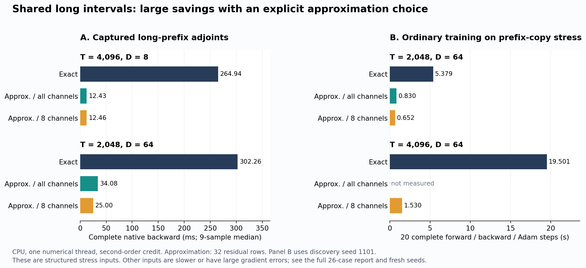

# Fast Exact Backpropagation for QKV-ROSA

One C++ implementation for hard QKV-ROSA matching, exact single-bit
counterfactual credit, and ordinary model training. It preserves untruncated
longest-match/latest-endpoint routing. Bit credit is a finite hard-output
change projected onto an upstream vector, not the ordinary derivative of a
threshold.

**Learn the algorithm:** [English](ALGORITHM.md) · [中文推导](ALGORITHM.zh-CN.md).
Both start from the literal O(DT⁴) all-flip brute force and derive the shared
work, invariants and costs that remain. Further guides cover
[native training](docs/native-training.md) / [中文](docs/native-training.zh-CN.md),
[exact randomization](docs/exact-randomized.md) / [中文](docs/exact-randomized.zh-CN.md),
and [forward acceleration](docs/forward.md) / [中文](docs/forward.zh-CN.md).

## Use it as an ordinary model component

```python
import torch
from conv_rosa_transformer.rosa_layer import NBitQKVRosa

layer = NBitQKVRosa(
    channels=128,
    n_bits=8,
    credit_order="second",  # "first" selects original singleton credit
    randomized=True,       # exact search acceleration; enabled by default
)
optimizer = torch.optim.AdamW(layer.parameters(), lr=1e-3)
x = torch.randn(2, 32, 128)
target = torch.randn_like(x)

optimizer.zero_grad(set_to_none=True)
y = layer(x)
loss = (y - target).square().mean()
loss.backward()
optimizer.step()
```

`first` uses the original complete single-bit credit. `second` adds a
component-defined diagonal trust penalty and at most one independent joint-bit
block per stream by default. It needs no supplied Hessian, whitening,
additional full-model evaluation or special optimizer. Each selected joint
corner does perform one internal matcher replay, included in the measurements.
The diagonal is a local geometric model; it does not recover an arbitrary
network's true curvature or guarantee loss reduction.

Packing, matching, metric preparation, proposals, singleton credits, joint
replays, logit mapping and embedding gradients run in batched C++. The Torch
adapter makes one native forward call and one native backward call, with no
Python loop over batch/group streams. Q/K/V/O parameter names and shapes are
preserved. Both modes use the same hard evaluation.

`randomized=True` is the default exact search accelerator. Full-key checks
retain every legal neighbor; a cost planner can keep direct queries when its
index would cost more. This option does not sample gradients. The default
`backward_mode="exact"` retains the complete finite-credit result.

For explicit aggressive acceleration, set `backward_mode="approximate"`.
It shares long numerical contractions when profitable and otherwise samples
complete residual rows after exact deletion/control work. V and embedding
gradients stay complete; chosen joint corners use complete matcher evaluations.
The [new derivation](docs/randomized-backward.md) / [中文](docs/randomized-backward.zh-CN.md)
explains the estimator, its certificates and the floating-point boundary.

## Current backward costs

These are absolute **complete native backward** costs: public-call validation
and allocation, metric/proposals, all credit computation, internal joint
replays, logit mapping, and V/embedding gradients. Dense model projections,
the task loss and the optimizer are outside this table. All rows use the
diagonal second-order rule and exact randomized search. Timings are medians
of nine interleaved samples on one pinned CPU core, with numerical-library
threads limited to one.

Approximate mode uses 32 residual rows. **A0** keeps all spectral channels;
**A8** explicitly samples eight. Zero means all channels, not zero computation.

| Input | T / D | B / G | Exact backward | A0 backward | A8 backward |
|---|---:|---:|---:|---:|---:|
| Random words | 128 / 8 | 1 / 1 | 0.252 ms | 0.291 ms | 0.287 ms |
| Random words | 8,192 / 16 | 1 / 1 | 10.916 ms | 12.932 ms | 13.032 ms |
| Wide words with one-bit neighbors | 8,192 / 64 | 1 / 1 | 25.079 ms | 25.236 ms | 25.820 ms |
| Last-row-only periodic adjoint | 4,096 / 4 | 1 / 1 | 4.093 ms | 2.948 ms | 2.852 ms |
| Captured context-recall adjoint | 512 / 2 | 4 / 4 | 17.044 ms | 13.509 ms | 13.503 ms |
| Captured long-prefix adjoint | 4,096 / 8 | 1 / 2 | 264.940 ms | 12.432 ms | 12.456 ms |
| Captured long-prefix adjoint | 2,048 / 64 | 1 / 2 | 302.257 ms | 34.084 ms | 25.005 ms |

Long shared match intervals benefit most: A0 is **21.31×** faster on the D8
prefix capture; A8 is **12.09×** faster on the D64 capture. Approximation is
slower on several other inputs. At 32 rows, raw Q/K gradient errors exceed
100% on some random and context inputs; those are retained as failures, not
described as accurate approximations. A8 also has a severe first-order
cancellation counterexample. The exact default keeps the complete answer.

The [full report](docs/randomized-results.md) / [中文实测](docs/randomized-results.zh-CN.md)
contains all **26 cases, both credit orders**, errors for Q alone as well as
shared Q/K parameters and preceding-layer inputs, negative results, and the
[source-hashed samples](benchmarks/results/random_final_native.json).
Older complete-layer and isolated-core timings remain in the
[historical native report](docs/native-results.md) and
[exact-search report](docs/exact-randomized.md); their scopes differ.

### Complete ordinary training steps

On a deliberately structured, fresh-data prefix-copy stress task, the final
implementation also saves time outside a standalone kernel. Each run below
has 20 ordinary forward/backward/Adam updates, B1/G2/D64, second-order credit,
and discovery seed 1101. Times include projections, loss and optimizer.

| Sequence length | Exact: 20 updates | A0: 20 updates | A8: 20 updates | Exact / A8 |
|---:|---:|---:|---:|---:|
| 2,048 | 5.379 s | 0.830 s | 0.652 s | 8.25× |
| 4,096 | 19.501 s | not measured | 1.530 s | 12.74× |



At length 4096, all 20 hard forwards and batch losses match exact; final
held-out loss is 15.54690 for both, while Q/K parameters differ from update
one. This is a short structural stress experiment, not a general convergence
claim. Two fresh seeds are reported too: on seed 2402, A8 is slower and has
worse loss than A0. The unretuned first-order configuration increases loss
for every method. The report preserves all 15 final runs and 300 updates.

To opt into the conservative approximate configuration:

```python
layer = NBitQKVRosa(
    channels=128, n_bits=8, credit_order="second",
    backward_mode="approximate",
    approximation_rows=32,
    approximation_channels=0,  # all spectral channels
)
# A positive channel budget, e.g. 8, is a separate advanced tradeoff.
```

### Forward matching

The completed forward scan uses a causal suffix automaton and a lazy
latest-endpoint index, with O(T) auxiliary memory. At T8192, native route-only
matching takes 0.367 ms for all-equal words, 1.583 ms for random 8-bit words,
and 0.475 ms for wide words with planted historical matches. Across its
21-case saved matrix, public `matching_stats` is 1.48–9.26× faster than the
preceding forward. The general bound remains O(T log T), assuming constant
average full-key hash probe cost. Payload gathering and neural projections
are outside these route-only times. The unchanged measured forward header
and historical whole-library scope are documented in the
[forward report](docs/forward.md).

### Small comparison with the original upstream backward

The repository's earlier paired experiment against original commit
[`32e90e2`](https://github.com/xiaoiecc/qkv-rosa-fast-exact-backward/commit/32e90e272929942a764d696b639409b783c61bb1)
is retained below. These are historical first-order public stream-call
measurements, not freshly measured native-layer results from this patch.

| Input | T / D | Original | Published unified backward | Speedup |
|---|---:|---:|---:|---:|
| Random 16-bit | 4,096 / 16 | 61.020 ms | 6.972 ms | 8.75× |
| Random 8-bit | 1,024 / 8 | 57.685 ms | 2.143 ms | 26.92× |
| Shadow, two payloads | 1,024 / 1 | 3749.891 ms | 4.098 ms | 915.00× |

All original samples, tolerances and build details remain in the
[benchmark history](benchmarks/README.md#original-upstream-comparison).

## Earlier training evidence and numerical migration

The preceding integration study remains available: better
credit modeling does not imply better results on every task. In three fresh
100-update MSE-retrieval runs, native integration reduces average training
loss from 0.068074 to 0.009362 while **held-out loss worsens from 0.278856 to
0.528012** against the frozen prior Python implementation. Fresh-data CE also
has slightly worse loss, with both at 100% accuracy. These negative results
are preserved.

The C++ mapping and reductions use binary64 intermediates, where the old Torch
path performed some float32 operations. A targeted trace finds an initial
maximum gradient difference of 1.49e-8, amplified by Adam near zero; hard bits
first diverge after five updates at logits near 1e-13. Thus old Python training
trajectories are not promised bitwise compatibility. Native randomization
on/off itself remains bitwise identical through every measured update.
The [results report](docs/native-results.md#4-ordinary-training-an-exact-toggle-and-a-numerical-migration-regression)
contains every seed, timing, negative result and the first-divergence trace.

The roughly 17× speedup in tiny, many-stream toy training mainly removes
Python orchestration. It is not a randomization speed claim and does not
establish larger-model accuracy or throughput.

## Standalone C++

The public [C ABI](conv_rosa_transformer/csrc/training.h) uses caller-owned
contiguous arrays and has no Torch headers. [API details](docs/native-api.md)
cover layouts, options, status codes and diagnostics.

```bash
c++ -O3 -std=c++17 -ffp-contract=off examples/native_training.cpp \
    conv_rosa_transformer/csrc/unified_core.cpp -o /tmp/rosa-native
/tmp/rosa-native
/tmp/rosa-native --first
```

Initialize options with `rosa_training_defaults`. To select original first
order from those second-order defaults, set `credit_order=1`, `joint_pairs=0`
and `trust_diagonal=0.0`; `randomized` is independent. The Python constructor
derives the related defaults automatically.

## Install, inspect and verify

```bash
python -m pip install -r requirements.txt
python tests/run.py --exhaustive
```

The CPU core is source-hashed and compiled on first use. The measured build
uses C++17 and `-ffp-contract=off`, without fast-math. CUDA tensors currently
incur transfers and synchronization; this is not a native GPU implementation.
Linux/GCC is the measured environment. The existing Windows developer-shell
build helper is retained, but the new native training path was not measured
there.

The [test guide](tests/README.md) describes independent all-flip oracles,
structural checks, bit63, floating cancellation, ordinary optimizers,
checkpoint, GradScaler and RNG parity. The [research scripts](research/README.md)
reproduce the finite training study. Runtime code does not import research.

| Entry | Role |
|---|---|
| [Algorithm guide](ALGORITHM.md), [中文](ALGORITHM.zh-CN.md) | Derivation from the literal all-flip algorithm |
| [training.h](conv_rosa_transformer/csrc/training.h) / [training_impl.h](conv_rosa_transformer/csrc/training_impl.h) | Standalone batched native training |
| [rosa_layer.py](conv_rosa_transformer/rosa_layer.py) / [native_training.py](conv_rosa_transformer/native_training.py) | Thin Torch / NumPy adapters |
| [rosa_core.py](conv_rosa_transformer/rosa_core.py) | Validated stream credits and source-hashed build |
| [rosa_reference.py](conv_rosa_transformer/rosa_reference.py) | Independent hard-forward and all-flip oracle |
| [csrc](conv_rosa_transformer/csrc/) | Shared forward, deletion, repair, scores and exact-event accumulation |
| [Conv∥ROSA package](conv_rosa_transformer/README.md) | Model integration and historical multiplication demo |

The stream API retains `exact_stream_bit_credits` with five returns and
`credits_numpy` with an additional work-counter dictionary. Supported words
have 1≤D≤64, T<2²⁸, T·D≤2³¹−1 and must fit available memory. Empty streams
are supported. Full-key route comparisons are exact; floating sums still
round under documented conditions. Sparse roots use O(UQ+R) storage, while
complete output gradients still require O(TD). Some continuation and periodic
deletion work remains quadratic; this is not a general near-linear backward.

The second-order metric/proposals depend on incoming g, so separately
backpropagating distinct losses need not equal a single backward on their sum.
Positive scaling of the same loss is supported; double autograd is explicitly
unsupported. These are surrogate-credit contracts, documented in the
[integration guide](docs/native-training.md).

## Architecture attribution and license

The QKV-ROSA forward architecture comes from **Bo Peng (BlinkDL)** and the
[RWKV-LM RWKV-v8 examples](https://github.com/BlinkDL/RWKV-LM/tree/main/RWKV-v8),
including `samx_qkv_slow` / `ROSA_QKV_B_1bit` in
[`251024_rosaQKV_run.py`](https://github.com/BlinkDL/RWKV-LM/blob/main/RWKV-v8/251024_rosaQKV_run.py).
This independent implementation supports n-bit hard symbols, a learned empty
payload and exact single-bit counterfactual backward. Exact block indexing
builds on the multi-index Hamming-search idea, with attribution in its guide.

Copyright 2026 xiaoiecc. Licensed under the [MIT License](LICENSE).
