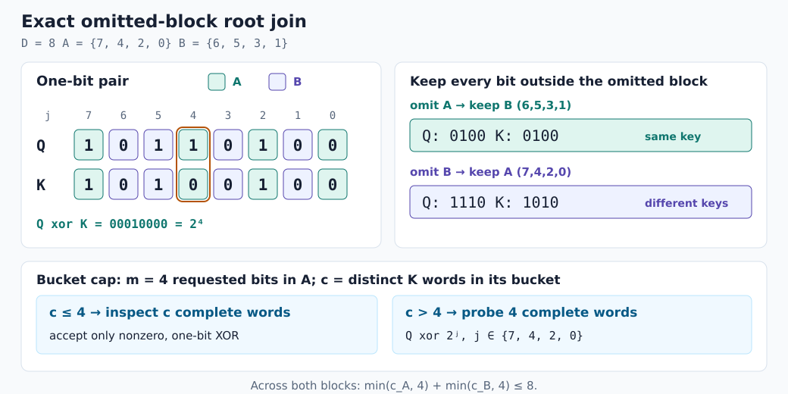

# Randomization without gradient noise: exact covering joins and sparse roots

[中文](exact-randomized.zh-CN.md) · [Ordinary training integration](native-training.md)

The selected randomized scheme is an **exact random covering join**. Randomness
changes search layout and screens distant, irrelevant word pairs. Every possible
one-bit repair is still found. No gradient coordinates are dropped, no fingerprint
is accepted as equality, and the selected joint block is unchanged.

`randomized=True` enables this exact acceleration. `False` enumerates requested
bit flips and looks up complete words. Both modes share sparse root storage,
matching states, and numerical accumulation. With other inputs and seeds fixed,
the switch changes work, not the first-order or diagonal/joint credit definition.

## 1. Could better sampling probabilities be enough?

The previous estimator writes $`C_{s,j}=B_s+R_{s,j}`$, retains the common deletion
term B exactly, and samples complete repair lanes. This avoids sampling inside
the K-candidate maximum, but its variance is substantial.

We first gave importance sampling an unusually generous oracle: suppose the full
residual energy $`E_j`$ of every lane were known for free. With expected budget
$`b`$, optimal marginal probabilities solve

```math
\min_{0\lt p_j\le1,\;\sum p_j\le b}
\sum_j E_j\left(\frac1{p_j}-1\right),
\qquad
p_j=\min\left(1,\frac{\sqrt{E_j}}{\lambda}\right).
```

The diagnostic itself is not free: it computes all exact credits first, then
evaluates this optimistic ceiling.

| Input | Budget | Uniform relative RMS | Oracle-importance relative RMS |
|---|---:|---:|---:|
| Random T=8,192, D=8 | 4 | 84.716% | 84.712% |
| Random T=8,192, D=16 | 8 | 70.412% | 70.274% |
| 64-bit slots, 8-bit vocabulary | 4 | 34.166% | 34.165% |

Lane energies are already nearly uniform in these cases. Even adding the exact
per-owner mean across all lanes as a free control variate leaves roughly 66–67%
relative RMS in the first two cases. This rejects the hope that clever inclusion
weights alone make these states nearly lossless; it does not rule out every
approximate randomized method. Definitions and values are retained in
[native_random_noise_ceiling.json](../research/results/native_random_noise_ceiling.json).

The public acceleration switch therefore selects exact search, not lane sampling.

## 2. What the old root queries waste

Equal Q words already share root queries, but every distinct Q word x still asks,
for every requested bit j,

```math
x\mathbin{\mathrm{xor}}2^j\in K\;?
```

This requires $`U_QD`$ complete-word lookups for $`U_Q`$ distinct Q words. Most
answers are absent in a sparse 64-bit vocabulary. The old dense table also stores
those absent answers, and each subsequent Q occurrence scans many empty slots.

Two related problems remain: ask fewer unproductive questions, and avoid storing
and rereading empty answers.

## 3. Why random blocks cannot miss a one-bit neighbor

Randomly permute the D bits and partition them into p balanced, disjoint blocks.
The implementation considers only p=2 or p=4. For each block b, index K words by
**all bits outside b**, using complete projected keys.

If two words differ only at a bit in b, they agree everywhere outside b. They
must share b's bucket. Every other block's projection retains the differing bit,
so the pair appears in exactly one bucket. Every one-bit neighbor is covered.

Each enumerated member still undergoes full-word XOR verification. Only a nonzero
power-of-two difference is accepted. Complete projected-key equality resolves
hash collisions; complete XOR rejects distant bucket members. Correctness does
not depend on collisions being unlikely.



The differing bit 4 belongs to A. Omitting A leaves identical keys `0100`;
omitting B retains the difference (`1110` versus `1010`). This small example
illustrates coverage. The planner can still choose direct lookups when indexes
would not repay their build cost.

For fixed p and a uniformly random partition, two words at Hamming distance h>0
share some bucket only when all h differences fall in one block. With block
sizes $`m_b`$,

```math
\Pr[\text{some shared bucket}]
=\frac{\sum_b {m_b\choose h}}{{D\choose h}}.
```

The probability is exactly 1 for h=1. With equal block sizes and h≥2, it is at
most $`p^{1-h}`$. Distant pairs tend to separate while useful one-bit neighbors
are retained. This formula assumes fixed p; a data-dependent planner does not
make the selected p's conditional distribution uniform.

## 4. Dense buckets have a deterministic work cap

Let a block contain m requested flip bits and its bucket contain c distinct K
words:

- If c≤m, enumerate bucket members and verify full XOR.
- If c>m, enumerate those m flips and use complete-word lookups.

The candidate work for one Q word is bounded by

```math
\sum_b\min(c_b,m_b)\le\sum_b m_b\le D.
```

This bound holds for every input and partition seed. Correlated codes or an
unfortunate partition cannot cause unbounded bucket scans. These are per-bucket
choices within one covering algorithm, not dispatch on benchmark family names.

Building indexes also costs time. A small planner uses $`U_Q`$, distinct K count
$`U_K`$, K's varying bits, and the fraction of exact Q/K word matches to estimate
direct queries and two-/four-block covering work. It charges construction,
queries, member checks, and fixed setup. If predicted savings are insufficient,
it uses direct queries. This model is only a performance heuristic; correctness
does not depend on it. Dense D=8, some dense D=16, and tiny inputs often stay direct.

## 5. Store only the answers that exist

Each Q class stores a 64-bit neighbor mask, a CSR offset, and packed int32 root
targets in ascending bit order. Repair birth order therefore stays identical to
the old algorithm.

A K word first appearing at or after the last occurrence of this Q class can
never be causal; that root is not stored. The scan separately checks causality
at the current time t.

Each query temporarily uses an uninitialized `targets[64]`, reading only entries
marked by its written mask. There is no hidden D-sized clearing pass, per-class
small container, or sorting step.

Let R count stored causal root neighbors. Root storage drops from $`O(U_QD)`$
to $`O(U_Q+R)`$, or $`O(T+U_Q+R)`$ including position-to-class mapping. Root visits
during the scan change from the $`TD`$ bound to

```math
\sum_{t=0}^{T-1}\deg(\mathrm{class}(Q[t])).
```

These are improvements to root preparation and repair births. Output tensors
still have $`TD`$ entries, and the full backward retains deletion, live-repair,
and numerical-corridor costs. This is not a linear bound for the whole algorithm.
Reserved vector capacity and other indexes also consume memory; R is not peak RSS.

The old `root_repair_entries` counter retains its logical
$`U_Q\times\text{requested bits}`$ meaning for compatibility. Diagnostics report
`stored_root_entries` separately rather than silently changing that contract.

## 6. Complete backward measurements

The baseline is the previous delivery, commit `f6d7c4b`. Both current off/on modes
use sparse roots; on additionally enables the covering join. Each row has 11
alternating measurements on one CPU core with fixed input and preallocated
output buffers. Timers include all native indexing and credit contraction;
Python validation, projections, optimizers, compilation, and warmup are excluded.

| Input | Previous complete native backward | Current off | Current on | Previous / on |
|---|---:|---:|---:|---:|
| Random T=8,192, D=32 | 11.624 ms | 11.351 ms | **7.121 ms** | **1.63×** |
| 64-bit words, planted one-bit repairs, T=8,192 | 21.824 ms | 20.094 ms | **12.033 ms** | **1.81×** |
| Same, diagonal costs | 18.437 ms | 16.659 ms | **10.435 ms** | **1.77×** |
| Random T=2,048, D=16 | 1.756 ms | 1.605 ms | 1.518 ms | 1.16× |
| Random T=8,192, D=8 | 26.656 ms | 26.835 ms | 23.974 ms | 1.11× |
| 64-bit slots, 8-bit vocabulary, T=8,192 | 44.476 ms | 39.129 ms | 43.731 ms | 1.02× |
| Periodic T=4,096, D=4 | 47.999 ms | 45.635 ms | 49.376 ms | **0.97×** |

The full 15-row previous/on range is **0.972–1.814×**, including a regression.
Timing changes in D=8 or periodic rows with unchanged work must not be called
algorithmic gains. Some current off/on ratios also fall below one; all raw
samples are retained.

For the planted 64-bit case, SAM preparation falls from **7.960 ms** off to
**1.713 ms** on. The 524,288 direct root lookups become 16,384 bucket queries and
2,048 member checks. Only 2,048 causal root targets are stored. All outputs remain
bitwise equal to the baseline.

Full matrix, seeds, work counts, and loaded-binary hashes:
[exact_randomized.json](../benchmarks/results/exact_randomized.json).
The tests gained four-block and sampled-trajectory cases after measurement;
production C++ did not change. The exact measured C++ probe is retained, with the
test-module versus production-source hash distinction documented in
[exact_randomized_provenance.json](../benchmarks/results/exact_randomized_provenance.json).
These are complete **credit-engine** times, not model training throughput;
ordinary component measurements appear in the main report.

## 7. Validation and reproduction

`tests/test_randomized_join.py` compares all Q/K/V credits, lengths, routes, and
the existing 23 structural counters across the switch. Cases include empty
streams, bit 63, multiple widths, correlated codes, direct/two-/four-block plans,
and several seeds. Existing repair-sampling expectation/variance, forced-lane,
and hash-layout checks continue to pass. Formal timings also compare bitwise
against the frozen previous engine and verify unchanged sources during the run.

```bash
python -m unittest tests.test_randomized_join tests.test_repair_sampling tests.test_backward_hash
python benchmarks/exact_randomized.py --baseline-root /path/to/frozen-previous-source --cpu 0
```

The external baseline is research-only and never a production backend. The old
probabilistic lane-sampling interface retains its explicit error contract;
`randomized=True` does not enable it.

## Relationship to prior work

Exact Hamming search with multiple substring indexes is established research;
see [Norouzi, Punjani, and Fleet: Multi-Index Hashing](https://arxiv.org/abs/1307.2982).
Random layouts that preserve all required near neighbors are also related to
[Pagh: CoveringLSH](https://arxiv.org/abs/1507.03225).
This implementation uses a simple radius-one cover, bounded bucket work,
causal certification, and sparse repair births to remove specific repeated work
in this ROSA engine. It does not claim to invent generic nearest-neighbor search.
