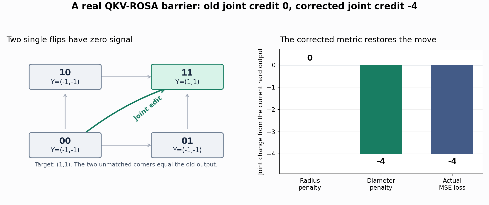

# One forward, one backward: the C++ training component

[中文](native-training.zh-CN.md) · [Randomized backward tutorial](randomized-backward.md) · [Measured results](randomized-results.md)

The implementation now has two layers. C++ takes contiguous arrays and owns
packing, hard matching, finite credits, joint corners, and input gradients.
PyTorch owns dense projections, device/layout conversion, and attachment to
the normal autograd graph. A standalone C++ program calls the same interface
without Python, NumPy, LibTorch, or PyTorch C++ headers.

## Three independent choices

| Option | Default | What it selects |
|---|---|---|
| `credit_order` | `"second"` | The original linear finite credit (`"first"`) or the diagonal trust model with joint-bit cooperation (`"second"`) |
| `randomized` | `True` | Exact randomized lookup acceleration; `False` keeps the deterministic lookup route |
| `backward_mode` | `"exact"` | Complete credit evaluation, or the explicit `"approximate"` contraction and sampling mode |

```python
from conv_rosa_transformer.rosa_layer import NBitQKVRosa

first = NBitQKVRosa(128, 8, credit_order="first")
second = NBitQKVRosa(128, 8)  # second order, randomized=True, exact backward

approximate = NBitQKVRosa(
    128, 8, credit_order="second", backward_mode="approximate",
    approximation_rows=32, approximation_channels=0,
)

# Optional extra approximation for wide spectral contractions.
sampled_channels = NBitQKVRosa(
    128, 64, credit_order="second", backward_mode="approximate",
    approximation_rows=32, approximation_channels=8,
)
```

`randomized=True` is enabled by default because it preserves the exact rule's
output. The exact path keeps its arithmetic order and is checked for bytewise
equality with the deterministic path. `randomized=False` controls that lookup
accelerator only; an explicitly selected approximate backward still samples.
Both credit orders work with either backward mode.

The training loop remains ordinary:

```python
optimizer.zero_grad(set_to_none=True)
prediction = model(x)       # model contains ROSA
loss = criterion(prediction, target)
loss.backward()
optimizer.step()
```

Both rules use hard Q/K/V forward and the same causal longest-then-latest
matching. Each batch/group is an independent stream. Second-order mode selects
at most one joint block by default. Exact backward needs at most one internal
ROSA matcher replay for that block; approximate backward may need up to three,
to evaluate both singleton corners and their joint corner completely. These
passes are internal component work. The model forward, downstream network and
task loss each run once. First-order mode has no joint-block replays.

`randomized=False` disables the new exact-search accelerator. The second-order
rule already has a bounded randomized joint proposer, whose random numbers are
identical in both accelerator modes. First-order exact mode consumes no
additional Torch RNG for the accelerator. Approximate mode saves its random
seed during forward, including in first-order mode, and reuses it in backward;
its sampling stream is separate from the joint proposer. Switching
`randomized` preserves framework RNG consumption, while switching
`backward_mode` can change it. Evaluation consumes no training RNG.

### What approximate backward changes

The hard forward remains exact. A cost planner contracts eligible long
shared-boundary corridors by FFT. Elsewhere, the engine computes the full
deletion term and a cheap one-symbol repair control, proves zero residuals
where possible, and samples the remaining correction rows. The row budget is
per batch/group stream; `approximation_rows=32` is the default. Candidate
maxima within an evaluated row are complete. V and embedding gradients and
the selected joint-block corners retain complete evaluation.

`approximation_channels=0` keeps every channel in the FFT contraction.
It does **not** turn approximate mode into exact mode: the row path can still
sample, and FFT changes floating-point reduction order. A positive budget
from 1 to 64 additionally samples signed numerical channels, with exact
constant terms and weighted fixed-size sampling. It only affects a spectral
path that actually uses channel sampling. The default stays at zero because
an eight-channel estimate can have large Q-gradient error when its control
term is weak, especially with the first-order rule.

The estimators have the stated conditional expectation in real arithmetic;
that is not a relative-error or convergence guarantee. Some inputs are slower
than exact. Measure the task's loss and upstream input gradient, as well as
Q and K separately: combining Q with an unchanged K can hide a poor Q
estimate. The [tutorial](randomized-backward.md) derives the controls and
sampling rules; the [results](randomized-results.md) include failures and
complete training-step timings. The legacy `repair_samples` research option
is separate and cannot be combined with `backward_mode="approximate"`.

## What first order computes

For the complete output change $`\delta`$ caused by one hard-bit edit,

```math
C^{(1)}=g^\top\delta,
\qquad g=\partial L/\partial Y.
```

In exact mode, the engine computes this finite-difference object exactly for
Q/K/V singleton edits. Approximate mode targets the same object while reducing
Q/K credit work. It is not the classical derivative of threshold quantization
or a full rerun of an arbitrary nonlinear downstream loss. The default mapping orients
the credit as bit-1 minus bit-0 and multiplies by the sigmoid probability's
derivative with respect to its logit.

## Second order: diagonal trust and joint cooperation

A normal backward gives the component an upstream gradient. At the same
output $`Y_0`$, the losses

```math
L_a(Y)=g_0^\top(Y-Y_0)+\tfrac12a\|Y-Y_0\|^2
```

have the same gradient and different curvature. This API therefore does not
claim to recover the true Hessian of an arbitrary downstream model. “Second
order” names an explicit local quadratic credit model:

```math
C^{(2)}(\delta)=g^\top\delta+
\tfrac12\sum_{t,j}h_{tj}\delta_{tj}^2.
```

One group's output set contains the empty output $`e_0`$ and all signed payload
vertices. Its diameter determines the scale:

```math
\Delta_Y=\max\left(2\|e_1\|_2,\ \||e_0|+|e_1|\|_2\right),
\qquad h_{tj}=\frac{\|g_t\|_2}{\Delta_Y}.
```

The implementation floors zero amplitude. A row shares one diagonal
coefficient, constructed in $`O(TD)`$ work. Q/K routing edits use this penalty;
V retains first-order credit. An edit aligned with the negative gradient, of
length $`a\le\Delta_Y`$, has model cost

```math
-a\|g_t\|_2+\frac{a^2\|g_t\|_2}{2\Delta_Y}
\le-\tfrac12a\|g_t\|_2\lt0.
```

This avoids canceling a useful jump between antipodal payloads, and includes
the learned empty output's scale. The guarantee concerns the chosen local
model, not every possible true task loss.

Joint blocks address a different obstacle: both singleton edits can have zero
signal while the joint edit helps. For corner costs $`C_i,C_j,C_{ij}`$, define
$`\kappa=C_{ij}-C_i-C_j`$. With the corners held fixed for the current local
calculation, the independent flip-probability objective is

```math
F=\alpha_iC_i+\alpha_jC_j+\alpha_i\alpha_j\kappa,
\qquad
\partial_{z_i}F=\alpha_i'(C_i+\alpha_j\kappa).
```

In exact backward, singleton costs already come from the full engine, and
one internal matcher replay gives the joint cost. In approximate backward,
selected singleton corners are also evaluated completely, using up to two
additional matcher replays. Thus the selected block uses exact local corner
costs even when other singleton credits are sampled. Floating-point reduction
order can still differ between the complete evaluations. Selected coordinate
gradients are replaced before accumulation into shared projection parameters.
Default J=1 bounds this work to at most three internal replays per stream.
Cross-block interactions are not solved in full.



The second-order metric and active-row proposal selection depend on g, so the
rule is generally not additive across different incoming loss gradients.
Combining loss terms and calling backward once is supported; separate backward
calls followed by accumulation need not equal that result. Positive rescaling
of the same loss is supported. Hard-credit double autograd is explicitly
unsupported rather than returning an incomplete higher-order derivative.

## C++ interface and layouts

The public header is [`csrc/training.h`](../conv_rosa_transformer/csrc/training.h).
Call `rosa_training_defaults(&options)` to initialize the versioned, sized
options struct. The defaults are the second-order surrogate and
`randomized=1`. For first-order credit, set all three related fields consistently:

```cpp
RosaTrainingOptions options;
rosa_training_defaults(&options);
options.credit_order = 1;
options.joint_pairs = 0;
options.trust_diagonal = 0.0;
options.randomized = 1;  // independent exact search option
```

The Python constructor derives these settings from `credit_order` automatically.

Approximation has a separate options struct and entry point, leaving the
original exact C ABI intact:

```cpp
RosaApproximationOptions approximation;
rosa_approximation_defaults(&approximation);
approximation.sample_rows = 32;
approximation.sample_channels = 0;  // full spectral channels; 8 is explicit
// Defaults: importance=1, reserved=0. Set seed for reproducible sampling.
```

Both option structures have ABI version 1 and carry `struct_size`. The current
`RosaApproximationOptions` is **32 bytes**, including `sample_channels` and
`reserved`; initialize it through the default function and compile against
the current header. The approximation API adds its own **40 counters per
stream** (`[B*G,40]`), separate from the existing 35 training counters
(`[B*G,35]`). These sizes come from `ROSA_APPROXIMATION_COUNTERS` and
`ROSA_TRAINING_COUNTERS`, respectively.

| Array | Contiguous row-major layout | Type |
|---|---|---|
| Q/K/V logits, output, incoming and input gradients | `[B,G,T,D]` | `double` |
| Empty output, payload scale, and their gradients | `[G,D]` | `double` |
| Packed Q/K | `[B,G,T]` | `uint64_t` |
| V bits | `[B,G,T,D]` | `uint8_t` |
| Match lengths and endpoints | `[B,G,T]` | `int32_t` |

`rosa_training_forward` processes the entire batch in one call: packing,
the completed accelerated exact matcher, payload selection, and the hard
state needed by backward. `rosa_training_backward` constructs the metric,
proposes blocks, calls the shared credit engine, replays selected joint corners,
maps Q/K/V logits, and accumulates embedding gradients for all streams.
For approximate backward, call `rosa_training_backward_approx` with the same
training options, the separate approximation options, and the additional
`saved_lengths`, `saved_routes` and approximation-counter buffer. The saved
lengths and routes must come from the **same forward** as the packed Q/K,
V bits, logits and embeddings; do not substitute a cache from another input
or mutate it between forward and backward. Python's autograd adapter saves
this state automatically.

The caller allocates memory and keeps inputs alive during each call. Status
codes and optional diagnostics are specified in the header. The exact entry
point never invokes FFT or residual-row sampling.

Compile and run the standalone example:

```bash
c++ -O3 -std=c++17 -ffp-contract=off examples/native_training.cpp \
    conv_rosa_transformer/csrc/unified_core.cpp -o /tmp/rosa-native
/tmp/rosa-native
```

All production computation uses this one core. The old Python arithmetic in
the tests is a migration oracle, never a runtime backend choice.

## Numerical and model compatibility

Q/K/V/O parameter names, shapes, and layer aliases are preserved. Existing
weights load strictly; training configuration must accompany them. Forward
uses hard values, and both credit modes have identical evaluation semantics.

Native credit and mapping arithmetic uses binary64 intermediates. Compared
with earlier Python/Torch float32 operations, reduction order and rounding can
differ. Migration checks use declared tolerances rather than claiming all old
float32 training trajectories remain bitwise identical. Within exact native
backward, the `randomized` toggle preserves the arithmetic result byte for
byte. Full-channel FFT belongs to approximate mode because it changes the
reduction order; near-zero recovery and exact payload identities limit numerical
problems without establishing a universal bitwise guarantee. With a fixed
sampling seed, runs are reproducible within the same implementation.

When active rows exceed `joint_rows`, the native weighted row sampler uses
`mt19937_64`; the frozen Python implementation used NumPy `PCG64`. The sampling
rule is preserved, but the same integer seed need not select the same rows
across those implementations. Within the native implementation, switching
`randomized` does preserve the proposal stream and framework RNG state.

The framework adapter preserves normal GradScaler overflow skipping and supports
ordinary optimizers, finite loss scaling, and checkpoint use. The C++ engine is
CPU code; CUDA tensors still incur CPU transfer and synchronization. No GPU
matching kernel is claimed.

The [current results report](randomized-results.md) separates complete native
backward timings, ordinary training-step timings and gradient-error probes.
Earlier migration and rule-selection experiments remain in the
[native results](native-results.md). Rule selection should depend on task
results per unit time, not on the complexity of the credit formula or an
isolated search speedup.
