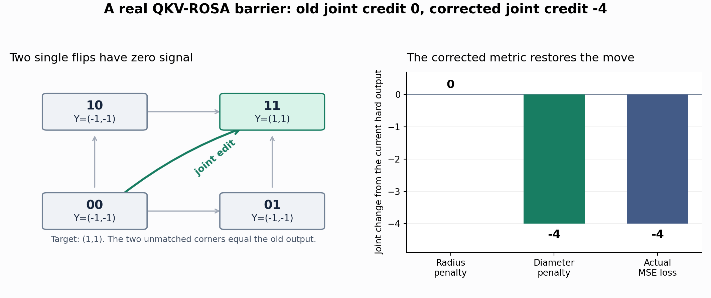

# 一次前向、一次反向：C++ 训练组件

[English](native-training.md) · [随机化反向教程](randomized-backward.zh-CN.md) · [实测结果](randomized-results.zh-CN.md)

QKV-ROSA 的训练接口现在分成两层。C++ 接收连续数组，负责打包、硬匹配、
有限信用、联合角点和输入梯度；PyTorch 负责稠密投影、设备与布局转换，以及
把返回的梯度接回普通计算图。独立 C++ 程序也能调用同一个接口，不依赖
Python、NumPy、LibTorch 或 PyTorch 的 C++ 头文件。

## 三个选择，各管一件事

| 选项 | 默认值 | 选择什么 |
|---|---|---|
| `credit_order` | `"second"` | 原一阶有限信用（`"first"`），或对角信任项与联合 bit 配合（`"second"`） |
| `randomized` | `True` | 保持答案精确的随机化查找；`False` 使用确定性的查找路线 |
| `backward_mode` | `"exact"` | 完整计算信用，或显式启用 `"approximate"` 收缩与抽样 |

```python
from conv_rosa_transformer.rosa_layer import NBitQKVRosa

# 原来的一阶单 bit 信用。
first = NBitQKVRosa(128, 8, credit_order="first")

# 对角信任项与一个联合 bit 块；开启答案精确的随机化搜索。
second = NBitQKVRosa(128, 8)  # second、randomized=True、exact backward

approximate = NBitQKVRosa(
    128, 8, credit_order="second", backward_mode="approximate",
    approximation_rows=32, approximation_channels=0,
)

# 宽通道频域收缩的进一步近似，需要显式选择。
sampled_channels = NBitQKVRosa(
    128, 64, credit_order="second", backward_mode="approximate",
    approximation_rows=32, approximation_channels=8,
)
```

`randomized=True` 已经默认开启，因为它保持精确规则的输出。精确路径保留
算术次序，并与确定性路径检查逐字节相等。`randomized=False` 只关闭这项
查找加速；如果显式选择了近似反向，近似路径仍会抽样。两种信用规则都能
搭配两种反向模式。

训练循环保持普通形式：

```python
optimizer.zero_grad(set_to_none=True)
prediction = model(x)       # model 内包含 ROSA
loss = criterion(prediction, target)
loss.backward()
optimizer.step()
```

两种规则都使用硬 Q/K/V 前向和相同的最长、最新、因果路由。每个
batch/group 是一条独立流。二阶模式默认最多选一个联合块。精确反向为它
最多重放一次 ROSA 匹配；近似反向为完整计算两个单点角点和联合角点，
最多需要三次内部匹配。这些都是组件内部工作，整个模型前向、下游网络和
任务 loss 仍各执行一次。一阶模式没有联合块重放。

`randomized=False` 关闭的是新增精确搜索加速。二阶规则原本就用一个有固定
预算的联合提案器；这个提案器在两个开关状态下使用相同随机数。
一阶精确模式不会为这项加速额外消耗 PyTorch RNG。近似模式会在前向保存
本次随机种子，反向时重用；一阶近似也如此，抽样流与联合提案流分开。
切换 `randomized` 保留框架 RNG 的消耗方式，切换 `backward_mode` 则可能
改变它。`.eval()` 不消耗这些训练随机数。

### 近似反向改了哪些计算

硬前向仍然精确。成本规划器把满足条件且值得收缩的长公共边界走廊交给
FFT；其他情况完整计算删除项，用便宜的单符号修复作控制量，先证明并排除
零残差，再抽样剩下的修正行。`approximation_rows=32` 是默认行预算，
分别作用于每条 batch/group 流。被选中行里的候选最大值仍然完整计算。
V、embedding 梯度和选中的联合块角点也保留完整计算。

`approximation_channels=0` 表示 FFT 保留全部通道，**不表示近似模式变成
了精确模式**：另一条行路径仍可能抽样，FFT 本身也改变浮点归约次序。
1 到 64 的正预算进一步抽样带符号的数值通道，保留精确常数项，使用有权重、
固定样本数的抽样。它只影响实际进行通道抽样的频域路径。默认保留全部通道，
因为控制量变弱时，八通道估计可能有很大的 Q 梯度误差，尤其是一阶规则。

估计器在实数算术下具有所述条件期望；这不是相对误差或收敛保证。有些输入
也会比精确模式更慢。应同时看任务 loss、传给前面层的输入梯度，以及分开
统计的 Q 和 K：把 Q 与未改变的 K 拼起来，可能掩盖 Q 的误差。
[算法教程](randomized-backward.zh-CN.md)推导了控制量和抽样规则，
[结果记录](randomized-results.zh-CN.md)保留失败案例与完整训练步计时。
旧的 `repair_samples` 是独立研究选项，不能与 `backward_mode="approximate"`
组合使用。

## 一阶模式到底计算什么

对于一个硬 bit 编辑造成的完整输出变化 $`\delta`$，一阶信用为：

```math
C^{(1)}=g^\top\delta,
\qquad g=\partial L/\partial Y.
```

精确模式对单 bit Q/K/V 编辑完整计算这个有限差分对象；近似模式保持同一
目标，减少 Q/K 信用的计算工作。它不是阈值函数的经典
导数，也不是任意非线性下游 loss 的完整重算。默认映射把信用定向为
“bit 取 1 相对取 0”，再乘 sigmoid 概率对 logit 的导数。

## 二阶模式：对角信任模型与联合配合

普通 backward 只给组件一个上游梯度。对于同一输出 $`Y_0`$，

```math
L_a(Y)=g_0^\top(Y-Y_0)+\tfrac12a\|Y-Y_0\|^2
```

可以有相同的梯度 $`g_0`$ 和不同曲率。因此，本接口不声称自动恢复了任意
下游模型的真实 Hessian。“二阶”描述的是明确选定的局部二次信用模型：

```math
C^{(2)}(\delta)=g^\top\delta+
\tfrac12\sum_{t,j}h_{tj}\delta_{tj}^2.
```

一组输出的可能值包含空输出 $`e_0`$ 和所有带符号的 payload 顶点。
取这个集合的直径：

```math
\Delta_Y=\max\left(2\|e_1\|_2,\ \||e_0|+|e_1|\|_2\right),
\qquad h_{tj}=\frac{\|g_t\|_2}{\Delta_Y}.
```

实现对零幅度加了数值保护。每行共享同一对角系数，构造成本为
$`O(TD)`$。它对 Q/K 路线改变收费，V 保留一阶信用。
如果长度为 $`a\le\Delta_Y`$ 的编辑沿负梯度方向，那么模型成本满足：

```math
-a\|g_t\|_2+\frac{a^2\|g_t\|_2}{2\Delta_Y}
\le-\tfrac12a\|g_t\|_2\lt0.
```

这个选择避免把跨越两个对径 payload 的有用跳跃惩罚成零，也包含学习后的
空输出尺度。保证针对局部模型，不是任意真实任务 loss 的下降定理。

联合块给单点零信号提供另一条路。单改 i、单改 j、一起改的成本分别为
$`C_i,C_j,C_{ij}`$，令 $`\kappa=C_{ij}-C_i-C_j`$。固定本次角点后，
两个翻转概率的独立块目标是：

```math
F=\alpha_iC_i+\alpha_jC_j+\alpha_i\alpha_j\kappa,
\qquad
\partial_{z_i}F=\alpha_i'(C_i+\alpha_j\kappa).
```

精确反向的单点成本已经由完整信用引擎给出，联合成本只需一次内部匹配。
近似反向还会完整计算选中的两个单点角点，最多增加两次内部匹配。
因此，其他单点信用即使经过抽样，选中联合块仍使用完整的局部角点成本；
不同完整计算之间的浮点归约次序仍可能有差异。选中坐标的梯度在累计到共享
投影参数之前替换。默认 J=1，把这部分工作限制在每条流最多三次内部重放；
没有声称求全跨块交互。



二阶模式的度量和活动行选择依赖 g，因此一般不对不同 loss 的梯度可加。
把各项 loss 加起来再调用一次 backward 是支持的用法；分别 backward 后累积，
不保证等于前者。同一 loss 的正比例缩放受支持。硬信用反向显式不支持
二次 autograd，不提供看似可用但不完整的高阶导数。

## C++ 接口与数组布局

公开头文件是 [`csrc/training.h`](../conv_rosa_transformer/csrc/training.h)。
先调用 `rosa_training_defaults(&options)` 初始化带版本号和结构大小的配置。
默认是二阶代理且 `randomized=1`。C 调用者选择原一阶时，要同步设置三个
相关字段：

```cpp
RosaTrainingOptions options;
rosa_training_defaults(&options);
options.credit_order = 1;
options.joint_pairs = 0;
options.trust_diagonal = 0.0;
options.randomized = 1;  // 独立的精确搜索选项
```

Python 构造函数会根据 `credit_order` 自动完成这几项设置。

近似使用单独的配置结构和入口，原精确 C ABI 保留：

```cpp
RosaApproximationOptions approximation;
rosa_approximation_defaults(&approximation);
approximation.sample_rows = 32;
approximation.sample_channels = 0;  // 完整频域通道；8 需要显式选择
// 默认 importance=1、reserved=0；设置 seed 可复现抽样。
```

两种配置结构的 ABI 版本都是 1，并带有 `struct_size`。当前
`RosaApproximationOptions` 是 **32 字节**，包含 `sample_channels` 和
`reserved`；请使用默认初始化函数，并针对当前头文件编译。
近似接口另外输出每条流 **40 个计数器**，布局为 `[B*G,40]`；原训练计数器
仍是 `[B*G,35]`，二者分开分配。对应常量为
`ROSA_APPROXIMATION_COUNTERS` 和 `ROSA_TRAINING_COUNTERS`。

| 数组 | 布局 | 类型 |
|---|---|---|
| Q/K/V logits、输出、上游与输入梯度 | `[B,G,T,D]`，连续行主序 | `double` |
| 空输出、payload 幅度及其梯度 | `[G,D]` | `double` |
| 打包后的 Q/K | `[B,G,T]` | `uint64_t` |
| V bit | `[B,G,T,D]` | `uint8_t` |
| 匹配长度、终点 | `[B,G,T]` | `int32_t` |

`rosa_training_forward` 一次处理整个 batch：打包 Q/K/V、执行已完成的精确
前向扫描、选择 payload，并返回反向需要的硬状态。
`rosa_training_backward` 一次处理全部流：构造信任项、生成联合提案、运行
信用核心、重放选中角点、映射 Q/K/V logits，并累计两个 embedding 的梯度。
近似反向调用 `rosa_training_backward_approx`，传入同一训练配置、单独的
近似配置，以及新增的 `saved_lengths`、`saved_routes` 和近似计数器缓冲区。
保存的长度和终点必须与打包 Q/K、V bits、logits、embedding 来自**同一次
前向**，不能换成另一份输入的缓存，也不能在前后向之间修改它们。
Python autograd 适配器会自动保存这些状态。

内存由调用者分配，输入在调用期间必须有效。详细状态码与可选诊断输出在
头文件中。精确入口不会调用 FFT 或残差行抽样。

可独立编译的例子：

```bash
c++ -O3 -std=c++17 -ffp-contract=off examples/native_training.cpp \
    conv_rosa_transformer/csrc/unified_core.cpp -o /tmp/rosa-native
/tmp/rosa-native
```

所有正式计算仍走这一套核心。测试目录里的旧 Python 算术只用于迁移对照，
不参与运行时选择。

## 数值与模型兼容性

原来的 Q/K/V/O 参数名、形状和层别名保留。权重可以严格加载，但训练配置
也应随模型保存。前向是硬值；`.eval()` 下两种信用模式的输出相同。

原生信用与映射使用 binary64 中间值。相较先前 Python/Torch 中部分 float32
运算，归约顺序和舍入可能不同；迁移比较使用明确容差，不把它宣传成旧版
所有 float32 训练轨迹都逐位相同。当前原生精确反向的 `randomized` 开关
保留逐字节相同的算术结果。使用全部通道的 FFT 仍属于近似模式，因为它
改变归约次序；近零恢复和精确 payload 恒等式能限制数值问题，但没有给出
全输入逐位相同的保证。固定抽样种子后，同一实现内可以复现运行。

活动行数超过 `joint_rows` 时，原生加权行采样器使用 `mt19937_64`，冻结的
Python 实现使用 NumPy `PCG64`。采样规则保留，但同一个整数 seed 在两种
实现间未必选中同一批行。原生实现内部切换 `randomized` 则保留联合提案流
和框架 RNG 状态。

框架适配器保留 GradScaler 溢出跳步的正常行为，并支持普通优化器、有限
loss 缩放和 checkpoint 使用。C++ 核心是 CPU 实现；CUDA 输入仍有 CPU
传输和同步，没有声称提供了 GPU 匹配内核。

本轮[结果记录](randomized-results.zh-CN.md)分别列出完整 native 反向、普通
训练步和局部梯度误差。更早的迁移与规则选择实验仍在
[原生结果](native-results.zh-CN.md)。选择规则应看单位时间的任务结果，
不能把信用更复杂、CPU 原生化或局部搜索更快直接等同于模型训练更好。
