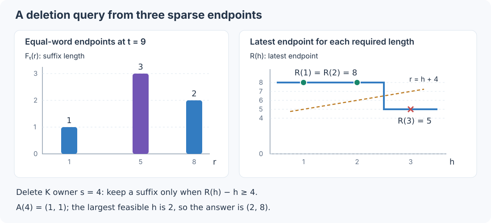

# Faster backward: prove what can be skipped, then sample the remainder

[中文](randomized-backward.zh-CN.md) · [From brute force to the exact engine](../ALGORITHM.md) · [Training API](native-training.md) · [Measurements and training results](randomized-results.md)

There are two quite different ways to use randomness here. We can randomize a search while finding every required answer, or evaluate fewer contributions and accept an estimation error. The first belongs in the default path. The second needs a useful control variate, a clear sampling unit, and measurements of what the error does to training.

This guide derives the optional approximate backward from the exact finite-credit formula. The hard forward, causal matching rule, and definition of a counterfactual remain the same throughout.

## 1. Three settings, two accuracy contracts

| Setting | What changes | Accuracy contract |
|---|---|---|
| `backward_mode="exact", randomized=False` | Direct complete-word neighbor lookup | Complete finite credits |
| `backward_mode="exact", randomized=True`, the default | Exact covering search and sparse neighbor storage | The same numerical outputs; randomness changes search work |
| `backward_mode="approximate"` | Certified residual sampling, or shared spectral contraction when its planner predicts a substantial saving | Explicit approximation; no bitwise or universal relative-error guarantee |

The exact randomized search partitions bit positions and indexes words with one block omitted. A one-bit neighbor agrees outside the block containing its differing bit, so it cannot be missed. Full-word XOR verifies every accepted candidate. A large bucket switches to complete-word bit-flip lookups, bounding enumeration work. See the [covering-join derivation](exact-randomized.md).

The approximate setting is one API. Its internal planner decides how to contract the same route credits. It does not recognize benchmark names or choose a different matching rule for particular input families. The row budget is used when it selects residual sampling. Spectral contraction evaluates all numerical channels by default; an additional, explicit channel budget is described below.

## 2. Start with the quantity we actually want

Use zero-based positions. At row $`t`$, only K endpoints $`r<t`$ are causal. Let

```math
F_t(r)=\operatorname{LCSuffix}(Q[0..t],K[0..r]),
\qquad
(L_t,r_t)=\max_{r<t}(F_t(r),r).
```

The maximum is lexicographic: longest match, then latest endpoint. A zero-length route is always normalized to $`(0,-1)`$. A nonempty route returns the payload **after** its endpoint:

```math
Y_t=P_{r_t+1},\qquad P_s=(2V_s-1)\odot e_1;
```

the empty route returns $`e_0`$.

Fix this hard forward, its upstream gradient $`g`$, and a chosen nonnegative diagonal $`h`$. Define the row score

```math
\phi_t(z)=g_t^\top(z-Y_t)
+\frac12\sum_j h_{t,j}(z_j-Y_{t,j})^2.
```

First order sets $`h=0`$. The second-order option supplies a diagonal trust model and selected joint-bit corrections; it does not recover an arbitrary downstream Hessian from one upstream gradient. That learning rule is explained in the [training guide](native-training.md).

A bit coordinate $`i`$ specifies Q or K, a sequence position (its owner), and a bit index. Its singleton credit is

```math
C_i=\sum_t\phi_t(Y_t^{\operatorname{flip}(i)}).
```

The literal algorithm flips every bit and reruns every comparison. Scanning a matching suffix for every $`(t,r)`$, for every one of $`O(TD)`$ flips, gives the familiar $`O(DT^4)`$ matching term. The [main tutorial](../ALGORITHM.md) removes those repeated computations. Here we start from its deletion-plus-repair decomposition and ask which remaining sums need to be evaluated at all.

## 3. Why sampling candidates before taking their maximum fails

Suppose an edited row has two candidate routes, of lengths 8 and 2, and we retain one uniformly. The expected selected length is 5, not 8. More importantly, the two endpoints may retrieve completely different payloads. Multiplying the selected payload's score by two does not reconstruct the missing maximum.

The issue is the order of operations:

```math
\max(\text{all candidates})
\quad\text{cannot generally be estimated by}\quad
\max(\text{sampled candidates})/\Pr(\text{sample}).
```

We therefore sample **complete output-row contributions**. Once row $`t`$ is selected, every candidate that could win any relevant counterfactual at that row is considered. Only after its route maxima have been settled do we multiply its credit by an inverse sampling probability.

This is particularly important for a K edit: many alignments may compete for the same owner and bit. Sampling a convenient alignment would change the question the backward answers.

## 4. Keep exact deletion, and use a cheap repair control

Conceptually replace an owner word by a fresh sentinel that matches no word in the opposite stream. Its position remains in the sequence. A match after a bit flip either avoids this owner or uses the repaired symbol. The best avoiding match is precisely the sentinel-deletion route.

Write

```math
D_{t,i}=\phi_t(Y_t^{\operatorname{delete}(i)}),\qquad
R_{t,i}=\phi_t(Y_t^{\operatorname{flip}(i)})
       -\phi_t(Y_t^{\operatorname{delete}(i)}).
```

Then $`C_{t,i}=D_{t,i}+R_{t,i}`$. The deletion term is common to every bit of one owner, which is why the exact engine can compute it economically.

Now consider a one-symbol router: it chooses the latest causal occurrence of the current Q word, ignoring earlier context. Let $`R_{1,t}`$ be its repair contribution, defined by the same flip-minus-deletion construction. This router is cheap because occurrences of a word are stored together, and a changed K occurrence only matters until a later unchanged occurrence supersedes it.

Our control and residual are

```math
\boxed{
B=D_{\mathrm{full}}+\sum_t R_{1,t},
\qquad
\rho_t=R_t-R_{1,t},
\qquad
C=B+\sum_t\rho_t.
}
```

This is more useful than merely sampling the full credit: the common deletion signal and all one-symbol repair effects are already present without sampling.

**Both full and one-symbol scores stay anchored at the actual full output $`Y_t`$.** For first order, subtracting two scores removes the anchor. For a quadratic score it does not: changing the center changes the cross term. Evaluating the control around its own one-symbol output and subtracting a control centered at $`Y_t`$ would not be this identity.

A useful exact simplification follows. If every active row has $`L_t\le1`$, deletion cannot create a longer match. Full deletion is then identical to one-symbol deletion, so one complete one-symbol pass already gives $`D_{\mathrm{full}}+R_1`$. This remains true even if a flip could repair a length-two match.

### A numerical detail that matters

Avoid expanding nearly equal squared payloads as $`a^2-b^2`$. With large, almost equal embeddings, that subtraction can overwhelm the desired tiny credit.

The implementation forms $`\delta=a-b`$ first. For a matched one-symbol baseline coordinate $`b`$, it keeps prefix sums $`G=\sum g`$, $`H_+`$, and $`H_-`$, grouping metric mass by the sign of the **actual** matched baseline. An interval contracts as

```math
\delta G+\frac12\delta^2(H_++H_-)
+\delta\bigl[(b-e_1)H_++(b+e_1)H_-\bigr].
```

If the one-symbol baseline is empty, the actual full baseline is empty too, and the last term is absent. This is the same quadratic identity, arranged to preserve small differences. The shared class plan and this contraction live in [approx_onegram.h](../conv_rosa_transformer/csrc/approx_onegram.h).

## 5. Two proofs remove residual rows before sampling

A small residual is pleasant. A residual proved to be zero is better: it consumes no sample and adds no variance.

### No near-equal adjacent pair

Any original or single-bit-edited match of length at least two must end in a pair of words whose total bit Hamming distance is at most one:

```math
\operatorname{popcount}(Q_{t-1}\oplus K_{r-1})
+\operatorname{popcount}(Q_t\oplus K_r)\le1.
```

If no causal two-word K window satisfies this condition, every relevant match has length at most one. Full and one-symbol routing agree, including after an edit or deletion, so $`\rho_t=0`$.

For example, equal last words alone do not suffice: their preceding words may differ in two bits. A single flip cannot repair that pair. Conversely, finding a pair at distance one only means “not certified”; it does not prove that the residual is nonzero.

The pair index stores complete keys. Hash collisions cannot turn this into a probabilistic certificate. See [approx_row_certificate.h](../conv_rosa_transformer/csrc/approx_row_certificate.h).

### No repair birth in the relevant owner window

Let

```math
b_u=\mathbf1\{\exists s<u:
\operatorname{popcount}(Q_u\oplus K_s)=1\}.
```

Take a potential repaired alignment ending at $`(t,r)`$. Suppose its unedited equal tail has length $`a`$. Its mismatching owners must be

```math
u=t-a,\qquad s=r-a.
```

That equal tail was already a legal baseline candidate, so $`a\le L_t`$. Also $`r<t`$, hence $`s<u`$. Every possible repair must therefore have a birth in

```math
t-L_t\le u\le t.
```

If the prefix sum of $`b`$ over this window is zero, no full repair exists. The window includes $`u=t`$, so no one-symbol repair exists either. Thus $`\rho_t=0`$, even for a very long baseline match.

The one-symbol class graph already knows the earliest K occurrence among each Q word's one-bit neighbors. That gives all $`b_u`$ without enumerating occurrence pairs; a prefix sum answers each window query in $`O(1)`$.

## 6. Sample residual rows, with the probability in the denominator

Order the remaining $`N`$ rows by time and split them into $`m`$ contiguous strata of nearly equal size, where $`m`$ is the row budget. If $`N\le m`$, evaluate all remaining rows with weight one.

Otherwise, choose one row from each stratum $`S`$, independently across strata:

```math
p_t=\frac{0.1}{|S|}
+0.9\,\frac{\|g_t\|_2}{\sum_{u\in S}\|g_u\|_2}.
```

A zero norm sum uses uniform probabilities. The estimator is

```math
\widehat C=B+\sum_S\frac{\rho_{T_S}}{p_{T_S}}.
```

Condition on the hard inputs, embeddings, upstream gradient, metric, certificates, and joint proposal. In real arithmetic,

```math
\mathbb E\left[\frac{\rho_{T_S}}{p_{T_S}}\right]
=\sum_{t\in S}\rho_t,
\qquad
\mathbb E[\widehat C]=C.
```

The variance exposes what helps:

```math
\mathbb E\|\widehat C-C\|_2^2
=\sum_S\left[
\sum_{t\in S}\frac{\|\rho_t\|_2^2}{p_t}
-\left\|\sum_{t\in S}\rho_t\right\|_2^2
\right].
```

A better control reduces $`\rho_t`$. A zero certificate removes it. Better probabilities avoid undersampling large residuals. For scalar residuals 6 and 2, probabilities $`3/4`$ and $`1/4`$ would return 8 whichever row is drawn: ideal importance sampling can remove all variance in that example. We do not know full residual norms for free, so upstream norms are a proxy, with a 10% uniform floor to preserve support and bound each weight by $`10|S|`$.

This is a conditional unbiasedness statement about the residual estimator, not a relative-error guarantee. If large terms cancel in the exact credit, relative error can be large. It also does not imply that clipping, Adam, or a training trajectory has the same expectation. Spectral roundoff, discussed below, has a different error contract. The implementation is [approx_sampling.h](../conv_rosa_transformer/csrc/approx_sampling.h).

## 7. A sampled row should not scan impossible endpoints

Sampling 32 rows still wastes work if each row scans every earlier K position. The one-symbol class graph gives a stronger filter.

Fix a selected row $`t`$.

- If $`K_r=Q_t`$, its unedited suffix length $`F_t(r)`$ may be positive.
- If those words differ in one bit, a repair may start at this final symbol, with equal-tail length zero.
- Every other last word is impossible: a one-bit edit cannot both repair the last word and another mismatch.

Enumerate the causal endpoints in the equal-word class and its one-bit-neighbor classes. This keeps every possible repair while skipping irrelevant endpoints.

For an equal-word endpoint, compute $`a=F_t(r)`$. If there is a preceding mismatch at $`u=t-a,\ s=r-a`$, it can be repaired only when $`Q_u\oplus K_s`$ is a single bit. If its preceding equal context has length $`b`$, the candidate route is $`(a+1+b,r)`$. Neighbor-class endpoints use the same formula with $`a=0`$.

We still need deletion routes to decide whether these repairs improve anything. They can also be computed from the sparse equal-word endpoints.

Define

```math
A(s)=\max_{r<s}(F_t(r),r),\qquad
R(h)=\max\{r:F_t(r)\ge h\}.
```

$`A`$ is an ordinary prefix maximum. Build $`R`$ by scanning equal-word endpoints from right to left: whenever the largest seen suffix length increases, append one interval to a staircase.

A Q deletion at owner $`u`$ caps every match at $`t-u`$. If $`0<t-u<L_t`$, its route is simply $`(t-u,R(t-u))`$.

For a K deletion at owner $`s`$, a surviving match either ends before $`s`$, giving $`A(s)`$, or starts after it. A suffix of length $`h`$ in the latter case exists exactly when

```math
R(h)-h\ge s.
```

On a staircase segment $`h\in[\ell,H]`$ with endpoint $`r`$, this permits $`h\le r-s`$. The values $`r-\ell`$ decrease across segments, so binary search finds the last feasible segment; its best length is $`\min(H,r-s)`$. Take the lexicographic maximum with $`A(s)`$.



For a concrete row, suppose the nonzero matches are $`(r,F)=(1,1),(5,3),(8,2)`$. Then $`R(1)=R(2)=8`$, $`R(3)=5`$. Deleting K owner $`s=4`$ leaves $`A(4)=(1,1)`$; the last feasible staircase length is 2, at endpoint 8. The deletion route is $`(2,8)`$. A Q deletion with cap 2 returns the same route. No dense array over every K owner is needed.

Endpoint enumeration now scales with the relevant class occurrences, plus exact LCE and staircase queries. This is an input-sensitive improvement, not a sublinear bound for the entire backward: output arrays alone have $`TD`$ entries. All samples reuse the class plan and any lazily built LCE index. See [approx_indexed_row.h](../conv_rosa_transformer/csrc/approx_indexed_row.h).

## 8. Long shared corridors can be summed by convolution

There is another source of repeated work. A certified repair may remain the same alignment over rows $`x\in[l,r]`$, retrieving payload

```math
P_{a+(x-l)}.
```

Call this an alignment corridor. Many corridors can share the same payload start $`a`$ and final row $`r`$, while starting at different $`l`$. Summing each separately repeats overlapping diagonal dot products.

Group by **both** boundary values $`(a,r)`$. For one scalar channel, reverse the gradient side:

```math
A_i=G_{r-i},\qquad B_j=P_{a+j}.
```

If $`k=r-l`$, the convolution coefficient is

```math
(A*B)_k
=\sum_{i=0}^kG_{r-i}P_{a+k-i}
=\sum_{x=l}^rG_xP_{a+x-l}.
```

For three rows, coefficient 2 is
$`G_rP_{a+2}+G_{r-1}P_{a+1}+G_{r-2}P_a`$:
exactly the corridor sum in reverse addition order. One convolution provides the answers for all corridor lengths in that group.

First order subtracts the baseline score sum separately. For second order, each payload coordinate is binary, so store its two possible **actual-baseline-centered** row costs. Convolve each cost channel with the corresponding payload bit indicator. Equal or complementary payload columns can share transforms, after complete column comparison verifies equality. Balanced columns use a signed channel plus a constant prefix; sparse columns retain two indicator channels to avoid cancellation. These are representations of the same sum.

For a maximum corridor length $`M`$, shared contraction can replace work proportional to the sum of corridor lengths by roughly $`O(DM\log M)`$, plus feature construction and query handling. It helps only when enough long queries share boundaries. A bounded planner first obtains sufficient corridor certificates, then charges index/setup work and demands a substantial predicted saving. It may decline this representation. The final contraction also compares its estimated cost with the existing direct, payload-cached sum.

One inexpensive sufficient certificate starts with a repaired word that occurs only once in K. At that birth, there is only one endpoint to follow. Exact comparisons of subsequent equal-symbol runs give its interval of validity. The preliminary planner caps both inspected births and run jumps at $`8T`$; an unfinished comparison supplies no certificate. It demands a predicted saving of more than a factor of two before choosing a full spectral pass. These caps keep a search for acceleration from becoming a new quadratic preprocessing step.

### FFT is an explicit floating-point approximation

The convolution identity is exact over real numbers. A floating-point FFT is not bitwise equivalent to the direct engine, and it is not the randomized row estimator.

With all channels evaluated, the implementation scales channels by powers of two, uses stable cost channels, and checks near-zero final credits. Its cancellation indicator has the form

```math
\eta=1024\,\epsilon\,(\log_2 N_{\mathrm{FFT}}+D+8)\,M\,S,
```

where $`S`$ combines channel magnitude scales, including the first-order baseline scale. If the final credit is close to zero on this scale, the original direct expansion is recomputed. **The guard does not set a small result to zero.** It recovers the direct computation.

When many such recoveries would themselves be expensive, an exact payload identity certificate can avoid a rescan. Compare the candidate payload-class string with the actual baseline payload-class string. Build dyadic substring ranks from complete pairs of child ranks; two overlapping blocks of length $`2^{\lfloor\log_2 m\rfloor}`$ certify an interval of length $`m`$. Full tuple equality resolves hash collisions, and only two adjacent rank levels are retained: memory is $`O(T+N_{\rm query})`$, not $`O(T\log T)`$. Under the finite-cost check, a confirmed equal string makes every direct row correction exactly zero. It is that proven identity, not a small FFT result, that allows the rescan to be omitted. See [exact_payload_identity_batch.h](../conv_rosa_transformer/csrc/exact_payload_identity_batch.h).

This indicator is a conservative numerical heuristic, not a proved error bound. It protects important cancellation cases without claiming that every other FFT result meets a universal tolerance. Therefore the FFT path belongs only to `backward_mode="approximate"`. It cannot silently enter the exact default. The planner and contraction are in [approx_corridor_eligibility.h](../conv_rosa_transformer/csrc/approx_corridor_eligibility.h) and [approx_corridor_fft.h](../conv_rosa_transformer/csrc/approx_corridor_fft.h).

### An advanced option: sample numerical channels

A wide payload can still require many transforms. The optional channel budget reduces this work without dropping Q/K credit coordinates or sampling route candidates.

For a balanced binary column, write its two quadratic row costs as

```math
c_t(b)=a_t+(2b-1)s_t,
\qquad a_t=\frac{c_t(0)+c_t(1)}2,
\qquad s_t=\frac{c_t(1)-c_t(0)}2.
```

Keep **every constant-prefix contribution**. Sparse indicator channels also remain complete because their representation was chosen to avoid cancellation. Only the remaining nonzero signed channels are eligible for sampling. The diagonal penalty's constant part is therefore retained; the combined constant also contains linear terms and need not itself be positive.

Let the eligible channels be $`j=1,\ldots,N`$, and let $`z_j`$ denote one channel's vector of convolution answers for the entire boundary group. Use the already available magnitude $`w_j=\max_t|s_{t,j}|`$ as a cheap importance proxy. For a positive budget $`m<N`$, water filling chooses

```math
\pi_j=\min\left(1,\frac{0.1m}{N}+\lambda w_j\right),
\qquad \sum_j\pi_j=m.
```

Channels with $`\pi_j=1`$ are always included. The others are selected by fixed-size pivotal rounding: repeatedly take two fractional probabilities, randomly round one to 0 or 1 while preserving both marginals and their sum, and continue until exactly $`m`$ indicators remain. A Fisher–Yates permutation first removes fixed adjacency between payload columns. With equal probabilities, permutation symmetry gives a uniform fixed-size subset.

Store the **original** $`\pi_j`$, not its intermediate rounded value. The correction is

```math
\widehat Z=\sum_{j\ \mathrm{selected}}\frac{z_j}{\pi_j},
\qquad \mathbb E[\widehat Z]=\sum_jz_j.
```

The layout, probabilities, short-interval cutoff, and certainty decisions all depend on complete fixed inputs. Corridors shorter than 32 rows are evaluated directly. The sample never changes a route maximum. The probability construction and rounding are in [approx_channel_pivotal.h](../conv_rosa_transformer/csrc/approx_channel_pivotal.h).

There is a trap when combining this estimator with numerical recovery. **Do not decide to replace a sampled result by its exact value merely because the sampled result is small.** An unbiased estimate taking 0 or 2 with equal probability has mean 1. Replacing only its zero outcomes by the exact value 1 changes the mean to 1.5.

The implementation consequently applies payload identity checks to sampled corridors independently of their sampled value. A proved zero raw correction is restored to zero; every unproved sampled correction keeps its estimate. Only nonsampled FFT queries retain the magnitude-based roundoff recovery described above. This preserves the conditional real-arithmetic expectation; floating-point transforms still have rounding error.

This option is deliberately **off by default**: $`\texttt{approximation\_channels}=0`$ evaluates all channels. A value such as 8 is an advanced speed/error tradeoff. First-order credits can have severe cancellation and do not benefit from the diagonal penalty's full control. Low error on a second-order example is not evidence that the same budget is adequate for first order.

Also distinguish Q-only error from concatenated Q/K error. Use one consistent quantity throughout: either finite credits or their mapped logit gradients. In this spectral branch K stays complete, so

```math
\operatorname{rel}_Q=\frac{\|\Delta C^Q\|}{\|C^Q\|},
\qquad
\operatorname{rel}_{QK}=\frac{\|\Delta C^Q\|}
 {\sqrt{\|C^Q\|^2+\|C^K\|^2}}.
```

A large exact K gradient can make the second number look reassuring while Q is badly estimated. Report both, alongside the downstream shared-parameter and input-gradient errors. The [measurements](randomized-results.md) retain first-order cancellation cases for this reason.

## 9. Use it as an ordinary component

```python
from conv_rosa_transformer.rosa_layer import NBitQKVRosa

# Exact randomized search is already the default.
exact = NBitQKVRosa(128, 8, credit_order="second")

# Explicit approximation; the planner chooses residual sampling or contraction.
fast = NBitQKVRosa(
    128, 8,
    credit_order="second",       # "first" is also supported
    backward_mode="approximate",
    approximation_rows=32,
    approximation_channels=0,   # all FFT channels; default
)

# Advanced opt-in: sample at most 8 signed channels per spectral group.
sketched = NBitQKVRosa(
    128, 64, credit_order="second",
    backward_mode="approximate",
    approximation_rows=32, approximation_channels=8,
)
```

The training loop is unchanged:

```python
optimizer.zero_grad(set_to_none=True)
loss = criterion(model(x), target)
loss.backward()
optimizer.step()
```

V and embedding gradients use the full upstream gradient. The selected joint block keeps its corner evaluations complete; when an approximate contraction would otherwise affect its singleton corners, the component performs the necessary internal matching replays. It does not rerun the surrounding model or request a second task loss.

The default budget is a practical starting point, not a claim that 32 rows suffice for every task. The [results report](randomized-results.md) separates raw Q/K-logit error, error after accumulation into shared model parameters, native backward timing, and actual training outcomes. Those quantities answer different questions. A large speedup with a badly distorted useful gradient is not a successful approximation.
