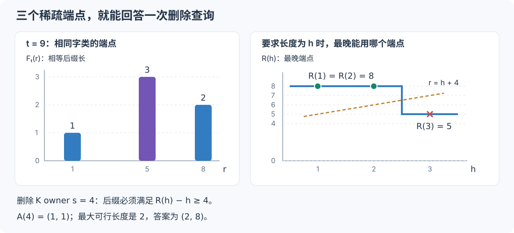

# 让反向传播更快：先证明哪些不用算，再随机抽剩下的

[English](randomized-backward.md) · [从暴力到精确引擎](../ALGORITHM.zh-CN.md) · [训练接口](native-training.zh-CN.md) · [速度、误差与训练结果](randomized-results.zh-CN.md)

随机化在这里有两种用法：改变搜索过程，但一个答案也不漏；或者少算一些贡献，接受可衡量的估计误差。前一种适合默认开启。后一种要想有用，关键在于抽什么、抽之前先消掉多少噪声，以及误差最终怎样影响训练。

下面从已有的精确信用公式出发，推导可选的近似反向传播。整个过程中，硬前向、因果约束、匹配的胜负规则都不变。

## 1. 三种配置，两类精度约定

| 配置 | 改变了什么 | 精度约定 |
|---|---|---|
| `backward_mode="exact", randomized=False` | 逐个构造翻转后的完整字，查找邻居 | 完整计算有限翻转信用 |
| `backward_mode="exact", randomized=True`，默认配置 | 用覆盖索引搜索，稀疏存储实际存在的邻居 | 数值输出相同，随机性只改变搜索工作量 |
| `backward_mode="approximate"` | 在证明为零的部分之外抽样残差；适合时用共享谱收缩 | 显式近似，不承诺逐位一致或普遍的相对误差上界 |

精确随机化的覆盖索引把 bit 分块，并按“去掉一个块后的字”建立索引。两个字若只差一个 bit，去掉包含这个 bit 的块后一定相等，因此不会漏掉。找到的候选还要检查完整字的 XOR。桶太大时，改为逐个翻转这个块内的 bit 做完整字查找，限制枚举量。具体证明见[覆盖连接教程](exact-randomized.zh-CN.md)。

近似模式只提供一个入口。内部根据证书和工作量估计，决定怎样收缩同一套路由信用；它不识别测试数据的名字，也不针对某种输入改写匹配规则。选择残差抽样时使用行预算。谱收缩默认计算全部数值通道；后文另有一个必须显式指定的通道预算。

## 2. 先固定我们到底在算什么

位置从 0 开始。输出第 $`t`$ 行只能使用 $`r<t`$ 的 K 端点。记

```math
F_t(r)=\operatorname{LCSuffix}(Q[0..t],K[0..r]),
\qquad
(L_t,r_t)=\max_{r<t}(F_t(r),r).
```

按二元组字典序取最大：长度更长者胜，同长度取更晚的端点。所有长度为零的路由统一记为 $`(0,-1)`$。非空匹配取的是端点**后一个位置**的 payload：

```math
Y_t=P_{r_t+1},\qquad P_s=(2V_s-1)\odot e_1;
```

空匹配则返回 $`e_0`$。

固定这次硬前向、传入的梯度 $`g`$，以及选定的非负对角量 $`h`$。对第 $`t`$ 行定义

```math
\phi_t(z)=g_t^\top(z-Y_t)
+\frac12\sum_jh_{t,j}(z_j-Y_{t,j})^2.
```

一阶模式就是 $`h=0`$。二阶模式使用对角信任模型，并加入选中联合 bit 块的修正；它不是从一个上游梯度中恢复任意下游网络的真实 Hessian。学习规则本身见[训练教程](native-training.zh-CN.md)。

一个 bit 坐标 $`i`$ 包含 Q/K 序列、所在位置（owner）和 bit 编号。我们要算的单点信用是

```math
C_i=\sum_t\phi_t(Y_t^{\operatorname{flip}(i)}).
```

最朴素的做法当然正确：每次翻一个 bit，再跑一遍所有匹配。若每个 $`(t,r)`$ 都向左逐字比较，那么对 $`O(TD)`$ 个翻转，总匹配开销就是熟悉的 $`O(DT^4)`$。[主教程](../ALGORITHM.zh-CN.md)逐步消除了这些重复计算。这里接着它得到的“删除项 + 修复项”，继续问：剩下的求和，哪些根本不必逐项做？

## 3. 为什么不能先抽候选，再对抽到的候选取最大

假设一次编辑有两个候选匹配，长度分别是 8 和 2。均匀保留一个，选中长度的期望是 5，不是 8。更麻烦的是，两个端点可能取出完全不同的 payload；给抽到的分数乘以 2，并不能还原没见到的那个最大值。

问题出在运算顺序：

```math
\max(\text{全部候选})
\quad\text{通常不能改成}\quad
\frac{\max(\text{抽中的候选})}{\text{抽样概率}}.
```

所以我们抽的是**完整的输出行贡献**。一旦第 $`t`$ 行被抽中，这一行里所有可能获胜的反事实匹配都必须算全。先确定每个路由的最大值，再给这行的信用乘逆概率权重。

K 编辑尤其不能省略这一步：同一个 owner、同一个 bit，可能有很多对齐在竞争。随手抽一条对齐，就已经改变了原问题。

## 4. 精确保留删除项，用单字修复作控制量

想象把某个 owner 的字替换成一个全新的哨兵，保证它不与另一条序列中的任何字相等。位置还在，并没有把序列缩短。

翻转一个 bit 后的匹配，要么绕开这个 owner，要么穿过被修好的字符。前一类的最优匹配，恰好就是哨兵删除后的路由。因此可以写成

```math
D_{t,i}=\phi_t(Y_t^{\operatorname{delete}(i)}),\qquad
R_{t,i}=\phi_t(Y_t^{\operatorname{flip}(i)})
       -\phi_t(Y_t^{\operatorname{delete}(i)}),
```

于是 $`C_{t,i}=D_{t,i}+R_{t,i}`$。同一个 owner 的所有 bit 共享删除项，这也是精确引擎能把它算便宜的原因。

再做一个很便宜的路由器：只看当前 Q 字，在历史 K 中找最后一次相同的字，不看更早的上下文。把它的“翻转分数减删除分数”记为 $`R_{1,t}`$。这部分好算：同一个字的出现位置放在一起；改动一个 K 出现位置，影响也只会持续到下一个未改动的同字出现为止。

选定的控制量和残差是

```math
\boxed{
B=D_{\mathrm{full}}+\sum_tR_{1,t},
\qquad
\rho_t=R_t-R_{1,t},
\qquad
C=B+\sum_t\rho_t.
}
```

这样一来，公共删除信号和全部单字修复效应都已经完整保留。随机性只负责补上“较长上下文带来的修复差别”。

这里有个很容易写错的细节：**完整路由和单字路由，都必须用实际完整前向的 $`Y_t`$ 作评分中心。** 一阶情况下，两次分数相减会消掉中心；二次项却还会留下交叉项。如果控制量围绕单字输出展开，而被减去的那一项围绕 $`Y_t`$ 展开，上面的恒等式就不成立了。

还有一个可以直接省工作的恒等式。若所有有贡献的行都满足 $`L_t\le1`$，删除不可能凭空创造更长的匹配，所以完整删除等于单字删除。此时跑一次完整单字信用，就已经得到 $`D_{\mathrm{full}}+R_1`$，不需要额外启动完整删除引擎。即使某次翻转能够修出长度 2，这条结论仍然成立。

### 二次项别用大数平方相减

把两个几乎相等的大数写成 $`a^2-b^2`$，在实数里没问题，在浮点数里可能把真正关心的小信用淹没。

实现先算 $`\delta=a-b`$。当单字基线路由非空、某个坐标的值为 $`b`$ 时，保存前缀和 $`G=\sum g`$，以及按**实际**基线 payload 正负号分开的 $`H_+,H_-`$。一个区间的贡献写成

```math
\delta G+\frac12\delta^2(H_++H_-)
+\delta\bigl[(b-e_1)H_++(b+e_1)H_-\bigr].
```

单字基线若为空，实际完整基线也为空，最后一项便不需要了。公式还是同一个公式，只是先形成小的差，再乘大数。共享字类计划和这部分收缩在 [approx_onegram.h](../conv_rosa_transformer/csrc/approx_onegram.h)。

## 5. 抽样之前，先证明一些行的残差一定是零

残差小，意味着方差小。残差能证明为零，就更划算：既不占预算，也不引入方差。

### 末尾两个字，不可能靠一次翻转同时匹配

任何长度至少为 2 的原始匹配或单 bit 编辑后匹配，其末尾两个字都必须满足

```math
\operatorname{popcount}(Q_{t-1}\oplus K_{r-1})
+\operatorname{popcount}(Q_t\oplus K_r)\le1.
```

若不存在这样的因果 K 窗口，所有相关匹配的长度就至多为 1。完整路由与单字路由在编辑、删除之后都相同，因此 $`\rho_t=0`$。

例如，最后一个字虽然相同，前一个字却差了两个 bit，一次翻转仍然救不回来。反过来，找到距离为 1 的字对，只能说明这条证书没能排除它；不能据此说残差一定非零。

索引保存和比较完整键。哈希冲突只会多做查找，不能让零证书出错。实现见 [approx_row_certificate.h](../conv_rosa_transformer/csrc/approx_row_certificate.h)。

### 相关 owner 区间内，根本没有修复出生点

定义

```math
b_u=\mathbf1\{\exists s<u:
\operatorname{popcount}(Q_u\oplus K_s)=1\}.
```

考虑一条可能被修好的对齐，结束于 $`(t,r)`$。设它最后一段原本就相等的后缀长为 $`a`$，那么失配的两个 owner 必定是

```math
u=t-a,\qquad s=r-a.
```

这段相等后缀原本就是一个合法基线候选，所以 $`a\le L_t`$。又因为 $`r<t`$，必有 $`s<u`$。因此，任何修复的 Q owner 都落在

```math
t-L_t\le u\le t
```

之中。

如果这个区间内所有 $`b_u`$ 都为零，完整修复就不存在。区间包含当前位置 $`t`$，单字修复也不存在。于是 $`\rho_t=0`$，哪怕基线匹配很长。

单字控制量已经建好了字类之间的精确 Hamming-one 邻接关系。取每个 Q 字所有邻居中最早的 K 出现位置，就能得到各个 $`b_u`$，不必枚举出现位置对。再做一个前缀和，每行的区间证书只需 $`O(1)`$。

## 6. 剩下的整行残差，用概率的倒数还原

把尚未排除的 $`N`$ 行按时间排序，分成 $`m`$ 个大小尽量相等的连续层，$`m`$ 是行预算。若 $`N\le m`$，直接全部计算，权重为 1。

否则，每层 $`S`$ 独立抽一行：

```math
p_t=\frac{0.1}{|S|}
+0.9\,\frac{\|g_t\|_2}{\sum_{u\in S}\|g_u\|_2}.
```

范数和为零时用均匀概率。最终估计是

```math
\widehat C=B+\sum_S\frac{\rho_{T_S}}{p_{T_S}}.
```

固定硬输入、embedding、上游梯度、度量、证书和联合提案，在实数运算下有

```math
\mathbb E\left[\frac{\rho_{T_S}}{p_{T_S}}\right]
=\sum_{t\in S}\rho_t,
\qquad
\mathbb E[\widehat C]=C.
```

方差公式能解释每一步优化到底在帮什么忙：

```math
\mathbb E\|\widehat C-C\|_2^2
=\sum_S\left[
\sum_{t\in S}\frac{\|\rho_t\|_2^2}{p_t}
-\left\|\sum_{t\in S}\rho_t\right\|_2^2
\right].
```

更好的控制量把 $`\rho_t`$ 变小；零证书把它整项消掉；更好的概率避免大残差被抽得太少。一个小例子：标量残差分别是 6 和 2，若概率恰好取 $`3/4,1/4`$，抽到哪一个，逆概率加权后都是 8，方差直接为零。

但完整残差的范数不是免费信息，所以这里用上游范数作代理，并混入 10% 均匀概率。这样每行都有机会被选中，每个权重也不超过 $`10|S|`$。

“无偏”只描述这个条件下的残差估计。精确信用若由大项相消而来，相对误差依然可能很大；梯度裁剪、Adam 和整条训练轨迹也不会自动继承相同期望。后文的 FFT 浮点误差更是另一回事。抽样实现见 [approx_sampling.h](../conv_rosa_transformer/csrc/approx_sampling.h)。

## 7. 抽中一行，也不该遍历所有不可能的端点

只抽 32 行还不够。若每行仍扫一遍全部历史 K，许多时间还是浪费在不可能匹配的字上。刚才的单字邻接图还可以复用一次。

固定抽中的 $`t`$：

- 若 $`K_r=Q_t`$，原始相等后缀 $`F_t(r)`$ 可能非零。
- 若两个字恰差一个 bit，修复可能从最后这个字开始，此时相等尾长为 0。
- 其他字类不可能贡献修复：一次翻转连最后一个字都修不好。

所以，只枚举相同字类和一 bit 邻居字类中 $`r<t`$ 的出现位置。没有丢任何可能的修复。

对相同字类端点，先求 $`a=F_t(r)`$。若其前面还有失配，两个 owner 是 $`u=t-a,\ s=r-a`$；只有 $`Q_u\oplus K_s`$ 恰为一个 bit 时才可修复。再求它之前的相等上下文长 $`b`$，得到候选路由 $`(a+1+b,r)`$。邻居字类用同一个公式，只是 $`a=0`$。

为了知道修复是否胜出，还需要删除后的路由。也不必为了它建立覆盖所有 K owner 的稠密数组。

定义

```math
A(s)=\max_{r<s}(F_t(r),r),\qquad
R(h)=\max\{r:F_t(r)\ge h\}.
```

$`A`$ 就是端点序上的前缀最大值。$`R`$ 则从右向左扫描相同字类端点：每当见到更大的后缀长度，记下一段新的阶梯。

删除 Q owner $`u`$，等价于把所有匹配长度截到 $`t-u`$。若 $`0<t-u<L_t`$，答案直接是 $`(t-u,R(t-u))`$。

删除 K owner $`s`$，幸存的匹配有两种：在 $`s`$ 之前结束，答案为 $`A(s)`$；或者在 $`s`$ 之后开始。后一种存在长度 $`h`$ 的匹配，当且仅当

```math
R(h)-h\ge s.
```

若某段阶梯在 $`h\in[\ell,H]`$ 上的端点是 $`r`$，那么这一段允许 $`h\le r-s`$。各段的 $`r-\ell`$ 严格递减，可以二分找到最后一段可行阶梯；该段的最优长度是 $`\min(H,r-s)`$。最后与 $`A(s)`$ 取字典序最大值即可。



例如，非零匹配为 $`(r,F)=(1,1),(5,3),(8,2)`$，那么 $`R(1)=R(2)=8,\ R(3)=5`$。删除 K owner $`s=4`$，有 $`A(4)=(1,1)`$，阶梯上最大可行长度为 2，对应端点 8，所以答案是 $`(2,8)`$。Q 删除若把长度截到 2，也得到这个答案。整个查询不需要逐个扫描 K owner。

这样，端点枚举量取决于相关字类的出现次数，外加精确 LCE 和阶梯查询。它改善的是实际工作量，不能据此声称整个反向传播次线性：光输出数组就有 $`TD`$ 个元素。全部样本共享字类计划，以及确有需要时才建立的 LCE 索引。实现见 [approx_indexed_row.h](../conv_rosa_transformer/csrc/approx_indexed_row.h)。

## 8. 一批长对齐区间，可以一起做卷积

还有一类重复发生在数值求和上。某条已认证的修复，在 $`x\in[l,r]`$ 内一直沿用同一条对齐，逐行读取

```math
P_{a+(x-l)}.
```

把这样的区间称为一条对齐走廊。有时许多走廊共享 payload 起点 $`a`$ 和最后一行 $`r`$，只有起始行 $`l`$ 不同。逐条求和，会反复计算重叠的斜线点积。

按**两个边界 $`(a,r)`$ 一起分组**。先只看一个标量通道，把梯度侧反转：

```math
A_i=G_{r-i},\qquad B_j=P_{a+j}.
```

令 $`k=r-l`$，卷积的第 $`k`$ 项就是

```math
(A*B)_k
=\sum_{i=0}^kG_{r-i}P_{a+k-i}
=\sum_{x=l}^rG_xP_{a+x-l}.
```

三行的小例子最容易检查：第 2 项是
$`G_rP_{a+2}+G_{r-1}P_{a+1}+G_{r-2}P_a`$，正是那条走廊的和，只是加法顺序反过来了。一遍卷积，就给出了这个分组内所有长度的答案。

一阶模式另减去基线分数的区间和。二阶模式中，每个 payload 坐标只有 0、1 两种情况，因此保存围绕**实际基线**计算的两种行分数，分别与对应的 bit 指示序列卷积。相同或互补的 payload 列可以共用变换，但必须完整比较列，确认相同；指纹只负责筛选。较均衡的列可以写成符号通道加常量前缀，稀疏列则保留两个指示通道，避免大数相消。这些都是同一个和式的不同表示。

若最长走廊长 $`M`$，共享收缩有机会把与“所有走廊长度之和”成正比的工作，降到约 $`O(DM\log M)`$，再加特征构建和查询开销。前提是确有足够多的长查询共享边界。工作量有上限的规划器先找充分的走廊证书，再估计建设成本，并要求有明显收益；不划算就不用。真正收缩时，还会与已有的直接求和、payload 缓存比较成本。

一个便宜的充分证书来自“修复后的字在 K 中只出现一次”：出生时只有一个端点可跟随，再通过完整比较后续相等字符段，求出这条对齐的有效区间。预规划对检查的出生点数、字符段跳跃数分别设 $`8T`$ 上限；比较没完成，就不能发出证书。只有预测收益超过两倍，才选择一次完整谱收缩。这样，寻找加速机会本身不会悄悄变成新的平方级预处理。

### FFT 的误差必须单独说明

上面的卷积恒等式在实数域里是精确的；浮点 FFT 却不等于原引擎的逐位结果，也不是前面的随机行估计。

计算全部通道时，实现用二的整数次幂缩放通道，保持评分形式稳定，并检查最终接近零的信用。它的相消尺度指标形如

```math
\eta=1024\,\epsilon\,(\log_2N_{\mathrm{FFT}}+D+8)\,M\,S,
```

$`S`$ 汇总各通道的幅度尺度，一阶时还包含基线分数的尺度。若最终信用在这个尺度下接近零，就用原来的直接展开重新计算。**不是把小数直接判成零，而是回到直接算法求答案。**

若这些恢复本身又需要大量回扫，还能先做一个精确的 payload 串相等证书：比较候选取出的 payload 类别串与实际基线类别串。按倍增长度，用两个子块 rank 的完整二元组构造新 rank；对长度 $`m`$，两个重叠的 $`2^{\lfloor\log_2m\rfloor}`$ 块就能证明整段相等。哈希冲突由完整二元组比较解决，只滚动保存相邻两层 rank，空间为 $`O(T+N_{\rm query})`$，无需 $`O(T\log T)`$。在评分有限的检查通过后，串相等意味着每行的直接修正都严格为零，因此可以免掉回扫。省略计算的依据仍然是已证明的恒等关系，而不是 FFT 算出了一个很小的数。实现见 [exact_payload_identity_batch.h](../conv_rosa_transformer/csrc/exact_payload_identity_batch.h)。

这个指标是偏保守的数值启发式，不是已经证明的误差上界。它保护重要的相消情形，但不承诺其余所有 FFT 结果都满足某个统一容差。因此，FFT 只允许进入 `backward_mode="approximate"`，不能悄悄混入默认精确路径。相关实现为 [approx_corridor_eligibility.h](../conv_rosa_transformer/csrc/approx_corridor_eligibility.h) 和 [approx_corridor_fft.h](../conv_rosa_transformer/csrc/approx_corridor_fft.h)。

### 一个高级选项：抽数值通道

payload 较宽时，FFT 仍要做不少次变换。可选的通道预算减少这部分工作，但不会丢弃 Q/K 信用坐标，也不会抽掉某些路由候选。

对于较均衡的二进制列，把两种二次行分数写成

```math
c_t(b)=a_t+(2b-1)s_t,
\qquad a_t=\frac{c_t(0)+c_t(1)}2,
\qquad s_t=\frac{c_t(1)-c_t(0)}2.
```

**所有常量前缀贡献都完整保留。** 稀疏指示通道也保留，因为选择这种表示本来就是为了避免相消。只在剩下的非零符号通道中抽样。这样，对角惩罚的常量部分仍然完整；不过合并后的常量还含有线性项，本身不一定为正。

设可抽通道为 $`j=1,\ldots,N`$，$`z_j`$ 是某个通道对整个边界分组的一组卷积答案。用已经算出的幅度 $`w_j=\max_t|s_{t,j}|`$ 作便宜的重要性代理。对正预算 $`m<N`$，用注水法求

```math
\pi_j=\min\left(1,\frac{0.1m}{N}+\lambda w_j\right),
\qquad \sum_j\pi_j=m.
```

$`\pi_j=1`$ 的通道必选。其余用固定样本数的 pivotal 舍入：每次取两个非整数概率，随机把其中一个变为 0 或 1，同时保持二者各自的期望与概率之和，直到恰好留下 $`m`$ 个选中项。开始前先用 Fisher–Yates 打乱列序，避免固定相邻列反复绑定。概率均匀时，置换对称性使结果成为均匀的固定大小子集。

逆概率权重要用**原始** $`\pi_j`$，不能用舍入过程中的中间值。修正量是

```math
\widehat Z=\sum_{j\ \mathrm{selected}}\frac{z_j}{\pi_j},
\qquad \mathbb E[\widehat Z]=\sum_jz_j.
```

分组、概率、短区间阈值、必选通道都由完整的固定输入决定。长度不足 32 的走廊直接计算；抽样不参与任何路由的取最大。概率构造与舍入见 [approx_channel_pivotal.h](../conv_rosa_transformer/csrc/approx_channel_pivotal.h)。

它与数值恢复结合时，有一个容易忽略的坑：**不能因为抽出来的值小，就把它换成精确值。** 假设一个无偏估计以相同概率取 0 或 2，真值是 1。若只把抽到 0 的情况重算成 1，新期望就变成了 1.5。

所以，对抽过通道的走廊，payload 串相等检查不依赖抽样结果的大小：证明原始修正为零，就恢复成零；没证明，就保留估计值。只有未抽通道的 FFT 查询，才使用前面的幅度阈值回退。由此保留的是实数运算下的条件期望；浮点变换本身仍有舍入误差。

这个选项**默认关闭**：$`\texttt{approximation\_channels}=0`$ 表示计算全部通道。像 8 这样的正值是更激进的速度／误差选择。一阶信用可能发生强烈相消，也没有对角惩罚提供的完整控制量；二阶例子里误差很小，不能证明同样预算也适合一阶。

还要区分 Q-only 误差与拼接 Q/K 后的误差。比较时统一使用有限信用，或统一使用映射后的 logit 梯度。这个谱收缩分支完整保留 K，因此

```math
\operatorname{rel}_Q=\frac{\|\Delta C^Q\|}{\|C^Q\|},
\qquad
\operatorname{rel}_{QK}=\frac{\|\Delta C^Q\|}
 {\sqrt{\|C^Q\|^2+\|C^K\|^2}}.
```

若精确的 K 梯度很大，第二个数可以很好看，但 Q 已经估计得很差。应把两者都列出来，再看下游共享参数和输入梯度的误差。[实测报告](randomized-results.zh-CN.md)保留了一阶相消用例，正是为了不把这种差别藏起来。

## 9. 放进普通模型，照常训练

```python
from conv_rosa_transformer.rosa_layer import NBitQKVRosa

# 默认已经开启精确随机化搜索。
exact = NBitQKVRosa(128, 8, credit_order="second")

# 显式选择近似；内部决定残差抽样还是共享收缩。
fast = NBitQKVRosa(
    128, 8,
    credit_order="second",       # 也支持 "first"
    backward_mode="approximate",
    approximation_rows=32,
    approximation_channels=0,   # 完整 FFT 通道，也是默认值
)

# 高级选项：每个谱收缩分组最多抽 8 个符号通道。
sketched = NBitQKVRosa(
    128, 64, credit_order="second",
    backward_mode="approximate",
    approximation_rows=32, approximation_channels=8,
)
```

训练循环照常写：

```python
optimizer.zero_grad(set_to_none=True)
loss = criterion(model(x), target)
loss.backward()
optimizer.step()
```

V 和 embedding 梯度使用完整上游梯度。选中的联合 bit 块，其角点计算也保持完整；若近似收缩会影响单点角点，组件就在内部补上必要的匹配重放。它不会重跑外围网络，也不要求再计算一次任务 loss。

默认 32 行是一个使用起点，不代表所有任务都只需要 32 行。[结果报告](randomized-results.zh-CN.md)分别列出原始 Q/K logit 梯度误差、累加到共享模型参数后的误差、原生反向传播时间和真实训练结果。这几项不能互相替代：速度提高很多，但把真正有用的梯度破坏了，仍然不算一次成功的近似。
